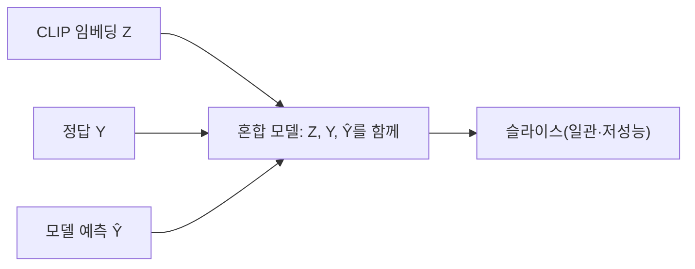
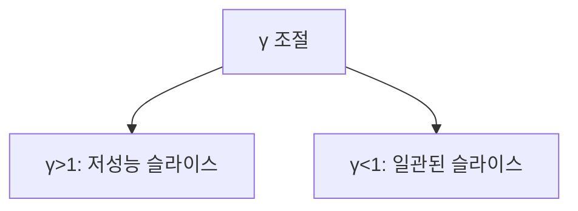

# 오류 인식 혼합 모델

> Domino가 모델이 체계적으로 틀리는 데이터 슬라이스를 찾으려고 쓴 혼합 모델이다. 임베딩 분포뿐 아니라 정답 라벨과 모델 예측도 함께 모델링해 "비슷하게 생겼고 자주 틀리는" 묶음을 찾는다.

## 쉽게 말하면
틀린 문제들을 모아 "이 유형이 자주 틀린다"는 묶음을 자동으로 찾는 분류 작업이다. 단순히 닮은 것끼리 묶지 않고 "틀림 여부"도 묶음 기준에 넣는다.

## 자세히
(Eyuboglu 외 "Domino" ICLR 2022, arXiv 2203.14960을 하위 에이전트가 원문으로 읽은 노트 기준.)
- **파이프라인 3단계**: ① 교차 모달 임베딩(CLIP·ConVIRT 등)으로 데이터 임베딩 ② **오류 인식 혼합 모델**로 슬라이스 분할 ③ 자연어 설명 생성.
- **모델**: k개 성분의 혼합. 슬라이스 S ~ Cat(p_S)이고 슬라이스 j가 주어지면 임베딩 Z ~ N(μ_j, Σ_j)(가우시안), 라벨 Y ~ Cat(p_j), 예측 Ŷ ~ Cat(p̂_j). 슬라이스가 주어지면 조건부 독립. **검증 세트에서 EM으로 적합**. γ 계수가 "일관성(coherence)과 저성능(underperformance)"의 균형을 조절(γ>1이면 저성능 슬라이스, 0≤γ<1이면 일관된 슬라이스). **혼동 행렬로 초기화**. (식 1에서 γ의 정확한 위치는 추출이 모호해 확인하지 못함.)
- **평가 틀**: 3개 영역(자연 이미지 CelebA+ImageNet, 의료 MIMIC-CXR 377,110장, EEG 시계열)에서 **1,235개 슬라이스 발견 설정**, 슬라이스 유형은 희소·상관·노이즈 라벨.
- **결과**: Domino가 슬라이스의 **36%**를 정확히 식별, 기존 방법보다 12%p 높음(초록). CLIP precision-at-10 평균 0.570(BiT보다 9%p, 무작위 활성값보다 23%p 높음). 희소·노이즈 슬라이스에서 precision-at-10 **0.639**(차선책 George 대비 105% 향상). **상관 슬라이스에서는 단순한 ConfusionSDM이 더 낫다**.
- **설치**: `pip install domino`(논문 기술).

## 그림으로 보기

## 예시
- 이미지 분류 모델의 검증 세트에 Domino를 돌려 "야외 사진·안경 쓴 사람" 같은 오류 슬라이스를 후보로 확인.
- 교육 활용: 군집 기준에 "틀림"을 넣는 아이디어를 설명.

## 헷갈리는 것과 비교
| 개념 | 차이 |
|---|---|
| 오류 인식 혼합 모델 | 임베딩+라벨+예측으로 슬라이스 발견 |
| 일반 군집화 | 임베딩 유사도만 사용 |
| [CLIP 임베딩](#clip-embeddings) | 모델이 쓰는 입력 공간 |

## 더 읽을거리
- [Domino (arXiv 2203.14960)](https://arxiv.org/abs/2203.14960) — 방법과 평가.
