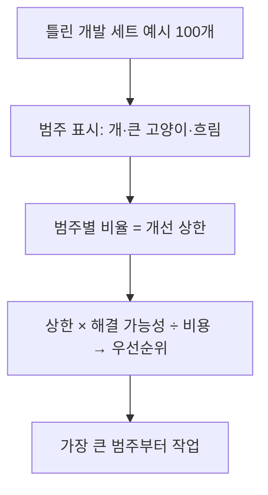
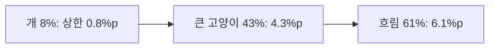

# 범주별 개선 상한

> 틀린 개발 세트 예시를 원인 범주로 분류했을 때, **한 범주가 전체 오류에서 차지하는 비율이 그 범주만 고쳐서 줄일 수 있는 오류의 상한(ceiling)**이다. 상한이 작은 범주에 시간을 쓰는 것은 아무리 잘해도 효과가 작다.

## 쉽게 말하면
시험에서 틀린 문제의 5%만 "단위 환산 실수"라면, 환산 실수를 완벽히 없애도 틀린 문제는 최대 5%만 줄어든다. 틀린 문제의 60%가 "시간 부족"이라면 거기가 투자할 곳이다.

## 자세히
- **개념(Ng의 Machine Learning Yearning 오류 분석 장 소개, 검색 요약으로 확인한 비공식 초안·학습 사이트 기준, 책 원문은 직접 열지 못함)**: 개 사진이 오분류의 5%뿐이면 개 문제를 고쳐도 최대 5%의 오류만 제거할 수 있다. 초안의 예에서는 100개 개발 세트 예시에서 개 오류가 8%일 때 최대 8% 제거라고 설명한다. 한 예시가 여러 범주에 속할 수 있어 비율의 합이 100%를 넘을 수 있다는 설명도 있다.
- **이 글의 계산 예(범주 비율은 설명용 가정: 개 8%, 큰 고양이 43%, 흐림 61%, 전체 오류율 10%, 오류가 여러 범주에 중복 가능)**
  | 범주 | 오류 중 비율 | 완전히 고칠 때 오류율 | 최대 감소(상한) | 절반만 고칠 때 |
  |---|---|---|---|---|
  | 개 | 8% | 10% → 9.20% | 0.8%p | 0.40%p |
  | 큰 고양이 | 43% | 10% → 5.70% | 4.3%p | 2.15%p |
  | 흐림 | 61% | 10% → 3.90% | 6.1%p | 3.05%p |
  상한 순위는 흐림 > 큰 고양이 > 개다. 상한은 **효과의 최댓값**이며 실제 개선은 그 범주 오류를 얼마나 줄이느냐(효율)에 곱해진다. 상한이 크더라도 해결 비용이 크면 우선순위가 달라진다.
- **표본 불확실성(직접 계산, Wilson 95% 구간)**: 오류 100개를 검토했을 때 개 8%의 구간은 0.04~0.15, 큰 고양이 43%는 0.34~0.53, 흐림 61%는 0.51~0.70. 50개면 개 0.03~0.19로 폭이 넓다. 오류 200개면 개 0.05~0.13.
- **순위가 안정적인가(시뮬, 2,000회)**: 비율 차이가 큰 위 세 범주는 100개 검토로 순위가 맞을 확률이 **0.99**. 비율이 비슷한 세 범주(0.30·0.27·0.25)는 100개로는 **0.41**에 불과하다. 비슷한 범주끼리의 우선순위는 100개 검토로 가릴 수 없고 더 검토하거나 다른 기준(해결 비용)으로 정한다.
- **절차**: ① 틀린 개발 세트 예시 100개 안팎을 뽑아 ② 범주 정의 후 표시 ③ 범주별 비율과 상한 계산 ④ 상한×해결 가능성/비용으로 우선순위 ⑤ 개선 후 같은 방식으로 재분석.
- **주의**: 오류 범주는 수동 분류라 정의가 흔들리면 비율도 흔들린다. 라벨 오류 자체도 한 범주로 둔다([개발 세트 라벨 오류 수정 기준](#mislabeled-dev-set-threshold)). 상한은 "그 범주 오류를 전부 고칠 수 있다"는 낙관적 가정이다.

## 그림으로 보기

## 예시
- 챗봇 오답 100건 분석: "출처 없는 답변 40%, 오래된 정보 30%, 질문 오해 15%, 기타 15%". 출처 문제 상한 4.0%p(전체 오류율 10% 가정)로 첫 투자.
- 교육: 업무 개선에서 "문제를 쪼개 크기를 재고 큰 것부터" 하는 파레토 사고.

## 헷갈리는 것과 비교
| 개념 | 차이 |
|---|---|
| 범주별 상한 | 비율이 주는 최대 개선 |
| 실제 개선 | 상한 × 해결 효율 |
| [오류 원인 분류](#error-cause-triage) | 범주를 만드는 절차 |
| 전체 오류율 | 모든 범주의 합 |

## 더 읽을거리
- [Machine Learning Yearning 오류 분석 초안(비공식 사본)](https://orefa.github.io/machine-learning-yearning-book/draft/Ng_MLY13-53-58.pdf) — "부분별 오류 분석" 장을 열어 확인(상한 설명은 다른 장이므로 검색 요약).
- [Saito & Rehmsmeier 2015](https://journals.plos.org/plosone/article?id=10.1371/journal.pone.0118432) — 비율이 평가 해석에 미치는 영향.
