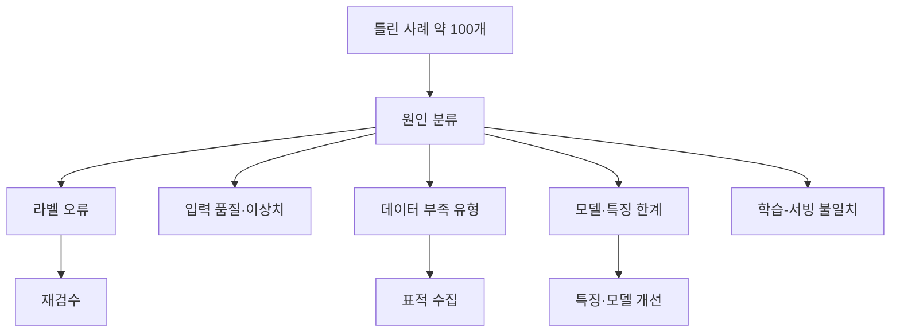
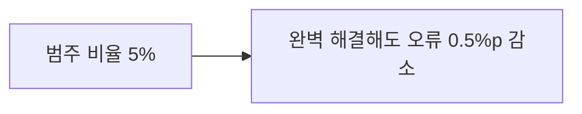

# 오류 원인 분류

> 모델이 틀린 사례를 모아 놓고 "왜 틀렸나"를 원인별로 나눠 세어 보는 일이다. 라벨이 틀렸는지, 입력이 흐리거나 이상한지, 모델이 못 하는 유형인지에 따라 고칠 방법이 달라서, 어디에 시간을 쓸지 정하는 근거가 된다.

## 쉽게 말하면
환자가 병원에 자주 와도 원인이 감기인지 알레르기인지 사고인지에 따라 처방이 다르다. 오답 노트도 "계산 실수·개념 모름·문제 오타"로 나눠야 공부 계획이 선다. 틀린 개수만 보고는 어디를 고칠지 알 수 없다.

## 자세히
(KDnuggets의 Andrew Ng 오류 분석 요약을 직접 열어 확인. Ng의 책 PDF는 401로 못 열었고 나머지는 검색 결과 요약.)
- **1단계 — 표본 수작업 검토**: 개발 세트에서 틀린 사례 약 100개를 뽑아 하나씩 본다.
- **2단계 — 범주화와 개수 세기**: 예를 들어 "개 사진", "흐린 사진", "인스타그램 스타일"로 나눠 비율을 센다. **범주 비율이 그 문제를 완벽히 고쳐도 줄일 수 있는 오류의 상한**이다. 글 속 예: 오류 10% 중 개 사진 비중이 5%면 완전히 해결해도 오류가 0.5%p만 준다. 여러 아이디어를 표로 비교해 이득이 큰 것을 먼저 한다.
- **새 범주 발견**: 틀린 사례를 보면서 "사람이라면 맞혔을까?"를 물으면 새로운 오류 범주와 해법이 떠오른다(검색 결과 요약). 한 사례가 여러 범주에 속할 수 있다는 설명이 있으나 자료마다 달라 확인이 필요하다.
- **라벨 오류 범주**: 틀린 라벨의 비중이 큰지 따로 센다. 글의 기준: 개발 세트 오류 10%에서 잘못된 라벨이 0.5%면 고칠 가치가 낮지만, 오류 2%에서는 전체 오류의 25%라 고칠 가치가 있다. 무작위 라벨 오류는 딥러닝이 비교적 견디지만 **체계적 라벨 오류는 모델을 오도**한다.
- **분류 틀(제안)**: ① 라벨 오류 → [라벨 오류 탐지](#label-error-detection) ② 이상치·품질 불량 입력 ③ 데이터에 아예 부족한 유형 → [목표 데이터 수집](#targeted-data-collection) ④ 모델·특징 한계 ⑤ 학습-서빙 불일치 → [학습-서빙 편향](#training-serving-skew). 구글 Rules of ML #26은 "측정된 오류의 패턴을 찾아 새 특징을 만들라"고 권한다(직접 확인).
- 비슷한 사례가 자동으로 묶이면 [슬라이스 발견](#slice-discovery)로 규모를 키운다.

## 그림으로 보기

## 예시
| 오류 사례 | 원인 | 조치 |
|---|---|---|
| "환불 문의"가 '불만'으로 라벨됐지만 실제 문의 | 라벨 오류 | 재라벨링 |
| 야간 사진만 틀림 | 데이터 부족 유형 | 야간 사진 추가 수집 |
| 신조어 포함 문장 | 모델 한계 | 프롬프트·특징 보강 |
- 교육 활용: 수강생이 챗봇 오답 30개를 직접 표로 분류해 보는 실습.

## 헷갈리는 것과 비교
| 개념 | 차이 |
|---|---|
| 오류 원인 분류 | 틀린 이유를 범주로 나누고 비중 파악 |
| [슬라이스 발견](#slice-discovery) | 오류가 모인 하위집단 찾기(자동) |
| [라벨 오류 탐지](#label-error-detection) | 라벨 오류만 찾는 작업 |
| 근본 원인 분석(RCA) | 운영 장애 분석. 개념은 비슷하나 대상이 다름 |

## 더 읽을거리
- [KDnuggets: Error Analysis to your Rescue – Lessons from Andrew Ng, part 3](https://www.kdnuggets.com/2018/01/error-analysis-your-rescue.html) — 100개 표본·범주 상한·라벨 오류 기준(열어 확인).
- [Google: Rules of Machine Learning](https://developers.google.com/machine-learning/guides/rules-of-ml) — Rule #26(열어 확인).
