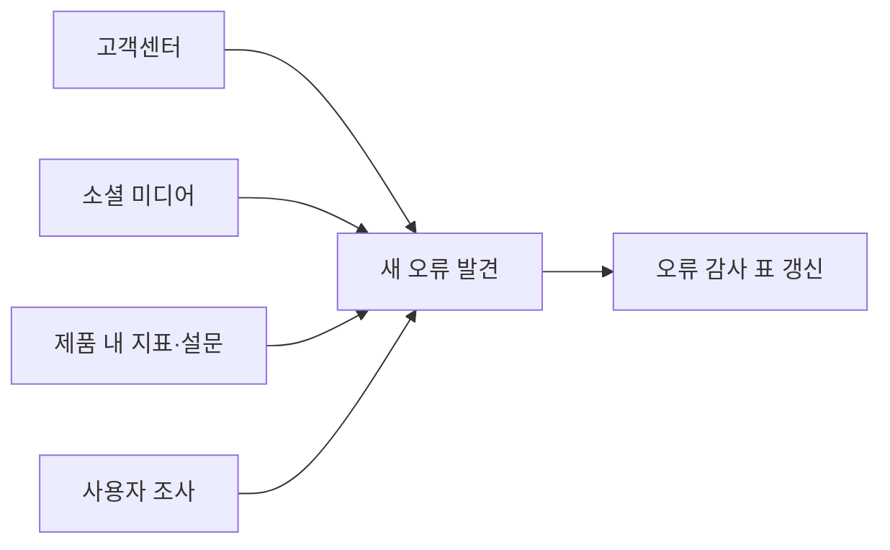

# 오류 채널 모니터링

> 고객센터·소셜 미디어·제품 내 지표·설문 같은 **피드백 채널을 감시해** 아직 목록에 없는 새 오류를 찾는 일이다.

## 쉽게 말하면
식당 사장이 손님 불만을 접수대, 리뷰 사이트, 영수증 설문, 재주문율로 동시에 듣는 것이다. 한 곳만 보면 놓친다.

## 자세히
(Google PAIR "Errors + Graceful Failure" 챕터를 직접 읽었다.)
- **모니터링 채널(PAIR)**: 고객센터 보고, 소셜 미디어 댓글·신고, 제품 내 지표·설문, 사용자 조사(제품 밖 설문·심층 인터뷰·일기 연구).
- **제품 안 피드백 기회(PAIR)**: 오류 메시지 안과 **올바른 출력 옆**에도 둔다. 사용자가 무엇을 기대했는지 묻고, AI 출력을 **반복해서 거부할 때** 피드백을 요청한다.
- **QA·파일럿(PAIR)**: 스트레스 테스트, 베타 테스트, 파일럿으로 출시 전 오류와 막다른 길을 찾고 출시 후에도 지속.
- **활용(PAIR)**: 잘못된 라벨 수정, 모델 정밀도 개선, 빠진 데이터 발견.
- **한계**: 사용자가 모르는 [백그라운드 오류](#background-error)는 이 채널로 잡기 어렵다.

## 그림으로 보기

## 예시
- AI 답을 세 번 연속 거부한 사용자에게 "무엇을 기대하셨나요?" 한 줄 입력칸을 띄운다(PAIR 권고 적용, 제안).

## 헷갈리는 것과 비교
| 개념 | 차이 |
|---|---|
| 오류 채널 모니터링 | 사용자 신호로 새 오류 발견 |
| QA·스트레스 테스트 | 사용자가 모르는 오류 사전 발굴 |
| [오류 감사](#errors-audit) | 오류 목록과 대응표 |

## 더 읽을거리
- [Google PAIR — Errors + Graceful Failure](https://pair.withgoogle.com/chapter/errors-failing/) — 직접 읽음.
