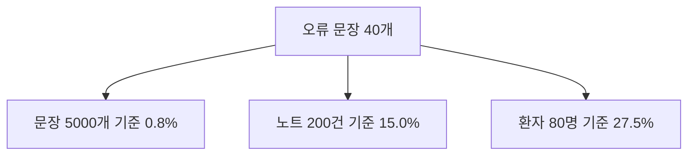
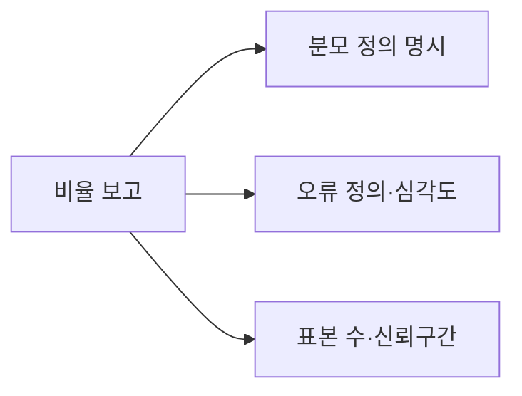

# 오류율 분모 문제

> 같은 오류 건수라도 "문장 중 몇 %인가, 노트 중 몇 %인가, 환자 중 몇 %인가"처럼 분모를 무엇으로 잡느냐에 따라 비율이 0.8%에서 27.5%까지 달라진다. 비율을 말할 때는 분모를 반드시 함께 밝혀야 한다.

## 쉽게 말하면
교실의 학생 30명 중 3명이 지각했다면 "학생의 10%"이지만 "전체 출석 기록 600칸 중 3칸"이라고 하면 0.5%다. 둘 다 틀리지 않았지만 같은 말이 아니다.

## 자세히
- **일반 원칙(Fini 용어집의 이탈률 예, 열람)**: 이탈 540건을 총 인입 콜 12,000건으로 나누면 4.5%, 같은 540건을 6,000건으로 나누면 9%라고 설명한다. 분모가 결과를 바꾼다는 점은 오류율에도 그대로 적용된다([이탈률 분모](#abandon-rate-denominator)).
- **노트·문장·환자 분모 비교(이 글의 가상 계산)**: 진료 노트 200건(노트당 평균 25문장, 총 5,000문장), 환자 80명, 오류 문장 40개. 오류 문장이 들어 있는 노트가 30건, 그런 노트가 있는 환자가 22명이라고 가정하면:

| 분모 | 계산 | 비율 |
|---|---|---|
| 문장 | 40 ÷ 5,000 | 0.8% |
| 노트 | 30 ÷ 200 | 15.0% |
| 환자 | 22 ÷ 80 | 27.5% |

같은 데이터에서 "오류율 0.8%"와 "환자 27.5%에게 오류가 있음"이 모두 참이다. 어느 쪽을 보고하느냐에 따라 안전에 대한 인상이 크게 달라진다.
- **어느 분모가 적합한가(해석)**: 안전 관점에서는 환자 또는 노트 단위(오류가 한 번이라도 있는 비율)가, 개선 우선순위를 정할 때는 문장 단위(오류 밀도)가 유용하다. 모델 간 비교에는 같은 분모와 같은 표본을 써야 한다.
- **보고 체크리스트(해석)**: 분모 정의, 표본 수, 오류 정의(누락·환각 포함 여부), 오류 심각도 구분, 신뢰구간을 함께 적는다. 비율만 인용된 문헌은 분모를 확인하기 전에는 비교하지 않는다.
- 위 수치는 설명용 가상 데이터이며 실제 시스템의 오류율이 아니다.

## 그림으로 보기

## 예시
- 보고서에 "오류율 0.8%"만 있으면 "환자 중 27.5%에 오류" 가능성을 놓친다. 문장·노트·환자 세 분모를 모두 표로 제시.
- 교육 실습: 같은 오류 목록을 세 가지 분모로 계산해 표를 만들고 각 숫자가 어떤 질문에 답하는지 한 줄씩 적는다.

## 헷갈리는 것과 비교
| 개념 | 차이 |
|---|---|
| 오류 밀도(문장 단위) | 얼마나 자주 틀리나 |
| 오류 노트 비율 | 오류가 한 번이라도 있는 노트의 몫 |
| 오류 환자 비율 | 한 번이라도 영향받은 환자의 몫 |
| [WER의 한계](#wer-limits) | 평균 지표가 드문 환각을 가림 |

## 더 읽을거리
- [Fini: Call abandon rate](https://www.usefini.com/glossary/what-is-call-abandon-rate) — 분모에 따라 4.5%가 9%가 되는 예(열람)
