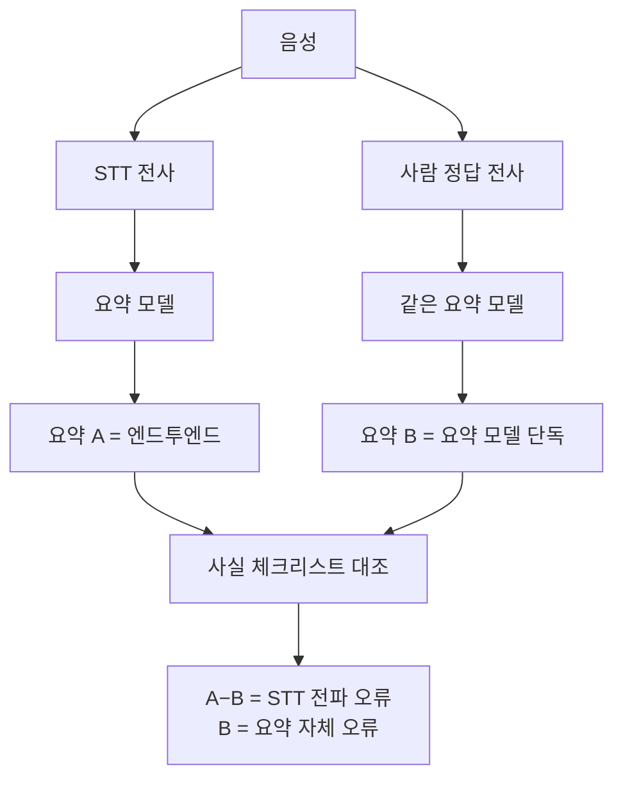

# 오류 계층 분리 감사 (STT 오류 vs 요약 오류)

> 음성 → 전사(STT) → 요약으로 이어지는 상담 AI에서, 최종 요약의 오류가 **어느 층에서 생겼는지(인식 오류가 번진 것인지, 요약 모델이 만든 것인지)를 따로 측정**하는 감사. 층을 나누지 않으면 고칠 곳을 잘못 짚는다.

## 쉽게 말하면
번역가가 받아 적은 메모가 틀렸는데 요약 담당자를 나무라면 안 된다. 같은 요약 담당자에게 정확한 메모를 주고 다시 시켜 보면 요약 담당자 몫의 오류만 가려진다.

## 자세히
출처: jiwer README(WER 등 지표와 최소 편집 거리 기반 계산, 본문 확인), Soniox 글의 WER 한계 논의([숫자·고유명사 오인식](#number-entity-errors)), [원문 링크형 요약](#source-linked-summary). **계층 분리 설계는 내가 제안하는 방법**이며 단일 출처가 정한 표준이 아니다. 아래 수치는 설명용 가상값이다.
- **측정 도구**: jiwer는 WER(단어 오류율), MER, WIL/WIP, CER을 제공하고 기준 문장과 가설 문장의 최소 편집 거리(RapidFuzz)로 계산한다고 README가 적는다. 기준(정답) 전사가 있어야 한다.
- **1층, STT**: 사람이 만든 정답 전사와 STT 전사를 비교해 WER·엔티티 오류율을 잰다. WER만으로는 금액·날짜 같은 핵심 정보의 오류가 가려진다([숫자·고유명사 오인식](#number-entity-errors)).
- **2층, 요약**: 같은 요약 모델을 **정답 전사**에 적용해 만든 요약의 오류율 = 요약 모델 자체의 오류(환각·누락·왜곡).
- **전파 오류**: 같은 모델을 **STT 전사**에 적용한 요약의 오류율 − 정답 전사 요약의 오류율 = STT에서 번진 오류(근사, 상호작용 포함).
- **엔드투엔드**: 실제 서비스 경로(음성 → STT → 요약)의 요약을 정답 요약·사실 체크리스트와 비교한 값.
- **직접 설계한 표(가상 값)**: 통화 200건, 요약당 핵심 사실 5개 체크리스트.

| 경로 | 핵심 사실 오류율 | 해석 |
|---|---|---|
| 정답 전사 → 요약 | 4% | 요약 모델 자체 오류 |
| STT 전사 → 요약 | 11% | 엔드투엔드 오류 |
| 차이 | 7%p | 약 63%가 STT에서 번진 오류 |

  이 예에서는 개선 투자를 STT(핵심 용어 사전, 숫자 검증)에 우선하는 편이 낫다. 숫자는 가상이다.
- **절차(제안)**: ①층화 표본(채널·소음·언어·업무 유형) 200건 이상 ②정답 전사와 정답 요약 체크리스트 작성(사람, 독립 검수) ③세 경로 실행 ④오류 유형별(숫자·이름·누락·환각)로 집계 ⑤층별 담당 배정 ⑥모델 변경 때마다 반복.
- **링크의 역할**: 요약 문장이 가리키는 전사 구간이 있으면 오류를 층별로 추적하기 쉽다([원문 링크형 요약](#source-linked-summary)).
- **한계**: 정답 전사·체크리스트 제작 비용이 크다. 두 층의 오류가 상호작용(전사 오류가 요약기를 혼란시켜 더 큰 오류)하면 단순 뺄셈이 정확하지 않다. 오류가 서로 상쇄되기도 한다.

## 그림으로 보기


## 예시
```python
# 표본별 핵심 사실 오류 수 집계 (체크리스트 대조 결과)
err_e2e   = errors(summary_from_stt, checklist)     # 엔드투엔드
err_model = errors(summary_from_gold, checklist)    # 요약 모델 단독
propagated = err_e2e - err_model                    # STT 전파 근사
share = propagated / err_e2e
```
교육 활용: "AI 요약 정확도 90%"라는 보고에서 어느 층의 오류인지, 정답 전사로 다시 돌려 봤는지 묻는 연습.

## 헷갈리는 것과 비교
| 개념 | 차이 |
|---|---|
| 오류 계층 분리 감사 | 오류의 발생 층을 가름 |
| 엔드투엔드 평가 | 최종 결과만 평가 |
| [STT 오류 전파](#stt-error-propagation) | 인식 오류가 요약으로 번지는 현상 자체 |
| [숫자·고유명사 오인식](#number-entity-errors) | STT 층의 핵심 정보 오류 |

## 더 읽을거리
- [jiwer (GitHub)](https://github.com/jitsi/jiwer) — WER·MER·WIL·CER 계산 라이브러리
- [Soniox: Beyond WER](https://soniox.com/wiki/beyond-wer) — WER의 한계와 엔티티 중심 평가(벤더 글)
