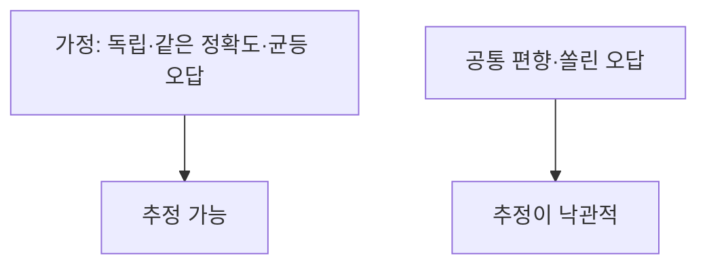

# 불일치율로 오류율 추정

> 정답이 없어도 두 주석자가 같은 샘플을 독립적으로 라벨링한 불일치율에서 한 사람의 정확도(오류율)를 근사할 수 있다. 두 사람이 같은 정확도로 독립적으로 판정한다는 가정이 핵심이다.

## 쉽게 말하면
두 채점자의 결과가 20% 갈렸다면, 한 사람이 틀릴 확률이 대략 얼마쯤이어야 그만큼 갈리는지 거꾸로 계산하는 것이다. 정답을 몰라도 "서로 얼마나 다른가"는 알 수 있기 때문이다.

## 자세히
- **이진 분류 공식(직접 유도)**: 두 사람이 독립이고 정확도가 a로 같으면 불일치가 나는 경우는 한 명만 틀릴 때뿐이라 불일치율 d = 2a(1−a)이다. 풀면 a = (1 + √(1 − 2d)) / 2. 예: d=0.18이면 a≈0.90.
- **K개 클래스(오답이 나머지 클래스에 균등 분포한다는 가정)**: 일치율 = a² + (1−a)²/(K−1). 이를 a에 대해 풀어 쓴다.
- **직접 시뮬레이션 검증(각 20만 쌍)**:

| 실제 정확도 a | 클래스 수 K | 관측 불일치율 | 공식으로 추정한 정확도 |
| --- | --- | --- | --- |
| 0.9 | 2 | 0.1808 | 0.899 |
| 0.9 | 5 | 0.1879 | 0.900 |
| 0.8 | 5 | 0.3501 | 0.800 |

  가정이 맞으면 공식이 실제 정확도를 거의 복원한다.
- **표본 크기 영향(직접 시뮬레이션, 실제 a=0.9, 이진, 50개 샘플 2,000번 반복)**: 추정 정확도의 5~95% 구간이 0.846~0.947로 넓다. 시범 규모가 작으면 오류율을 정밀하게 말하기 어렵다([kappa용 시범 크기](#pilot-size-for-kappa)).
- **가정이 깨질 때(해석)**: ① 두 사람의 정확도가 다르면 평균적인 값만 나온다 ② 서로 독립이 아니면(같은 편향 공유, [주석자 공통 편향](#shared-annotator-bias)) 불일치가 작게 나와 정확도를 과대평가한다 ③ 오답이 한 클래스로 몰리면(모호 쌍) K개 공식이 어긋난다. 그래서 이 추정은 "정확도의 상한 근사"로 읽고, 일치 항목 표본 검수로 보완한다([일치했지만 틀린 항목 표본 검수](#agreed-but-wrong-sampling)).

## 그림으로 보기

## 예시
- 이진 라벨 200개를 두 명이 독립 라벨링해 36개가 갈렸다면 d=0.18, 한 사람의 정확도 ≈ 0.90, 오류율 ≈ 10%.
- 교육 활용: 공식을 유도해 보고 시뮬레이션 코드로 맞는지 확인한다.

## 헷갈리는 것과 비교
| 개념 | 차이 |
| --- | --- |
| 불일치율 | 두 사람이 갈린 비율 |
| 오류율(개인) | 한 사람이 틀린 비율, 불일치율에서 가정 하에 추정 |
| [Dawid-Skene 모델](#dawid-skene-model) | 가정 없이 혼동 행렬까지 추정 |
| [kappa와 클래스 불균형](#kappa-class-imbalance) | 우연 일치까지 고려한 일치도 |

## 더 읽을거리
- [Interrater reliability: the kappa statistic (McHugh, 2012)](https://pmc.ncbi.nlm.nih.gov/articles/PMC3900052/) — 일치율과 우연 일치의 관계
