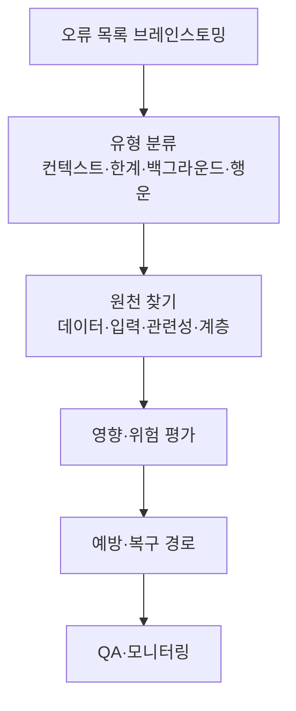

# 오류 감사

> AI 기능이 낼 수 있는 오류를 미리 목록으로 만들고, 각각의 원천·사용자 영향·예방과 복구 경로를 표로 정리하는 작업. Google PAIR 가이드북의 "Errors + Graceful Failure" 워크시트가 대표 틀이다.

## 쉽게 말하면
건물 소방 점검표와 같다. 불이 날 수 있는 곳을 먼저 다 적고, 각각 어떻게 번질지, 대피로는 있는지를 확인한다. 불이 난 뒤가 아니라 설계할 때 한다.

## 자세히
PAIR 챕터(pair.withgoogle.com/chapter/errors-failing, 열람)의 틀:
- **오류 유형 4가지**
  - 컨텍스트 오류: 시스템은 의도대로 작동했지만 설명이 부족하거나 사용자의 멘탈 모델과 어긋나 사용자가 오류로 느끼는 것.
  - 시스템 한계(failstate): 본질적 한계로 맞는 답이나 답 자체를 못 주는 것.
  - 백그라운드 오류: 시스템은 틀렸는데 사용자도 시스템도 모르는 것. 스트레스 테스트 같은 전용 QA가 필요.
  - 행운의 사고(happy accident): 오류로 표시됐지만 결과가 유용하거나 흥미로운 것.
- **원천 찾기**: 예측·학습 데이터(잘못된 라벨, 누락), 입력(오타, UI 변경으로 깨진 습관), 관련성(확신이 낮거나, 맞는 출력이 엉뚱한 때·곳·형식에 나옴), 시스템 계층(여러 시스템이 겹쳐 반응). 오류마다 사용자 영향, 위험 크기, 사용자 여정 단계를 평가한다.
- **복구 경로**: 한계를 설명하고 대안·다음 단계 제시, 고위험 상황에선 대안의 안전성 확인, 사용자에게 통제권과 상황 인식을 돌려주기, 오류·반복 거부 출력에 대한 피드백 수단, 데이터 수정·우선순위 설정·이전 방식으로 되돌리기. 실패를 안전하고 일상적으로 만들되 악용을 부를 취약점은 과하게 설명하지 않는다.
- **운영**: 고객센터·SNS·제품 지표·설문·연구 등 여러 채널에서 새 오류를 감시하고, 베타·파일럿으로 막다른 길을 출시 전에 찾는다.
- **워크시트**: 검색 요약에 따르면 오류 감사(어떤 오류를 만날 수 있는지 브레인스토밍) → 원천 질문 → 실패 상태 점검 → 해결 경로 → QA 섹션 순서다. 워크시트 PDF는 텍스트를 읽지 못해 세부 질문은 확인하지 못했다.

## 그림으로 보기

## 예시
- 번역 앱: 존댓말을 임의로 바꿨다 → 컨텍스트 오류(설명 부족), 복구 경로는 "원래 문체로 되돌리기" 버튼.
- 교육 실습: 자기 AI 기능 하나의 오류를 5개 이상 적고 유형과 복구 경로를 칸에 채운다.

## 헷갈리는 것과 비교
| 개념 | 차이 |
|---|---|
| 오류 감사 | 출시 전 오류를 체계적으로 목록화 |
| [신뢰 보정](#trust-calibration) | 오류가 있을 때 사용자 신뢰를 맞추는 목표 |
| [의도적 마찰 설계](#friction-by-design) | 오류 영향을 줄이는 UX 수단 |
| [튜터 회귀 평가](#tutor-regression-eval) | 변경 후 오류 재발 점검 |

## 더 읽을거리
- [People + AI Guidebook: Errors + Graceful Failure](https://pair.withgoogle.com/chapter/errors-failing/) — 유형·원천·경로(열람)
- [PAIR 워크시트 PDF](https://pair.withgoogle.com/worksheet/errors-failure.pdf) — 5쪽 워크시트(열었으나 텍스트 추출 실패)
