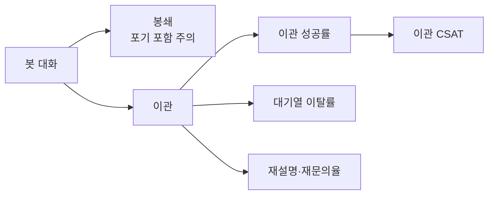

# 이관 지표

> 챗봇→사람 이관이 잘 되는지 재는 지표 묶음. 이관율 하나로는 부족하고, 봉쇄율의 함정과 이관 성공·재설명을 같이 본다.

## 쉽게 말하면
식당 만족도를 "불만 접수 건수"로만 재면 손님이 말없이 나간 것을 놓친다. 봇도 "사람 연결 요청이 적다"를 성공으로 오해하기 쉽다.

## 자세히
- **봉쇄율(containment)**: 사람 없이 봇이 끝낸 대화 비율. 한 가이드는 일반 범위로 60~80%, 이관율 20~40%를 제시(벤더 지표, 참고용).
- **함정**: 고객이 포기하고 나가도 "봉쇄 성공"으로 잡힌다. "원하는 걸 얻었나"를 따로 봐야 한다.
- **이관 성공률**: 사람 대기열이 대화 로그와 맥락이 보존된 채 받은 비율(2026 가이드 제안).
- **이관 후 CSAT·재문의율**, 재설명 비율(고객이 같은 말을 반복하는 정도 — 표준 벤치마크는 찾지 못함).
- **대기열 이탈률**: 봇 봉쇄율과 분리해서 측정.

## 그림으로 보기

## 예시
- 봉쇄율 75% → 그중 설문 해결 응답이 50%면 25%p는 사실상 포기.
- 이관 성공률이 낮다면 패킷 전달이 깨졌다는 뜻.

## 헷갈리는 것과 비교
| 개념 | 차이 |
|---|---|
| 봉쇄율 | 봇이 끝낸 비율, 만족과 무관 |
| 에스컬레이션율 | 이관 건수 ÷ 전체 접촉 |
| [웜 이관](#warm-vs-cold-handoff) | 지표를 개선하는 설계 |

## 더 읽을거리
- [Koji: AI-to-human handoff 리서치](https://www.koji.so/docs/ai-human-handoff-escalation-research) — 이관 순간 측정
- [Macha: Containment rate](https://www.getmacha.com/glossary/containment-rate) — 정의(벤더)
- [Quickchat: Chatbot KPI guide](https://quickchat.ai/post/chatbot-kpi-guide) — KPI 목록(벤더)
