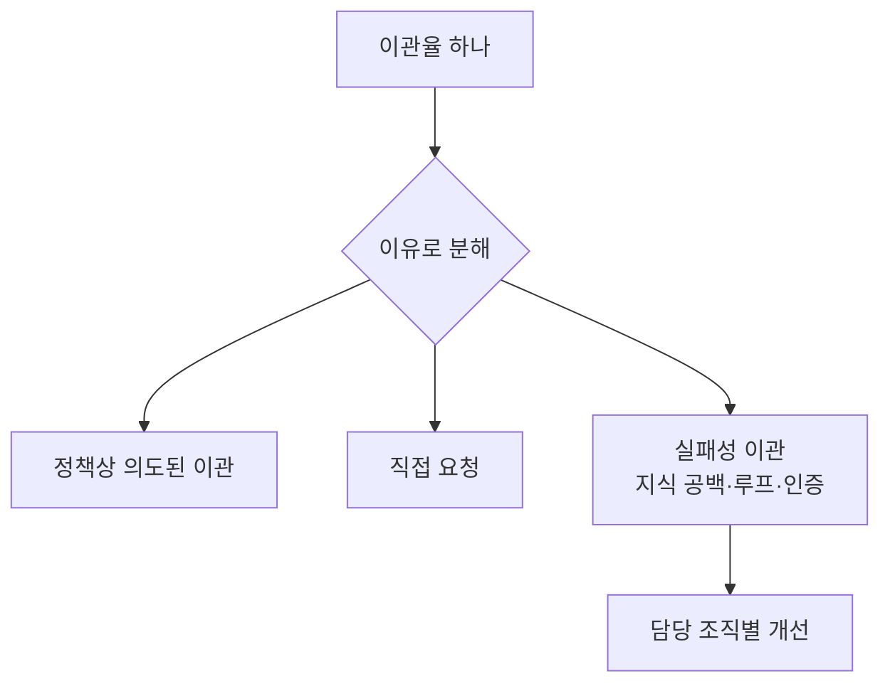
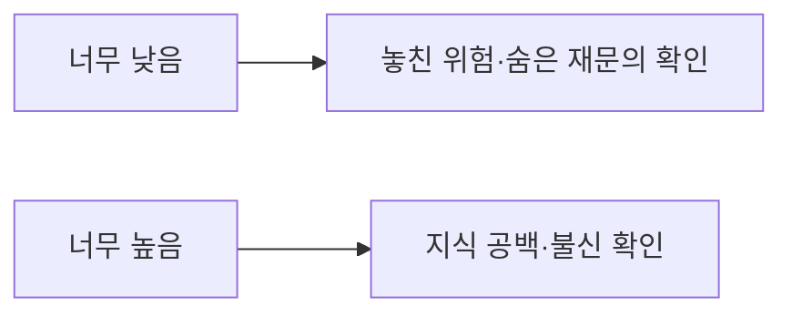

# 에스컬레이션율 목표

> 전체 대화 중 사람에게 넘어간 비율. "몇 %가 좋다"는 정답은 없고, 너무 낮아도 너무 높아도 문제 신호이므로 이유별·업무별로 쪼개서 본다.

## 쉽게 말하면
병원 응급실 이송률과 비슷하다. 0%면 위급한 환자를 놓치고 있을 수 있고, 100%면 1차 진료가 제 역할을 못 한다. 그래서 숫자 하나보다 "왜 보냈나"를 본다.

## 자세히
- **벤치마크는 제각각**: 벤더 글에서 20~35%가 건강하다는 말, 5~10%를 목표로 하라는 말이 함께 나온다. 모두 벤더 자료라 권위가 없다. 자기 기준선과 비교한다.
- **너무 낮을 때**: 위험 업무에서 0에 가까우면 이관했어야 할 건이 나갔을 수 있다. 재문의·번복·보상·재작업 같은 숨은 비용을 확인한다. 사람 연결 버튼을 숨겨 숫자를 낮추는 것은 개선이 아니다.
- **너무 높을 때**: 1차 원인은 임계값보다 지식 공백인 경우가 많다. 팀이 봇의 결과를 믿지 않고 손으로 다시 하는 상태일 수도 있다.
- **이유별 분해(Enterpret의 6가지)**: 지식 공백 / 보수적 신뢰도 임계값 / 정책상 사람 필요 / 인증 실패 / 루프 감지 / 고객의 직접 요청. 이유마다 담당 조직이 다르다. 정책에 따른 의도된 이관은 따로 보고하고 직접 요청도 별도 분류한다.
- **업무별로 달라야 정상**: 한 업무가 60%, 다른 업무가 8%면 시스템이 강약을 학습한 것. 모든 업무가 같은 비율이면 전역 임계값 하나일 가능성(MetaCTO).
- 분모를 먼저 정의한다(해결률과 이관율의 기준이 다른 경우가 많다). 새 업무를 전수 검토로 시작하면 전체 이관율은 오히려 오른다. 이는 확장이지 실패가 아니다.

## 그림으로 보기

## 예시
- 이관율 40%를 분해하니 절반이 "환불 정책상 사람 필요"로 의도된 것 → 실패성 이관은 20%.
- 교육 실습: 이관 사유 20건을 직접 6개 범주로 분류하고 담당 조직을 붙여 본다.

## 헷갈리는 것과 비교
| 개념 | 차이 |
|---|---|
| 이관율 | 사람에게 넘어간 비율 |
| [응대 전환율 deflection](#deflection-rate) | 사람에게 안 간 비율(거의 반대 관점) |
| [이관 트리거 신호](#escalation-triggers) | 이관을 일으키는 원인 신호 |
| [단계 전환 기준](#rollout-gates) | 이관율을 게이트 지표로 쓰는 맥락 |

## 더 읽을거리
- [Enterpret: 6 reasons your AI support agent escalates](https://www.enterpret.com/guides/the-6-reasons-your-ai-support-agent-escalates-to-humans-in-2026) — 이유별 분해(벤더)
- [MetaCTO: How we decide when an agent hands off](https://www.metacto.com/blogs/how-we-decide-when-an-agent-hands-off-to-a-human) — 낮음·높음 해석(벤더)
