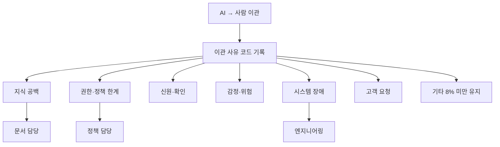

# 이관 사유 분류 (Escalation Reason Taxonomy)

> AI가 사람에게 넘긴 건에 **왜 넘겼는지를 일정한 코드로 기록하는 체계**. 사유별 비중과 처리 비용이 달라서, 사유 코드가 있어야 "어디를 고쳐야 이관이 줄어드는지"를 알 수 있다.

## 쉽게 말하면
병원 응급실이 "접수 사유"를 적어 두면 어느 증상이 많은지 보여 개선할 곳이 보인다. 사유 칸이 없으면 "환자 많음"만 안다. 이관도 이유를 적어야 개선점이 나온다.

## 자세히
출처: Intercom Fin 에스컬레이션 보고 속성 도움말(본문 확인)과 Robylon 블로그 글(본문 확인), 2026-11-18. Robylon 수치는 한 벤더의 자체 데이터이며 라벨링 방법이 설명되지 않았다.
- **Intercom Fin의 이관 사유 15개(도움말 원문)**: 사용자 요청, 사용자 불만, 빠른 답장 버튼 클릭, 이관 규칙 적용, 워크스페이스 지침 적용, 맞춤 답변 이관, 범위 밖, 맞춤 도구 오류, 코드 조건 오류, 시스템 오류, 사용량 한도 도달, 음성 이관, API 이관, 팀원 인계, 기타. 보조 속성 "누가 이관했나(escalated by)"는 어떤 절차·지침·규칙이 발동했는지를 보여 준다. 두 속성을 조합하면 어떤 지침이 이관을 가장 많이 만드는지 알 수 있다. 제한: 이관 상태일 때만 값이 채워지고 과거 대화는 비어 있으며 소급되지 않는다.
- **Robylon의 8개 사유 계열(이메일 이관 210만 건, 벤더 자체 분석)**: 지식 공백 28.4%, 권한 한계 19.1%, 신원·확인 11.6%, 감정·위험 10.8%, 모호성 9.7%, 시스템 장애 8.2%, 확신 낮음·원인 불명 7.2%(잔여 기타), 고객이 사람 요청 5.0%. 합계 100%(직접 검산).
- **기타 비율 기준(Robylon)**: 코드 집합을 네 번 고쳐 기타가 8% 미만이 되게 했고, 잔여 25%면 쓸 수 없는 분류라고 한다. 데이터는 18개월(2026 2분기 종료), 12개 업종, 수신 이메일 약 940만 건, 이관 22.3%, 배포 초기 14일 이관은 제외.
- **사유별 비용(Robylon, 중앙 처리 시간)**: 감정·위험 14분, 지식 공백 6분, 모호성 5분, 권한 한계 3분. 건수가 많은 사유와 비싼 사유가 다르다.
- **벤더 주장 주의**: 이관의 34%가 피할 수 있었다, 사유 기록 정확도가 39% → 94%로 개선, 지식 공백이 6개월 만에 41% → 22%로 감소 같은 서술은 방법이 불명확한 벤더 자체 관찰이다.
- **설계 원칙(제안)**: ①사유 코드는 상호 배타적으로 정의하고 정의문을 쓴다([처리 결과 코드 설계](#disposition-code-design)) ②"이관 사유"와 "발동한 규칙"을 분리 ③기타 비율을 감시 ④사유별 담당 조직(지식 공백→문서 담당, 시스템 오류→엔지니어링, 권한 한계→정책 담당)을 정한다 ⑤정기적으로 대화 텍스트를 군집화해 새 사유를 발굴.
- **한계**: 업계 표준 분류는 없고 소스마다 개수가 다르다(15개 vs 8계열). 자사 대화로 검증해 조정해야 한다.

## 그림으로 보기

## 예시
| 사유 계열 | 비중(Robylon) | 중앙 처리 시간 | 담당 조직(제안) |
|---|---|---|---|
| 지식 공백 | 28.4% | 6분 | 지식 관리 |
| 권한 한계 | 19.1% | 3분 | 정책·운영 |
| 감정·위험 | 10.8% | 14분 | 고객 경험·위기 대응 |
교육 활용: 자사 이관 로그 100건을 직접 분류해 보고 기타 비율과 정의 충돌 지점을 찾는 실습.

## 헷갈리는 것과 비교
| 개념 | 차이 |
|---|---|
| 이관 사유 코드 | 왜 넘겼는지(원인) |
| "이관한 주체" 속성 | 어떤 규칙·절차가 발동했는지 |
| [처리 결과 코드](#disposition-code-design) | 상담이 어떻게 끝났는지 |
| [지식 공백 이관](#knowledge-gap-escalation) | 사유 중 문서 부족으로 인한 이관 |

## 더 읽을거리
- [Intercom: Escalation reporting attributes](https://www.intercom.com/help/en/articles/16202960-escalation-reporting-metrics-attributes) — 사유 15개와 이관 주체 속성
- [Robylon: AI escalation reason codes taxonomy](https://www.robylon.ai/blog/ai-escalation-reason-codes-taxonomy) — 8개 계열 비중·비용(벤더 자체 데이터)
