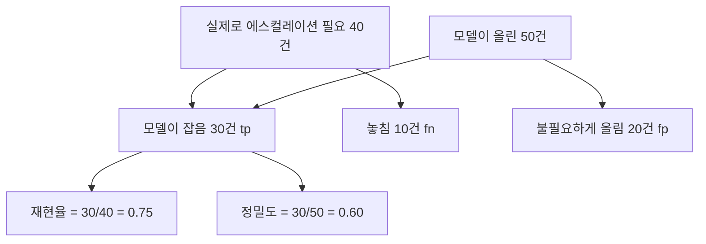

# 에스컬레이션 재현율

> AI 분류가 **상급자·전문 부서로 넘겨야 할 중요한 건 가운데 실제로 몇 %를 잡아냈는가**를 재는 지표(재현율, recall). 놓친 중요 건 비율을 보여 주므로, 컨택센터 처리 결과 분류에서 정확도보다 먼저 봐야 할 수치다.

## 쉽게 말하면
화재경보기에서 중요한 것은 "불이 났을 때 울리는가"다. 불이 난 100번 중 70번만 울렸다면 재현율 70%다. 가끔 헛울림(오탐)이 있어도 놓치는 것보다는 덜 위험하다. 대신 헛울림이 너무 많으면 사람들이 경보를 무시하게 된다.

## 자세히
출처: scikit-learn 모델 평가 문서(정의·공식·`fbeta_score`, 앞 100,000자 확인, 2026-11-18). 컨택센터 적용 서술은 제안이다.
- **정의**: `재현율 = tp / (tp + fn)`(민감도라고도 함). 정밀도 = `tp / (tp + fp)`. 여기서 tp는 제대로 에스컬레이션한 건, fn은 필요했는데 놓친 건, fp는 불필요하게 올린 건.
- **F-beta**: `F_β = (1+β²)·tp / ((1+β²)·tp + fp + β²·fn)`. β>1이면 재현율을 더 중시한다. 문서 예시(y_true=[0,1,0,1], y_pred=[0,1,0,0], 정밀도 1.0, 재현율 0.5)에서 β=0.5는 0.83, β=1은 0.66, β=2는 0.55.
- **다중 분류 평균**: `micro`는 전체를 풀링(다중 클래스에서 정확도와 같아짐), `macro`는 클래스별 점수의 단순 평균으로 희귀 클래스에 같은 비중, `weighted`는 지지도 가중. 에스컬레이션처럼 희귀하지만 중요한 클래스는 **클래스별 재현율**(`average=None`)을 따로 본다.
- **임계값**: `precision_recall_curve`는 임계값별 (정밀도, 재현율) 쌍을 준다. 점수 임계값을 낮추면 재현율이 오르고 정밀도는 내려간다.
- **직접 계산한 예**(가상): 1,000건 중 에스컬레이션이 필요한 건 40건. 모델이 50건을 올렸고 그중 30건이 맞았다 → tp=30, fp=20, fn=10. 정밀도 0.60, 재현율 0.75, F1 0.667, F2 0.714.
- **운영 기준(제안)**: 재현율 하한을 먼저 정하고(예: 민원·해지·안전 관련은 95% 이상) 그 아래에서 정밀도를 올린다. 놓친 건은 샘플 전수 검토, 사유 유형별 집계.
- **함정**: 전체 정확도가 높아도(대부분 건이 비에스컬레이션) 희귀 클래스 재현율이 낮을 수 있다.

## 그림으로 보기


## 예시
```python
from sklearn.metrics import recall_score, precision_score, fbeta_score
recall_score(y_true, y_pred, pos_label="escalate")
fbeta_score(y_true, y_pred, beta=2, pos_label="escalate")   # 재현율 중시
```
교육 활용: 컨택센터 관리자에게 "정확도 98%"보다 "놓친 해지 의사 건 수"를 묻는 보고 양식을 연습시킨다.

## 헷갈리는 것과 비교
| 개념 | 차이 |
|---|---|
| 재현율 | 필요한 건 중 잡은 비율 |
| 정밀도 | 올린 건 중 맞은 비율 |
| 정확도 | 전체 중 맞은 비율(희귀 클래스에 둔감) |
| [처리 결과 코드 설계](#disposition-code-design) | 분류 체계 자체의 설계 |

## 더 읽을거리
- [scikit-learn: Precision, recall, F-measure](https://scikit-learn.org/stable/modules/model_evaluation.html#precision-recall-and-f-measures) — 공식·평균 방식·PR 곡선
