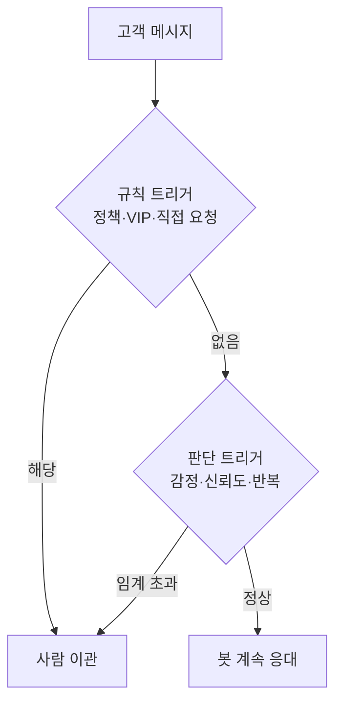

# 이관 트리거 신호

> 챗봇이 "여기서부터는 사람이 해야 한다"고 판단하게 만드는 신호들. 하나만 보지 않고 여러 신호를 조합한다.

## 쉽게 말하면
신입 직원이 "이건 제가 못 합니다, 팀장님께 넘길게요"라고 말하는 순간을 규칙으로 정해 두는 것이다. 너무 늦으면 고객이 화나고, 너무 빠르면 사람이 과로한다.

## 자세히
- **고객이 직접 요청**: "상담사 연결" 같은 명시적 요구는 무조건 이관.
- **부정 감정·반복 불만**: 감정 분석 점수나 같은 질문을 3번 반복하는 패턴(한 글로서리의 예시).
- **낮은 신뢰도·지식 공백**: 답을 못 찾았거나 확신이 낮을 때. 단 RLHF로 학습된 모델의 자체 신뢰도는 정확도와 어긋날 수 있다는 경고가 있어 검색 점수 등 외부 신호를 함께 쓴다.
- **정책 제한 주제**: 환불 예외, 법률·의료·컴플라이언스는 규칙(하드코딩)으로 이관.
- **고객 등급·승인 필요 행동**: VIP, 고액 처리 등.
- **임계값 튜닝**: 너무 보수적이면 봇이 오래 붙잡는다. 벤더 글은 에스컬레이션율 15~30%를 목표로 제시(검증되지 않은 주장).

## 그림으로 보기

## 예시
- "환불 예외 해 주세요" → 정책 규칙 → 즉시 이관.
- 같은 배송 질문 3회 + 부정 감정 → 이관.

## 헷갈리는 것과 비교
| 개념 | 차이 |
|---|---|
| 트리거 신호 | 언제 넘길지 |
| [웜 vs 콜드 이관](#warm-vs-cold-handoff) | 어떻게 넘길지 |
| [이관 컨텍스트 패킷](#handoff-context-packet) | 무엇을 넘길지 |

## 더 읽을거리
- [Conduit: When should AI hand off to a human](https://www.conduit.ai/blog/the-escalation-question-when-should-ai-hand-off-to-a-human) — 트리거 정리(벤더)
- [Kustomer: Chatbot escalation](https://www.kustomer.com/glossary/chatbot-escalation/) — 용어 설명
