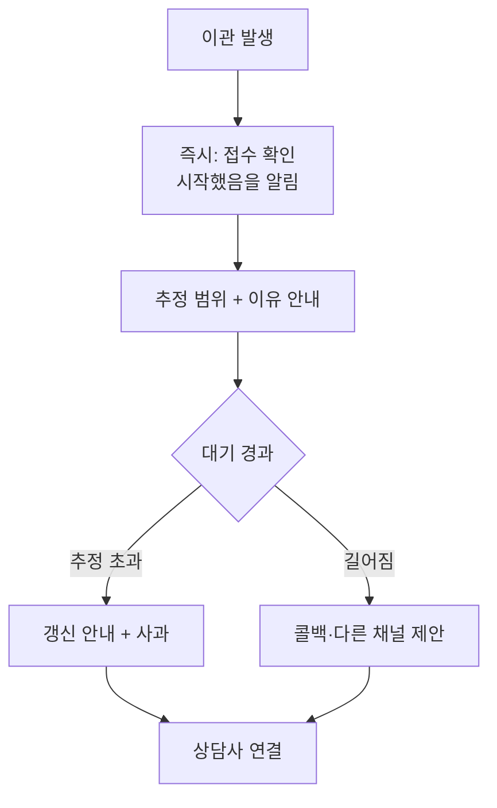

# 예상 대기 안내 메시지

> 사람에게 이관한 고객에게 "대략 얼마나, 왜 기다려야 하는지"를 알리는 문구와 표시 시점 설계. 마이스터(David Maister)의 대기 심리 명제에 따르면 **알 수 없는 대기와 설명 없는 대기가 더 길게 느껴지므로**, 추정치와 이유를 함께 알리되 추정이 틀릴 수 있음을 숨기지 않는 것이 핵심이다.

## 쉽게 말하면
택시가 늦을 때 "눈이 와서 20분쯤 걸릴 것 같습니다"라고 말해 주면 참을 만하지만, "곧 갑니다"만 반복하면 더 화가 난다. 숫자와 이유가 있고, 틀릴 수 있으면 미리 말해 주는 쪽이 신뢰를 지킨다.

## 자세히
출처: David Maister, "The Psychology of Waiting Lines"(원문 페이지 본문 확인, 2026-11-18). 문서는 명제에 번호를 붙이지 않았다. 아래 상담 적용은 모두 제안이다. 대기 추정의 수학적 한계는 [대기 시간 추정의 한계](#wait-time-estimation-limits)에서 계산했다.
- **첫 번째 법칙(원문)**: 만족 = 인식 − 기대(S = P − E). 안내 메시지는 **기대**를 만드는 일이다.
- **불확실한 대기는 더 길다**: 알려진 유한한 대기가 모르는 대기보다 낫다. "몇 분만 더"라는 모호한 안심은 오히려 더 나쁘다. → 숫자 또는 범위를 준다.
- **설명 없는 대기는 더 길다**: 설명이 있으면 특히 정당한 이유일 때 견디기 쉽다. "알지 못한 채 기다리면 무력감이 생긴다." → 이유(문의 폭주, 전문 상담사 연결 중)를 알린다.
- **시작했음을 알리면 줄어든다**: 첫 접촉 전 대기가 서비스 시작 후 대기보다 길게 느껴진다(응급 접수 후 간호사 선별 예). → 이관 즉시 "상담사에게 요청이 접수되었습니다".
- **불안이 대기를 늘린다**: 잊혔을까, 순서가 맞을까 하는 걱정. → 대기 순번·갱신 표시.
- **점유된 시간은 짧게 느껴진다**: 엘리베이터 거울 사례. → 대기 중 자가 해결 안내·정보 입력 같은 유용한 활동 제공(단 허위 활동은 금물).
- **불공정한 대기는 더 길다**: 새치기에 분노. → 우선순위 기준이 있다면 이유를 설명.
- **가치가 클수록 오래 기다린다 / 혼자는 더 길다**: 중요한 문의는 더 기다리지만 보상이 없으면 견디기 어렵고, 혼자 기다리면 길게 느낀다.
- **메시지 설계(제안)**: ①이관 접수 확인 ②추정 범위 "보통 5~10분"과 "추정" 표시 ③이유 한 줄 ④대기 순번·갱신(기간 경과 시 "예상보다 길어지고 있습니다") ⑤길면 콜백·다른 채널 제안 ⑥기다리는 동안 할 수 있는 일(주문번호 준비) ⑦과장 금지.
- **트리거 설계(제안)**: 추정 오차가 커지는 높은 점유율에서는 단일 값 대신 범위, 추정치가 2배 넘게 틀리면 갱신 메시지를 자동 발송.
- **한계**: 원문은 일반 서비스 대기 연구이며 챗봇·상담 이관에 맞춰 검증된 것은 아니다. 문구 효과는 A/B 테스트로 확인한다.

## 그림으로 보기

## 예시
- "상담사에게 요청이 접수되었습니다. 지금은 문의가 많아 보통 5~10분 정도 걸립니다(추정). 기다리시는 동안 주문번호를 준비해 주시면 빠르게 도와드릴 수 있습니다."
- 12분 경과 시: "예상보다 대기가 길어지고 있어 죄송합니다. 원하시면 연락 주실 번호를 남겨 주시면 순서대로 전화드리겠습니다."
- 교육 활용: 자사 이관 안내 문구를 마이스터 명제 8가지에 비춰 점검하는 실습.

## 헷갈리는 것과 비교
| 개념 | 차이 |
|---|---|
| 예상 대기 안내 | 대기를 설명하고 기대를 관리 |
| 실제 대기 시간 단축 | 큐 운영·인력으로 줄임 |
| [대기 시간 추정의 한계](#wait-time-estimation-limits) | 추정치가 흔들리는 수학적 이유 |
| [Erlang C 모델](#erlang-c) | 대기 확률·시간을 계산하는 모델 |

## 더 읽을거리
- [Maister: The Psychology of Waiting Lines](https://davidmaister.com/articles/1/52/index.html) — 대기 심리 명제와 사례
