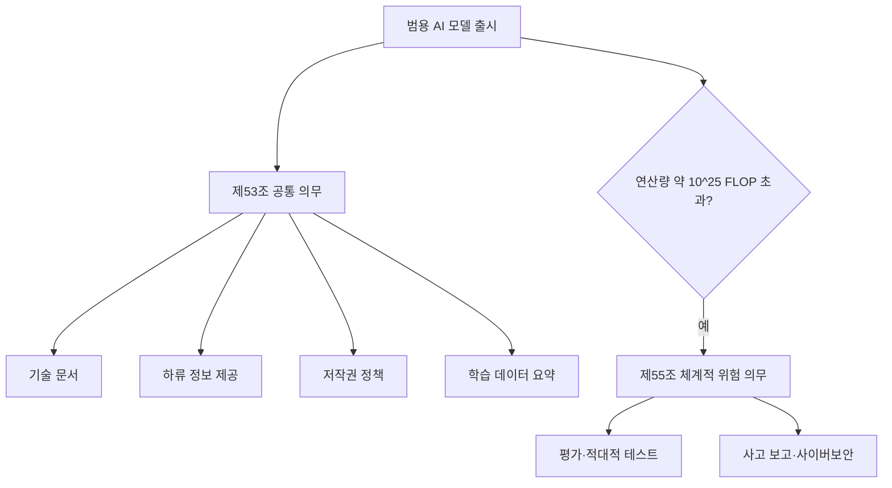

# EU AI Act 범용 AI 의무

> EU AI Act에서 GPT·Claude·Llama 같은 범용 AI(GPAI) 모델을 시장에 내놓는 제공자에게 붙는 별도 의무. 2025-08-02부터 적용됐다.

## 쉽게 말하면
식품 공장에게 "완제품 가게"와 별개로 "원재료 공급업체 의무"를 둔 것과 같다. 모델 자체를 만드는 회사는 하류 기업이 안전하게 쓰도록 설명서·저작권 방침·학습 데이터 요약을 내야 하고, 아주 큰 모델은 추가 안전 점검을 받는다.

## 자세히
- **모든 GPAI 제공자(제53조)**: ① 기술 문서 작성·유지 ② 하류 제공자용 정보 제공 ③ EU 저작권법 준수 정책 ④ 학습 데이터 공개 요약(템플릿 사용). 오픈소스 모델은 일부 면제가 있으나 체계적 위험 모델은 제외.
- **체계적 위험 GPAI(제55조)**: 학습 연산량이 약 10^25 FLOP를 넘으면 체계적 위험이 있다고 추정(제51조). 추가로 모델 평가·적대적 테스트, 위험 평가·완화, 중대 사고 보고, 사이버보안 보호 의무.
- **실천 규범(Code of Practice)**: 2025-07 집행위가 자발적 이행 도구로 공개, 서명 시 준수 입증이 수월해진다(저는 서명 현황을 이번에 확인하지 못함).
- **집행**: 의무는 2025-08-02 시작, 집행·과징금은 2026-08-02부터, 그 전에 출시한 모델은 2027-08-02까지 유예라는 설명이 많다([과태료](#eu-ai-act-penalties)). 제55조 위반은 EU 집행위 집행 체계(제101조)에서 다뤄진다는 보도(2차 자료).
- 수치·조문 일부는 일반 지식이며 관보 원문 확인이 필요하다.

## 그림으로 보기

## 예시
- 모델 API를 공급하는 AI 회사: 하류 기업에 모델 한계·사용 지침 문서를 배포하고 학습 데이터 요약을 공개 게시.
- 파인튜닝만 하는 기업: 큰 수정을 하면 제공자 지위가 될 수 있어 범위 확인 필요.

## 헷갈리는 것과 비교
| 개념 | 차이 |
|---|---|
| GPAI 의무 | 모델 제공자 대상 |
| [고위험 시스템 의무](#eu-ai-act-high-risk) | 특정 용도 AI 시스템 대상 |
| [EU AI Act 과태료](#eu-ai-act-penalties) | 위반 시 제재 |

## 더 읽을거리
- [Houthoff: Obligations for GPAI model providers and penalties](https://www.houthoff.com/insights/news/obligations-for-gpai-model-providers-and-penalties/) — 의무와 집행
- [DLA Piper: Latest wave of obligations](https://www.dlapiper.com/insights/publications/2025/08/latest-wave-of-obligations-under-the-eu-ai-act-take-effect) — 2025-08 시행 정리
- [TechRepublic: EU AI Act GPAI models](https://www.techrepublic.com/article/news-eu-ai-act-gpai-models/) — 보도
