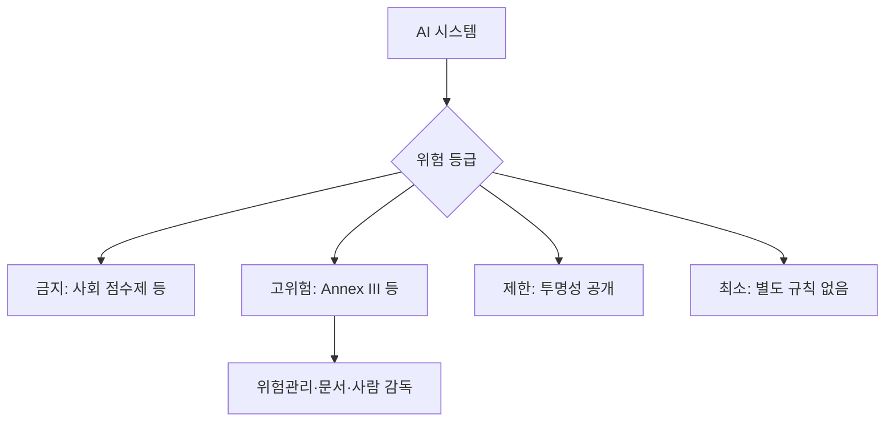

# EU AI Act 고위험 분류

> EU AI Act는 AI를 위험 등급 4단계로 나누고, 그중 고위험 시스템(Annex III 등)에 위험 관리·문서화·사람 감독 같은 엄격한 의무를 부과하는 법이다.

## 쉽게 말하면
식당 규제와 비슷하다. 라면 가게(최소 위험)는 거의 규제가 없고, 병원 급식(고위험)은 위생 점검·기록 의무가 크며, 독극물을 쓰는 곳(금지)은 아예 허용되지 않는다.

## 자세히
(EU 집행위원회·artificialintelligenceact.eu 열람 기준, 2026-11-13 확인. 일정은 개정이 잦으니 EUR-Lex로 재확인.)
- **4단계**: 금지(unacceptable) / 고위험 / 제한(투명성 공개) / 최소(스팸 필터, 게임 AI 등).
- **일정**: 2024-08-01 발효. 금지 사항 1~8과 AI 리터러시는 2025-02-02부터, 거버넌스·범용 AI(GPAI) 의무는 2025-08-02부터. 집행위 페이지에 따르면 2026-07-27 발효한 'AI Omnibus'가 고위험 일정을 늦췄다. 타임라인 페이지 기준 Annex III 고위험 의무는 2027-12-02, Annex I(규제 제품 내 AI)는 2028-08-02, 공공기관 고위험은 2030-08-02. (두 페이지 설명이 완전히 일치하지는 않아 재확인 필요.)
- **Annex III 8개 영역**: 생체인식, 핵심 인프라, 교육·직업훈련, 고용·근로자 관리, 필수 서비스(복지·신용평가·생명/건강보험·응급 분류), 법 집행, 이민·국경, 사법·민주 절차. 금융 사기 탐지는 신용평가 항목의 예외.
- **고위험 제공자 의무**: 위험 평가·완화, 고품질 데이터셋, 활동 기록, 기술 문서, 배포자에 대한 정보 제공, 사람 감독, 견고성·사이버보안·정확도.
- **과태료(제99조, 페이지 텍스트가 일부 깨져 EUR-Lex 확인 필요)**: 금지 행위 위반 3,500만 유로 또는 전 세계 매출 7%, 기타 의무 1,500만 유로 또는 3%, 허위 정보 제공 750만 유로 또는 1%. 중소기업은 둘 중 낮은 쪽.

## 그림으로 보기

## 예시
대출 심사용 신용평가 AI는 고위험이므로 학습 데이터 품질 관리, 로그 보관, 사람이 결과를 뒤집을 수 있는 절차가 필요하다. 사기 탐지 전용 시스템은 같은 영역에서 예외다.

## 헷갈리는 것과 비교
| 개념 | 차이 |
| --- | --- |
| 고위험 | 사용처 기준 분류(모델 크기와 무관) |
| GPAI 의무 | 범용 모델 제공자 대상 별도 의무 |
| [금융 AI](#ai-in-finance) · [교육 AI](#ai-in-education) | 고위험에 걸리는 대표 분야 |

## 더 읽을거리
- [EU AI Act Annex III](https://artificialintelligenceact.eu/annex/3/) — 고위험 8개 영역
- [Implementation Timeline](https://artificialintelligenceact.eu/implementation-timeline/) — 적용 일정
- [Article 99: Penalties](https://artificialintelligenceact.eu/article/99/) — 과태료
- [European Commission: AI Act](https://digital-strategy.ec.europa.eu/en/policies/regulatory-framework-ai) — 공식 개요
