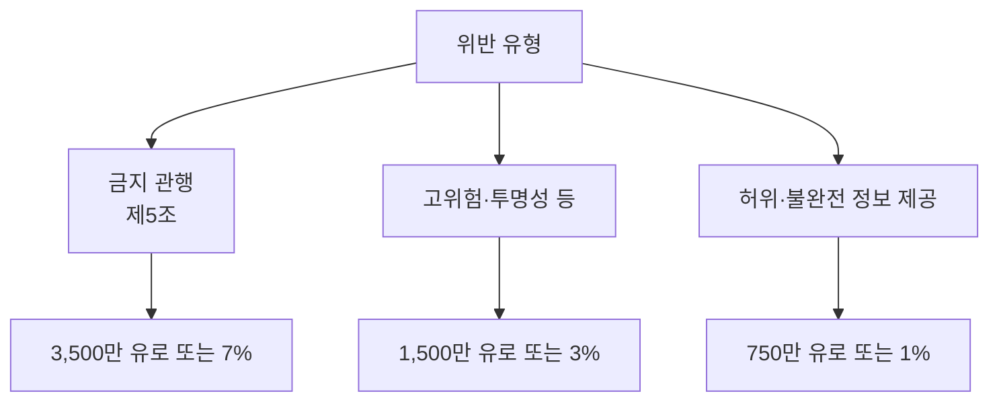

# EU AI Act 과태료

> EU AI Act 위반 시 부과되는 행정 과징금. 위반 유형별로 3단계 상한(금액 또는 전 세계 매출 비율 중 큰 쪽)이 있다.

## 쉽게 말하면
교통 위반 벌금표와 같다. 신호 위반(금지된 AI 사용)이 가장 무겁고, 서류 미비나 거짓 보고는 가볍다. 다만 기업 매출에 비례해 올라가서 대기업에는 "비용으로 감수"하기 어렵게 만든다.

## 자세히
- **1단계 — 최대 3,500만 유로 또는 전 세계 연 매출 7%**(큰 쪽): 제5조 금지 관행 위반(예: 사회적 점수화 등).
- **2단계 — 최대 1,500만 유로 또는 3%**: 고위험 AI 요건·제50조 투명성 의무 등 그 밖의 위반.
- **3단계 — 최대 750만 유로 또는 1%**: 당국에 부정확·불완전·오해 소지 정보를 제공.
- **중소기업(SME)**: 두 값 중 낮은 쪽이 상한이다.
- **범용 AI(GPAI) 모델 제공자**: 제99조가 아니라 제101조 체계에서 EU 집행위가 직접 집행하며 최대 1,500만 유로 또는 3%로 보도됐다. 조문 번호는 관보 원문으로 재확인 필요(2차 자료 기준).
- **시점**: GPAI 의무는 2025-08-02부터 적용, 집행·과징금 권한은 2026-08-02부터라는 설명이 다수이고, 2025-08 이전 출시 모델은 2027-08-02까지 유예라는 설명도 있다. 일정은 개정 논의가 있을 수 있어 최신 확인 필요.
- 부과 시 위반의 성격·기간·규모·협조 여부를 고려한다.

## 그림으로 보기

## 예시
- 연 매출 100억 유로 기업이 금지 관행을 위반 → 상한은 max(3,500만, 7억) = 7억 유로.
- 연 매출 2,000만 유로 SME가 1단계 위반 → min(3,500만, 140만) = 140만 유로 상한.

## 헷갈리는 것과 비교
| 개념 | 차이 |
|---|---|
| EU AI Act 과태료 | AI 규제 위반. 단계별 7/3/1% |
| GDPR 과징금 | 개인정보 위반. 최대 4% 또는 2,000만 유로 |
| [범용 AI 의무](#eu-ai-act-gpai) | 모델 제공자에게 붙는 별도 의무와 집행 |
| [고위험 시스템](#eu-ai-act-high-risk) | 2단계 과태료가 주로 적용되는 대상 |

## 더 읽을거리
- [Houthoff: AI Act obligations for GPAI providers and penalties](https://www.houthoff.com/insights/news/obligations-for-gpai-model-providers-and-penalties/) — GPAI와 과징금 정리
- [DLA Piper: Latest wave of obligations take effect (2025-08)](https://www.dlapiper.com/insights/publications/2025/08/latest-wave-of-obligations-under-the-eu-ai-act-take-effect) — 일정과 집행
- [sota.io: Article 99 Penalties Guide](https://sota.io/blog/eu-ai-act-article-99-penalties-fines-developer-guide) — 단계표
