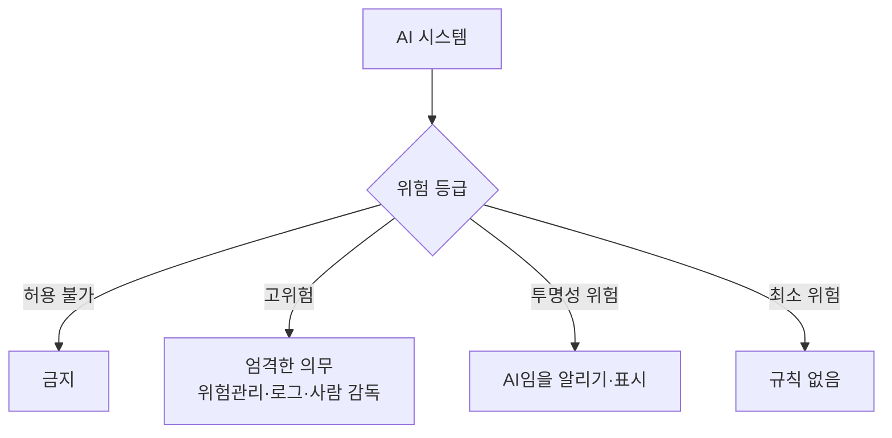
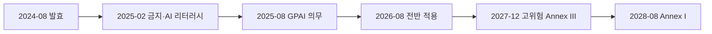

# EU AI Act

> EU AI Act(규정 (EU) 2024/1689)는 AI를 위험 등급별로 나눠 의무를 달리 부여하는 세계 최초의 포괄적 AI 법으로, 2024-08-01 발효해 단계적으로 적용된다.

## 쉽게 말하면
자동차 규제와 비슷하다. 장난감 자동차는 규제가 없고, 일반 승용차는 안전기준을 지켜야 하며, 위험한 개조는 아예 금지다. AI도 쓰이는 곳의 위험이 클수록 더 엄격한 규칙이 붙는다.

## 자세히
- **4개 위험 등급**(EU 집행위 설명):
  - **금지(허용 불가)**: 사회적 점수화, 얼굴 이미지 무차별 수집 등 9가지 관행.
  - **고위험**: 허용되지만 위험관리·데이터 품질·로그·문서화·사람 감독 의무. 예: 핵심 인프라, 교육, 채용, 법집행 분야 AI.
  - **투명성 위험**: AI와 대화 중임을 알리기, 딥페이크 표시, AI 생성물 식별 가능하게 하기.
  - **최소 위험**: 별도 규칙 없음(스팸 필터, 게임 AI 등 대다수).
- **적용 일정**(EU 집행위 페이지 기준, 확인일 2026-11-01): 2024-08-01 발효 → 2025-02-02 금지 관행·AI 리터러시 의무 → 2025-08-02 거버넌스·범용 AI(GPAI) 모델 의무 → 2026-08-02 전반 적용(투명성 규칙 포함). 고위험 Annex III 규칙은 AI Omnibus 개정으로 2027-12-02, 규제 제품 내장형(Annex I)은 2028-08-02로 늦춰졌다고 안내된다. 이 일정은 개정 중이므로 시행 전 공식 페이지를 다시 확인한다.
- **GPAI 제공자**: AI Office가 문서 요청·모델 평가·시정 조치·과징금을 부과할 수 있다. 과징금 액수는 해당 페이지에 없어 규정 원문을 봐야 한다.
- 한국 기업도 EU 시장에 AI 제품을 내거나 EU 사용자에게 출력을 제공하면 적용 대상이 될 수 있다(일반적 설명, 구체 적용은 법무 검토 필요).

## 그림으로 보기

## 예시
- 채용 지원서를 AI로 걸러내는 서비스 = 고위험 → 기록·사람 감독 체계 필요.
- 고객 상담 챗봇 = 투명성 의무 → "AI 상담원입니다" 고지.

## 헷갈리는 것과 비교
| 개념 | 차이 |
| --- | --- |
| EU AI Act | 법적 의무, 위반 시 제재 |
| [NIST AI RMF](#nist-ai-rmf) | 미국의 자발적 위험관리 틀 |
| GDPR | 개인정보 보호법, AI Act와 별개로 함께 적용 |
| [AI 리터러시](#literacy) | AI Act도 2025-02부터 AI 리터러시 의무를 명시 |

## 더 읽을거리
- [European Commission: AI Act 규제 체계](https://digital-strategy.ec.europa.eu/en/policies/regulatory-framework-ai) — 등급·일정
