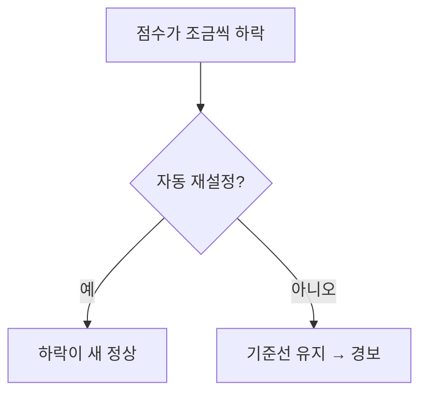

# 기준선 자동 재설정이 위험한 이유

> 평가의 **기준선(baseline)을 점수가 변할 때마다 자동으로 갱신하면** 서서히 나빠지는 드리프트가 새 정상으로 굳어 버린다. 기준선은 사람이 검증한 릴리스에서만 의도적으로 잡아야 한다.

## 쉽게 말하면
키 재는 기준 눈금을 매달 학생 평균에 맞춰 다시 그으면 반 전체가 작아져도 "정상"으로 보인다. 눈금은 고정해 두고, 바꿀 때는 이유를 확인한다.

## 자세히
(Stack Overflow Blog와 Langfuse 가이드를 직접 읽었다.)
- **기준선 예(SO)**: 릴리스 2026-01-09, exact_match 평균 0.942(n=2400, 표준편차 0.012). 알려진 양호 릴리스를 승인할 때 **의도적으로** 기록한다.
- **금지(SO)**: "자동 재기준화는 드리프트를 새 정상으로 세탁한다". 검증 후에만 다시 잡는다.
- **비교 규칙(SO 예)**: 지표별 최소 효과(exact_match 0.01, human_override_rate 0.02)와 z > 2 확인.
- **Langfuse**: 승인된 기준선과 항목별로 비교해 평균이 올라도 새로 깨진 케이스를 찾는다. 임계값은 기준선보다 약간 낮게(예: 기준 0.88, 임계 0.8) 두어 정상 변동을 흡수한다.
- 튜터 적용(제안): 누출률 기준선은 사람이 샘플을 검토한 릴리스에서만 갱신하고 갱신 사유를 커밋에 적는다.

## 그림으로 보기

## 예시
- 한 달간 누출률이 1%에서 3%로 올랐다면 기준선을 3%로 올리지 말고 원인(모델·프롬프트 변경)을 찾는다.

## 헷갈리는 것과 비교
| 개념 | 차이 |
|---|---|
| 기준선 | 승인된 양호 릴리스의 점수 |
| 임계값 | 기준선보다 약간 낮은 합격선 |
| [섀도 평가](#shadow-eval) | 드리프트를 운영에서 감시 |

## 더 읽을거리
- [Stack Overflow Blog](https://stackoverflow.blog/2026/10/07/evals-as-a-deployment-gate-and-how-to-know-when-they-drift/) — 직접 읽음.
- [Langfuse](https://langfuse.com/resources/engineering/llm-regression-testing.md) — 승인된 기준선 비교(직접 읽음).
