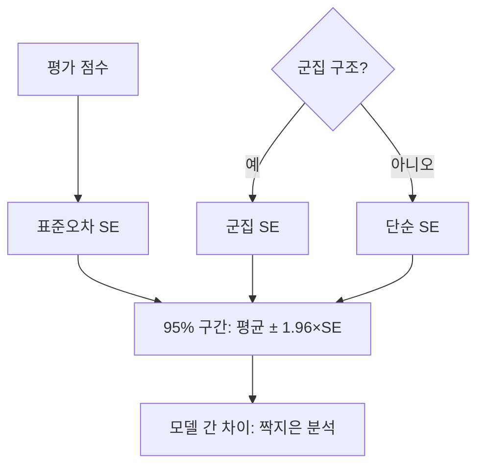
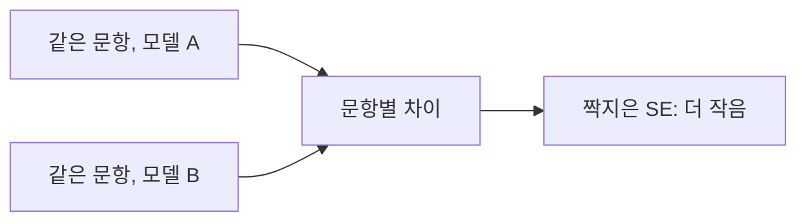

# 평가 오차 막대

> 모델 평가 점수(벤치마크 정확도 등)에 **표준오차나 신뢰 구간을 함께 적는 것**이다. 점수는 문제 표본에서 나온 추정값이므로 문제를 다시 뽑으면 달라진다. 오차 막대가 없으면 1~2점 차이가 실력 차이인지 우연인지 알 수 없다.

## 쉽게 말하면
여론조사가 "지지율 52%"라고만 하지 않고 "±3%p"를 같이 적는 이유와 같다. 시험 문제 몇 백 개로 잰 점수도 그 문제들을 운 좋게 만났는지에 따라 흔들린다.

## 자세히
(Evan Miller의 「Adding Error Bars to Evals」(Anthropic, arXiv 2411.00640, 2024-11) PDF를 직접 읽어 확인하고, 아래 수치는 직접 시뮬레이션했다.)
- **관점(논문)**: 평가는 본질적으로 실험이며, 평가 문항이 보이지 않는 **초모집단(super-population)**에서 뽑혔다고 보고 통계적으로 분석하자고 제안한다. 업계는 SOTA 수치를 굵게 표시하지만 유의성 검정이 드물고, Llama 3 보고서가 몇몇 평가에 신뢰 구간을 낸 예외라고 소개한다. 저자는 그 보고서의 구간이 어떤 경우에는 너무 좁고 어떤 경우에는 너무 넓다고도 지적한다.
- **논문의 다섯 권고**: ① **중심극한정리로 평균의 표준오차**를 계산하고 95% 구간은 평균 ±1.96×SE ② 문항이 관련 묶음(같은 지문 등)에서 뽑혔다면 **군집 표준오차** ③ 답안을 여러 번 재표집하거나 다음 토큰 확률을 분석해 **분산 줄이기** ④ 두 모델을 비교할 때는 요약 통계가 아니라 **문항 단위의 짝지은 차이**로 추론 ⑤ **검정력 분석**으로 평가(또는 부분 표본)가 가설을 검정할 수 있는지 확인.
- **군집의 영향(논문 표 4)**: Anthropic 모델의 실제 평가 두 가지에서 같은 데이터를 분석했을 때 **군집 표준오차가 단순(naive) 표준오차보다 3배 넘게 커질 수 있다**고 보고한다.
- **직접 시뮬레이션(문항 500개, 모델 A 정확도 약 0.70, B 약 0.68, 문항 난이도를 두 모델이 공유)**
  | 방식 | 표준오차(차이) | 95% 구간(관측 차이 +0.026) |
  |---|---|---|
  | 비짝(두 정확도를 따로 처리) | 0.0290 | −0.031 ~ +0.083 |
  | **짝지은 차이** | **0.0203** | −0.014 ~ +0.066 |
  두 모델의 문항별 정오 상관이 0.51이면 짝지은 분석의 표준오차가 약 30% 작아진다(비율 1.43). 구간이 모두 0을 포함해 **이 차이는 구분되지 않는다**. 같은 문항을 쓰는 비교는 짝지은 분석이 더 정밀하다.
- **직접 시뮬레이션(지문 100개×문항 5개=500문항, 지문마다 난이도 차이)**: 정확도 0.68에서 단순 표준오차 0.0209, **군집 표준오차 0.0368**(1.76배). 같은 지문의 문항이 서로 비슷하게 맞고 틀리므로 문항 500개가 독립 500개처럼 작동하지 않는다(유효 표본이 줄어듦).
- **보고 방법(제안)**: 점수 옆(또는 아래)에 (±SE)를 표기, 비교 결과는 **차이와 구간**을 보고, 군집 구조가 있으면 군집 SE 사용, 평가를 설계할 때 검정력 분석으로 필요한 문항 수 계산, 모델 샘플링을 여러 번 해 분산을 줄이면 구간이 좁아진다.
- **한계**: CLT 기반 SE는 문항 수가 충분하다고 가정한다. 점수가 0·1에 몰려 있거나 문항이 매우 적으면 정확 구간(Wilson 등)이 낫다([작은 칸 표시](#crosstab-small-cell-flag)). 시뮬레이션은 가정한 난이도 구조에서 나온 것이다.

## 그림으로 보기

## 예시
- 두 모델 도입 비교에서 벤치마크 점수 70.0 대 68.2를 "A가 우수"라고 쓰기 전에 짝지은 차이와 구간을 계산 → 구간이 0을 포함하면 "구분 안 됨, 비용·지연으로 결정".
- 교육 소재: "SOTA 굵은 글씨의 함정" — 점수표에 오차 막대를 직접 그려 보기.

## 헷갈리는 것과 비교
| 개념 | 차이 |
|---|---|
| 평가 오차 막대 | 평가 점수에 불확실성 표시 |
| [슬라이스 다중 비교](#multiple-comparisons-slices) | 슬라이스를 많이 볼 때 우연한 발견 |
| [작은 집단의 불확실성](#small-subgroup-uncertainty) | 칸별 표본 부족 |
| 재현성(시드 변동) | 학습·샘플링 무작위로 인한 변동(오차 막대는 문항 표본 변동 중심) |

## 더 읽을거리
- [Adding Error Bars to Evals (arXiv 2411.00640)](https://arxiv.org/abs/2411.00640) — 평가의 통계적 분석, 군집 SE, 짝지은 차이, 검정력(PDF 직접 확인).
