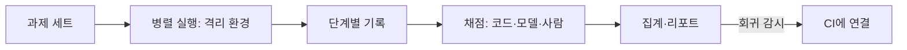

# 평가 하네스

> 평가 하네스(eval harness)는 평가를 처음부터 끝까지 자동으로 돌리는 인프라다. 지시와 도구를 주고, 과제를 병렬 실행하고, 모든 단계를 기록하고, 결과를 채점·집계한다(Anthropic 정의).

## 쉽게 말하면
시험 감독 시스템이다. 시험지 배부, 시간 관리, 답안 수거, 채점, 성적표까지 한 번에 처리한다. 학생(AI)을 바꿔도 같은 시험장·같은 채점 기준이라 점수를 비교할 수 있다.

## 자세히
- **에이전트 하네스와 다르다**: 에이전트 하네스(스캐폴드)는 모델이 도구를 쓰며 일하게 하는 시스템(예: Claude Code). 에이전트를 평가한다는 것은 **하네스+모델 조합**을 평가한다는 뜻이라, 모델은 그대로고 하네스만 바꿔도 점수가 변한다.
- 구성: 과제 세트([평가셋](#eval-set)) → 실행 환경(격리·병렬) → 기록(트랜스크립트) → 채점기(코드·모델·사람) → 집계(예: [pass@k](#pass-at-k)).
- 설계 팁(Anthropic 글 요약, 2026-01경): 도구 호출 순서를 검사하면 너무 경직 — 에이전트는 설계자가 예상 못 한 유효한 길을 찾으니 **결과물**을 채점한다. 능력 평가와 [회귀 평가](#regression-eval)를 구분하고, 모델 채점기는 사람과 보정한다([LLM 판사](#llm-as-judge)).
- 한계: 1차 글 본문 전체는 직접 확인하지 못했고 일부는 2차 요약에 의존.

## 그림으로 보기

## 예시
- 새 모델이 나올 때마다 같은 50개 업무 과제를 하네스로 돌려 이전 모델과 점수·비용을 비교.
- 프롬프트를 고친 뒤 하네스를 CI에 걸어, 기존에 통과하던 과제가 깨지면 배포 중단.

## 헷갈리는 것과 비교
| 개념 | 차이 |
|---|---|
| 평가 하네스 | 평가를 돌리는 인프라 |
| [하네스(에이전트)](#harness) | 모델이 일하게 하는 스캐폴드 |
| [벤치마크](#benchmarks) | 문제와 정답 모음(내용물) |

## 더 읽을거리
- [Demystifying evals for AI agents (Anthropic Engineering)](https://anthropic.com/engineering/demystifying-evals-for-ai-agents) — 하네스 정의와 평가 설계
- [Agent eval harness (futureagi)](https://futureagi.com/blog/agent-eval-harness/) — 두 하네스 구분 해설(2차)
