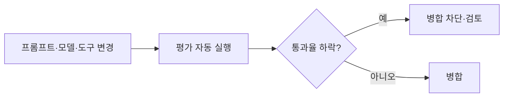
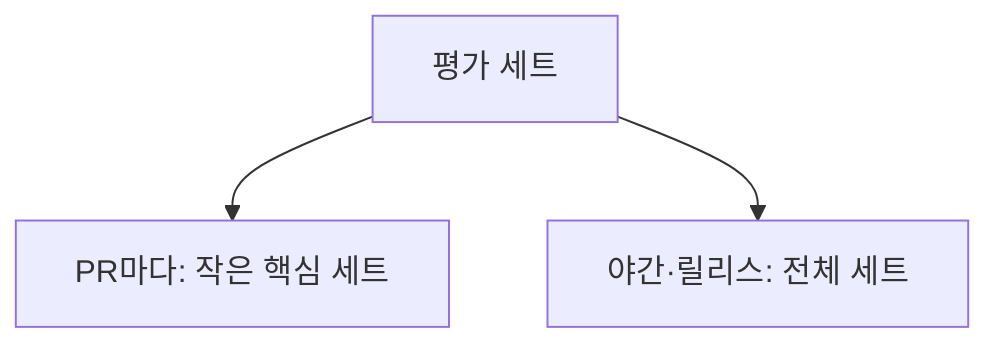

# CI에서의 평가

> **에이전트나 프롬프트를 바꿀 때마다 평가를 자동으로 돌리는** 습관. 코드 변경에 단위 테스트를 돌리듯, AI 변경에는 평가 세트를 돌려 품질 저하를 가장 먼저 잡는다.

## 쉽게 말하면
요리 레시피를 바꿀 때마다 시식 심사를 자동으로 거치게 하는 것이다. 바꾼 뒤에야 손님 불만으로 알게 되는 일을 줄인다.

## 자세히
(Anthropic 엔지니어링 글 열람 기준.)
- 자동 평가는 실사용자 없이 개발 중에 돌릴 수 있어 **출시 전 테스트와 CI/CD**에 적합하다. **에이전트 변경과 모델 업그레이드마다** 돌려 품질 문제를 막는 **첫 방어선**이 된다.
- 구성(내 정리): 회귀 평가(100% 근처, 하락=경고) + 변경 영향이 큰 능력 평가 일부. 한 번 실행의 잡음을 고려해 여러 번 샘플링([위치 편향](#position-bias) 등 심판 편향 완화도 함께).
- 채점기 선택: 코드 기반은 빠르고 싸 CI에 적합, 모델 기반 심판은 비결정적이고 비싸므로 [교정](#grader-calibration)과 비용 관리가 필요하다.
- 비용 관리 팁(내 제안): PR마다는 작은 핵심 세트, 야간·릴리스 때는 전체 세트를 돌린다.
- 한계: 글은 CI 설정 방법(워크플로 파일 등)을 다루지 않았다. 구체 구현은 사용하는 CI 도구 문서를 확인한다.

## 그림으로 보기

## 예시
- 시스템 프롬프트를 수정한 PR이 올라오면 회귀 평가 50개를 돌려 통과율이 95%에서 80%로 떨어지면 알림.
- 교육: 간단한 평가 스크립트를 만들어 변경 전후 통과율을 비교하는 실습.

## 헷갈리는 것과 비교
| 개념 | 차이 |
|---|---|
| CI 평가 | 변경마다 자동 실행 |
| 프로덕션 모니터링 | 실사용 중 지속 관찰 |
| [능력 평가](#capability-eval) | 무엇을 잘하나, 평가 종류의 한 갈래 |

## 더 읽을거리
- [Demystifying evals for AI agents](https://www.anthropic.com/engineering/demystifying-evals-for-ai-agents) — CI/CD 활용과 채점기(읽음).
