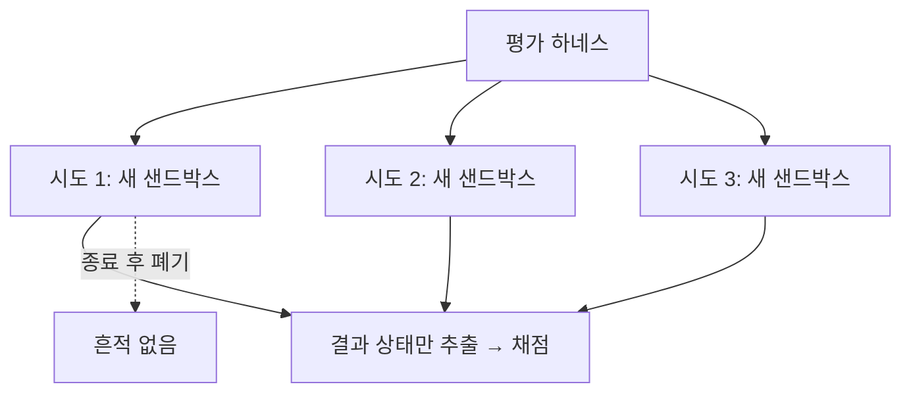
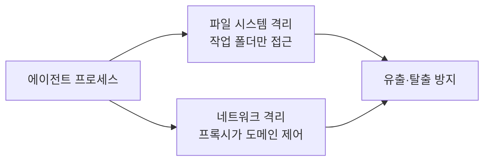

# 평가 샌드박스

> 에이전트를 평가할 때 시도마다 깨끗하고 격리된 환경에서 돌려, 에이전트가 환경을 망가뜨리거나 이전 시도의 흔적·정답을 엿보지 못하게 하는 실행 구역.

## 쉽게 말하면
수험생마다 새 시험장 책상을 주고 쓰던 연습장과 정답지를 모두 치운 뒤 입실시키는 것과 같다. 앞사람이 남긴 메모가 책상에 있으면 점수가 부풀고, 어떤 수험생이 책상을 부수면 다음 사람이 시험을 못 본다. 격리는 공정성과 안전을 함께 지킨다.

## 자세히
**평가에서의 격리(Anthropic "Demystifying evals for AI agents")**
- 각 시도를 **깨끗한 환경에서 시작**해 시도 간 독립성을 보장한다.
- 남은 파일, 캐시 데이터, 자원 고갈은 에이전트 능력이 아니라 **인프라** 때문에 생기는 **상관된 실패**를 만든다.
- 공유 상태는 점수를 **부풀리기도** 한다. 글은 Claude가 이전 시도의 **git 기록을 살펴보며 부당한 이점**을 얻은 사례를 든다.
- 자원 설정에 따라 점수가 달라지므로 환경 구성도 기록한다([하네스 편차](#agent-harness-variance)).

**보안 관점의 샌드박스(Claude Code 샌드박싱 글)**
- "효과적인 샌드박싱에는 **파일 시스템 격리와 네트워크 격리가 모두** 필요하다."
- **파일 시스템 격리**: 현재 작업 디렉터리 안에서만 읽기·쓰기 허용, 밖의 파일 수정 차단.
- **네트워크 격리**: 인터넷 접속을 샌드박스 밖의 **프록시**로 통과시켜 접근 가능한 도메인을 제한하고 새 도메인은 사용자 확인을 받는다.
- **OS 수준 강제**: Linux는 bubblewrap, macOS는 seatbelt를 사용하고 명령이 띄운 하위 프로세스에도 적용된다.
- **왜 둘 다**: 네트워크 격리가 없으면 침해된 에이전트가 SSH 키 같은 민감 파일을 밖으로 유출할 수 있고, 파일 시스템 격리가 없으면 샌드박스를 벗어나 네트워크에 닿을 수 있다.
- 내부 사용에서 샌드박싱으로 **권한 확인 창이 84% 감소**했다고 보고했다.

**평가용 샌드박스 설계 체크리스트(실무 제안)**
1. 시도마다 새 컨테이너·새 작업 디렉터리·초기화된 DB
2. 정답·이전 결과·평가 코드가 에이전트에게 보이지 않게 분리(읽기 전용 마운트 금지 대상 포함)
3. 외부 네트워크 기본 차단, 필요한 호스트만 허용
4. CPU·메모리·시간 상한과 강제 종료 한도 설정
5. 시도 후 환경 폐기, 결과 상태만 채점기로 전달
6. 사용한 환경 사양을 평가 보고에 기록

## 그림으로 보기

## 예시
- 코딩 에이전트 평가: 문제마다 저장소를 새로 체크아웃한 컨테이너에서 실행하고, 이전 시도의 git 기록·캐시가 남지 않게 한다.
- 사내 업무 에이전트 시험: 가짜 고객 DB를 매 시도 초기 상태로 복원하고, 외부 메일 발송은 목(mock) 서버로 대체한다.

## 헷갈리는 것과 비교
| 개념 | 차이 |
|---|---|
| 평가 샌드박스 | 공정하고 재현 가능한 시험을 위한 격리 |
| 보안 샌드박스 | 유출·파괴를 막기 위한 격리(파일·네트워크) |
| [하네스 편차](#agent-harness-variance) | 자원 설정이 점수에 미치는 영향 |
| [트랜스크립트](#eval-transcripts) | 샌드박스 안 시도의 기록 |

## 더 읽을거리
- [Demystifying evals for AI agents (Anthropic)](https://www.anthropic.com/engineering/demystifying-evals-for-ai-agents) — 시도별 깨끗한 환경과 공유 상태 문제
- [Claude Code sandboxing (Anthropic)](https://www.anthropic.com/engineering/claude-code-sandboxing) — 파일·네트워크 격리 구조
