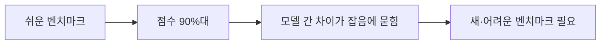
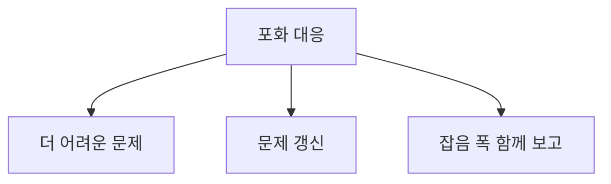

# 평가 포화

> 벤치마크 점수가 높아져 **최상위 모델들을 점수로 더 이상 믿고 구분할 수 없게 되는** 현상. 통과율이 100%에 가까우면 개선 신호가 사라진다.

## 쉽게 말하면
모두가 95점 이상을 받는 쉬운 시험으로는 우등생과 수재를 가를 수 없다. 이제 시험을 어렵게 바꿔야 한다.

## 자세히
(검색 결과 요약 기준.)
- 정의: 2026 연구는 포화를 **최신 모델들 사이의 신뢰할 만한 변별력을 잃는 것**으로 정의하고, 잡음 추정이 없으면 정체(stagnation)와 포화를 구분하기 어렵다고 한다.
- MMLU: Humanity's Last Exam(HLE) 논문은 MMLU 같은 인기 벤치마크에서 LLM이 90%를 넘게 달성한다고 말한다. 2차 자료는 Stanford HAI 2026 AI Index를 인용해 프런티어 모델이 MMLU에서 88% 이상이라고 한다.
- 대응 1 — 더 어려운 시험: HLE는 전문가가 쓴 닫힌형 학술 문제 약 2,500개로, 이전 평가들이 거의 만점이라 최신·미래 능력을 가려 버린다는 문제의식에서 만들었다. 2차 자료는 최고 점수가 출시 때 20% 미만에서 2026-05 기준 46.9%로 올랐다고 보고(검증 약함).
- 대응 2 — [갱신형 벤치마크](#live-benchmark).
- 확인 못 함: GSM8K 포화를 직접 다룬 자료는 이번 검색에서 찾지 못했다.
- 실무: 내 업무 평가에서도 통과율이 95%를 넘으면 쉬운 케이스를 줄이고 어려운 케이스를 늘린다. 변화 감지에는 잡음 폭(여러 번 실행의 편차)을 같이 본다.

## 그림으로 보기

## 예시
- 사내 챗봇 평가 세트 통과율이 98%이면 개선 효과를 측정할 수 없다 → 실패 사례를 모아 어려운 세트를 만든다.
- 교육: 같은 모델을 3번 돌려 점수 편차가 모델 간 차이보다 큰지 확인하는 실습.

## 헷갈리는 것과 비교
| 개념 | 차이 |
|---|---|
| 평가 포화 | 점수 천장에 닿아 변별력 상실 |
| [벤치마크 오염](#benchmark-contamination) | 문제가 학습에 섞여 점수가 부풀음 |
| [갱신형 벤치마크](#live-benchmark) | 포화·오염을 피하려 문제를 교체 |

## 더 읽을거리
- [Humanity's Last Exam (arXiv 2501.14249)](https://arxiv.org/pdf/2501.14249) — 포화 배경과 HLE(검색 결과 확인).
- [When AI Benchmarks Plateau](https://arxiv.org/html/2602.16763) — 포화 정의(검색 결과 확인).
