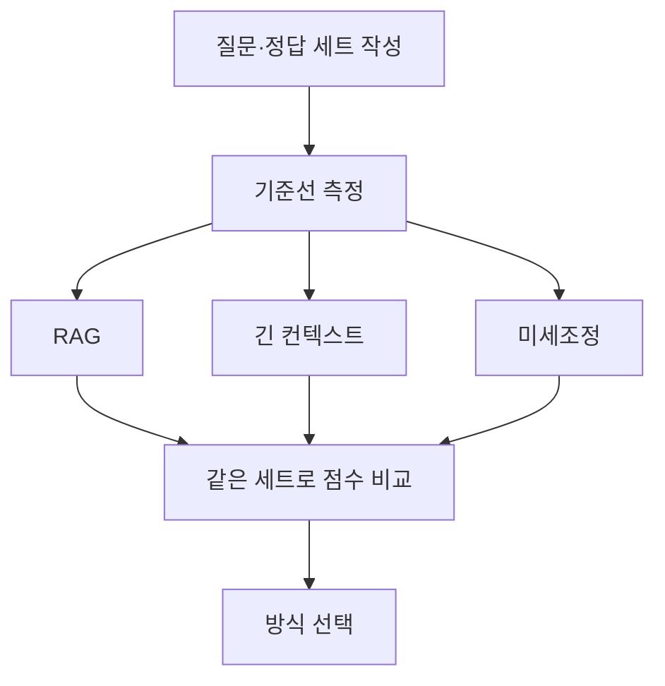
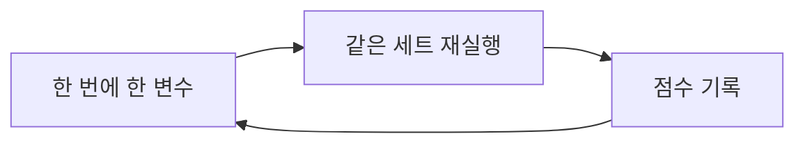

# 질문·정답 세트 먼저 만들기

> RAG·긴 컨텍스트·미세조정 중 무엇을 쓸지 정하기 전에, 우리 업무의 실제 질문과 정답 기준 세트부터 만들고 그 점수로 방식을 고르는 원칙.

## 쉽게 말하면
이사 갈 집을 고르기 전에 "채광, 통근 시간, 월세 한도" 체크리스트를 먼저 만드는 것과 같다. 기준표가 있어야 집을 비교할 수 있고, 없으면 마지막에 본 집이 좋아 보인다.

## 자세히
- **원칙(Google Cloud 블로그, 2024-12-19, 열람)**: RAG는 엄격한 평가 없이는 조용히 실패하므로 반복 가능한 자동 시험 장치를 먼저 만들고 한 번에 한 가지만 바꿔 개선한다.
- **세트 구성**: 데이터의 넓은 범위를 덮는 다양한 질문(표현 변형, 쉬운 것·복합 질문·오타 포함)을 실제 사용 사례에 맞춰 쓰고 이해관계자·최종 사용자와 검증한다. 질문마다 정답 기준(골든 레퍼런스)을 붙인다. 실행 사이에 질문·정답·설정을 바꾸지 않는다.
- **지표 예**: 응답 근거성, 장황함, 지시 준수, 답변 품질. 채점은 모델 기반 점별(0~5)·쌍별, 계산 기반(ROUGE·BLEU). 도구는 Ragas나 Vertex AI 평가 서비스.
- **원인 분리와 반복**: 검색 정확도와 LLM에 전달되는 문맥을 분리해 본다. 기준선을 기록하고 한 변수씩(검색 이웃 수, 임베딩 모델, 청킹 크기·겹침, 요약 전처리, 모델·프롬프트, 메타데이터 보강, 청크 대신 전체 문서 전달)을 바꿔 같은 시험으로 비교하고, 더 이상 안 오르면 설정을 고정한다.
- **사람 평가**: 자동 지표가 안정된 뒤 어조·명확성·모호성을 사람이 본다.
- **방식 선택의 근거 연구**: Long Context vs RAG 평가(arXiv 2501.01880, 초록 열람)는 QA 벤치마크에선 긴 컨텍스트가 대체로 앞서지만 요약 기반 검색은 비슷하고 청크 기반 검색은 뒤처지며, 대화형·일반 질의에서는 RAG가 유리하다고 하고 단일 승자는 없다고 결론짓는다. 따라서 우리 데이터로 직접 비교해야 한다.
- **세트 크기**: 검색 요약의 블로그들은 최소 50개, 운영 확신용 200개 이상 같은 경험칙을 말하지만 근거가 약한 경험칙이다. 최종 점수는 튜닝에 안 쓴 보류 세트로 보고하는 방식도 제안됐다.

## 그림으로 보기

## 예시
- 사내 규정 Q&A: 실제 문의 로그에서 질문 50개를 뽑고 담당자가 정답과 근거 조항을 적음 → RAG와 전체 문서 입력을 같은 50개로 비교.
- 교육 실습: 자기 업무 문서에 대해 질문 10개와 정답 기준을 만들고 두 가지 방식을 비교하는 표 작성.

## 헷갈리는 것과 비교
| 개념 | 차이 |
|---|---|
| 질문·정답 세트 | 방식을 고르기 위한 기준표 |
| [긴 컨텍스트의 한계](#long-context-limits) | 세트로 확인해야 할 약점 |
| [튜터 회귀 평가](#tutor-regression-eval) | 변경마다 같은 세트로 재시험 |
| [근거성 지표](#groundedness-metric) | 세트에 넣는 지표 중 하나 |

## 더 읽을거리
- [Google Cloud: Optimizing RAG retrieval](https://cloud.google.com/blog/products/ai-machine-learning/optimizing-rag-retrieval) — 평가 주도 반복(열람)
- [Long Context vs. RAG (arXiv 2501.01880)](https://arxiv.org/abs/2501.01880) — 두 방식 비교(초록 열람)
