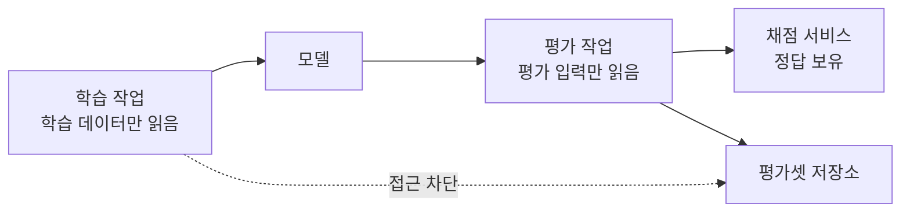
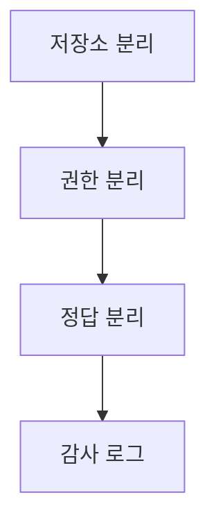

# 평가셋 격리

> 평가셋 격리는 학습·튜닝 작업이 평가셋을 읽지 못하도록 저장 위치와 접근 권한을 분리하는 운영 방식이다. 실수로든 의도적으로든 평가 데이터가 학습에 섞이는 경로를 처음부터 막는다.

## 쉽게 말하면
시험지는 교사 금고에 두고 학생이 쓰는 서재에는 두지 않는다. 학생이 부정직해서가 아니라, 서재 책 사이에 시험지가 끼어 있으면 모르고 공부해 버릴 수 있기 때문이다. 접근 자체를 막아 두면 사고가 없다.

## 자세히
- **접근 통제 수단의 예(Hugging Face Hub 게이트 데이터셋 문서, 열람)**: 데이터셋 저자가 접근 요청(access request)을 켜면 사용자가 요청해야 파일에 접근한다. 자동 승인과 수동 승인이 있고, 접근은 조직이 아니라 개인 단위로 허용된다. 승인·거절·재설정 이력을 UI나 API로 관리하고 접근 보고서를 내려받을 수 있다. 조직 소유 데이터셋은 조직 구성원에게도 요청을 요구하는 옵션이 있고, 관리자와 생성자는 예외다.
- **격리 설계의 요소(해석)**:
  1. **저장소 분리**: 평가셋을 학습 데이터 저장소·버킷과 다른 곳에 둔다.
  2. **권한 분리**: 학습 작업의 서비스 계정에는 평가셋 읽기 권한을 주지 않는다. 평가는 별도 평가 작업(계정)만 읽는다.
  3. **정답 분리**: 평가 입력과 정답을 따로 두고 정답은 채점 서비스만 갖는다.
  4. **감사 기록**: 누가 언제 평가셋을 읽었는지 로그를 남긴다.
  5. **공개 평가셋은 다르다**: 이미 공개된 벤치마크는 격리가 불가능하므로 [카나리 문자열](#canary-string)과 [겹침 검사](#ngram-overlap-test)로 보완한다.
- **한계(해석)**: 격리는 내부 평가셋에 유효하다. 평가 결과를 반복해서 보고 모델을 고치는 간접 누수(점수를 보고 조정)는 접근 통제로 막지 못한다([테스트 세트 재사용 위험](#test-set-reuse-risk)).
- **이 글에서 직접 시험하지 않은 것**: 위 설계 요소는 일반적 운영 관행에 대한 해석이며 실제 환경에서 실행해 검증하지 않았다.

## 그림으로 보기

## 예시
- 사내 모델 평가셋을 별도 클라우드 프로젝트에 두고 학습 파이프라인의 계정에는 읽기 권한을 주지 않는다. 평가 때만 평가 계정이 읽는다.
- 교육 활용: 사내 데이터 폴더 구조를 그려 평가셋이 학습 작업에서 읽히는 경로가 있는지 찾아 본다.

## 헷갈리는 것과 비교
| 개념 | 차이 |
| --- | --- |
| 평가셋 격리 | 접근 자체를 막음(예방) |
| [카나리 문자열](#canary-string) | 유출 표식과 재현 확인 |
| [n-gram 겹침 검사](#ngram-overlap-test) | 이미 섞인 것을 찾음(탐지) |
| [CI 겹침 게이트](#ci-overlap-gate) | 변경 때마다 자동 점검 |

## 더 읽을거리
- [Hugging Face Hub: Gated datasets](https://huggingface.co/docs/hub/datasets-gated) — 접근 요청, 승인, API 관리
