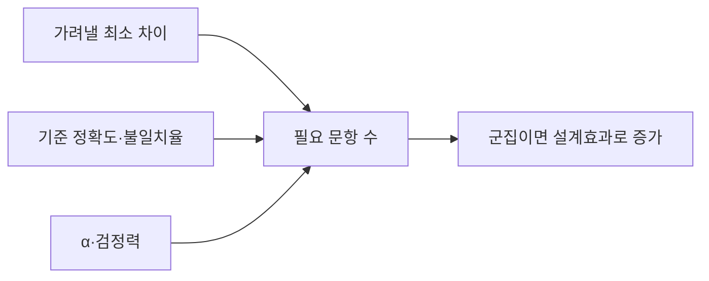
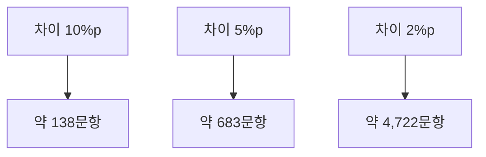

# 평가셋 크기 계획

> 평가셋 크기 계획은 "모델 A가 B보다 5%p 낫다"는 정도의 차이를 신뢰성 있게 가려내려면 문항이 몇 개 필요한지를 미리 계산하는 일이다. 가려내려는 차이가 작을수록 필요한 문항 수가 크게(대략 차이의 제곱에 반비례해서) 늘어난다.

## 쉽게 말하면
저울로 1g 차이를 재려면 정밀한 저울이 필요하고 10g 차이는 아무 저울로도 보인다. 평가셋은 저울의 정밀도다. 작은 차이를 보고 싶으면 문항을 훨씬 많이 모아야 한다.

## 자세히
- **핵심 관계(Wikipedia Sample size determination, 열람)**: 비율을 오차 한계 W 안으로 추정하려면 n = 4Z²p(1−p)/W²이고 p=0.5로 보수적으로 잡으면 n = Z²/W²다. 문서의 예로 95% 신뢰·폭 0.02이면 n = 1.96²/0.02² = 9,604다. 검정력 계산에서는 효과 크기가 작을수록 표본이 커지며(문서의 표: Cohen's d 0.2·0.5·0.8에서 집단당 393·64·26) 효과를 절반으로 줄이면 필요한 n이 대략 4배가 된다. 이 문서에는 두 비율 비교 공식은 없었다.
- **독립 비교 공식(표준 공식, 직접 계산)**: 두 모델을 서로 다른 문항에 돌린다고 보면 집단당 n = (z_{α/2} + z_β)² [p1(1−p1) + p2(1−p2)] / (p1−p2)². α=0.05(양측), 검정력 80%이면 (1.96 + 0.84)². 정확도 85% 대 90%면 집단당 약 683문항, 85% 대 87%면 약 4,722문항, 85% 대 95%면 약 138문항이다. 2%p 차이를 보려면 5%p 차이의 약 7배가 필요하다.
- **같은 문항 짝 비교면 훨씬 적게 든다(직접 계산, McNemar 정확 검정의 검정력을 가능한 모든 결과를 합산해 계산)**: 두 모델이 다르게 답하는 불일치 문항이 전체의 10%이고 그중 B만 맞힌 쪽이 7.5%, A만 맞힌 쪽이 2.5%(정확도 차 5%p)라고 가정한다. 양측 α=0.05에서 검정력은 n=200이면 54.3%, n=300이면 74.4%, n=340이면 80.5%, n=400이면 87.4%다. 즉 약 340문항으로 80% 검정력을 얻는다. 같은 5%p 차이를 독립 비교로 보려면 모델마다 683문항이 필요했다. 불일치 비율이 20%로 높아지면 같은 차이를 가려내는 검정력이 낮아져 n=500에서 67.6%에 그친다(불일치가 많으면 정보가 더 분산됨). 이 계산은 가정(불일치 비율·방향)에 달려 있다.
- **계획 순서(해석)**: ① 의미 있는 최소 차이를 정한다(비용·위험 기준) ② 기준 정확도와 불일치 비율을 파일럿으로 추정 ③ 위 공식이나 시뮬레이션으로 n 계산 ④ 군집이 있으면 [설계효과](#clustered-samples-ci)로 n을 키운다 ⑤ 못 모으면 "이 크기로는 X%p 이하의 차이는 못 가린다"고 보고한다.
- **작은 차이를 가리지 못할 때**: 비용·지연·안전성 같은 다른 기준으로 선택한다([작은 차이를 넘는 모델 선택](#model-choice-beyond-small-gaps)).

## 그림으로 보기

## 예시
- 프롬프트 두 버전 비교: 같은 문항으로 짝 비교하고 불일치 10%·차이 5%p를 가정하면 약 340문항이 목표다. 현재 200문항뿐이면 검정력 54%라 결과를 "확인 안 됨"으로 둔다.
- 교육 활용: 최소 차이를 바꿔 필요한 n이 어떻게 변하는지 표로 만들어 보는 실습.

## 헷갈리는 것과 비교
| 개념 | 차이 |
| --- | --- |
| [같은 문항 쌍 비교](#paired-test-same-items) | 짝 검정의 이점. 크기 계획은 그 검정의 검정력 계산 |
| 신뢰구간 폭 기반 계산 | 한 모델의 정확도를 추정하는 데 필요한 n |
| 검정력 | 실제 차이가 있을 때 이를 찾아낼 확률 |
| [군집 표본의 신뢰구간](#clustered-samples-ci) | 필요한 n을 설계효과만큼 키움 |

## 더 읽을거리
- [Wikipedia: Sample size determination](https://en.wikipedia.org/wiki/Sample_size_determination) — 비율 추정 공식과 효과 크기별 표본
