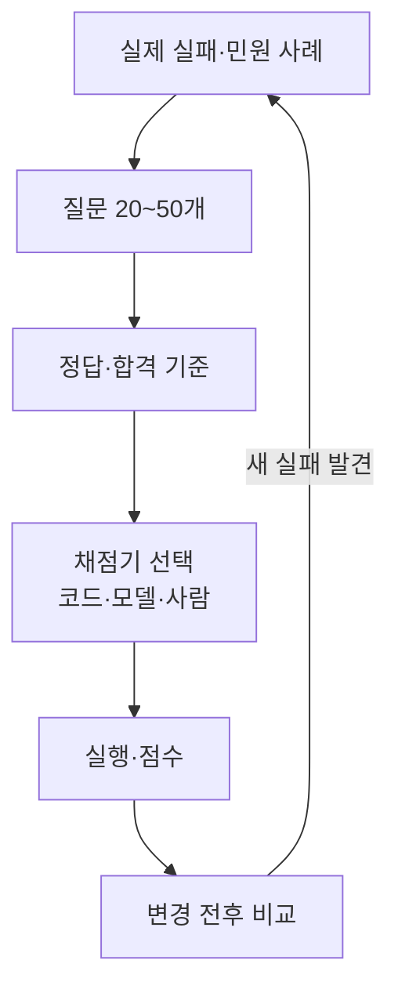

# 평가셋 만들기

> 내 업무에 맞춘 테스트 질문과 정답(또는 합격 기준) 모음. 프롬프트·모델을 바꿀 때 나아졌는지 확인하는 시험지다.

## 쉽게 말하면
자동차 정비소가 수리 후 쓰는 점검표다. 실제로 고장 났던 증상 목록으로 다시 점검해 고쳐졌는지 보고, 다른 곳이 망가지지 않았는지도 확인한다.

## 자세히
Anthropic 글의 권고를 정리하면:
1. **작게 시작**: 실제 실패 사례에서 뽑은 20~50개.
2. **명확한 과제**: 전문가 두 명이 같은 합격/불합격을 내려야 한다. 기준 해법을 함께 둔다. 전 시도가 0%면 과제가 잘못됐을 가능성이 크다.
3. **균형**: 해야 하는 경우와 하지 말아야 하는 경우를 모두 넣는다.
4. **환경 격리**: 시도마다 깨끗한 상태에서 시작.
5. **결과 중심 채점**: 정해진 도구 순서가 아니라 산출물을 본다. 부분 점수 허용.
6. **우회 방지**: 에이전트가 허점으로 통과하지 못하게 채점기를 설계.
7. **관리**: 기록(transcript)을 직접 읽어 채점이 공정한지 확인하고, 포화되면 회귀 테스트로 전환한다.

## 그림으로 보기

## 예시
- 사내 규정 챗봇: 질문 40개(정답 있는 것 30, "모른다고 답해야 하는 것" 10)를 만들고, 프롬프트 수정마다 점수를 기록한다.
- 업무 문서 요약: 좋은 요약 예 5개로 루브릭을 만들고 [LLM 심사위원](#llm-as-judge)으로 채점.

## 헷갈리는 것과 비교
| 개념 | 차이 |
| --- | --- |
| 평가셋 | 비공개·내 업무 |
| [벤치마크](#benchmarks) | 공개·일반 능력 |
| few-shot 예시 | 모델에게 보여 주는 예. 평가셋은 모델에게 숨기고 점수만 낸다 |

## 더 읽을거리
- [Demystifying evals for AI agents](https://www.anthropic.com/engineering/demystifying-evals-for-ai-agents) — 설계 요령 전반
