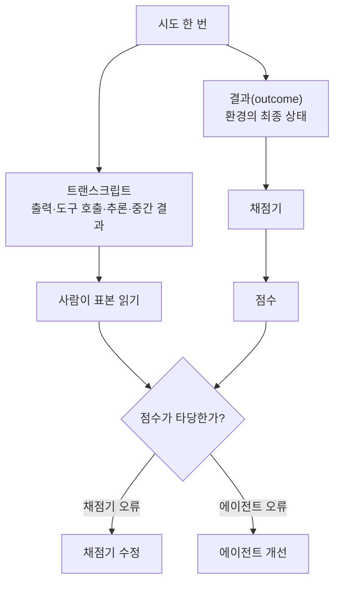
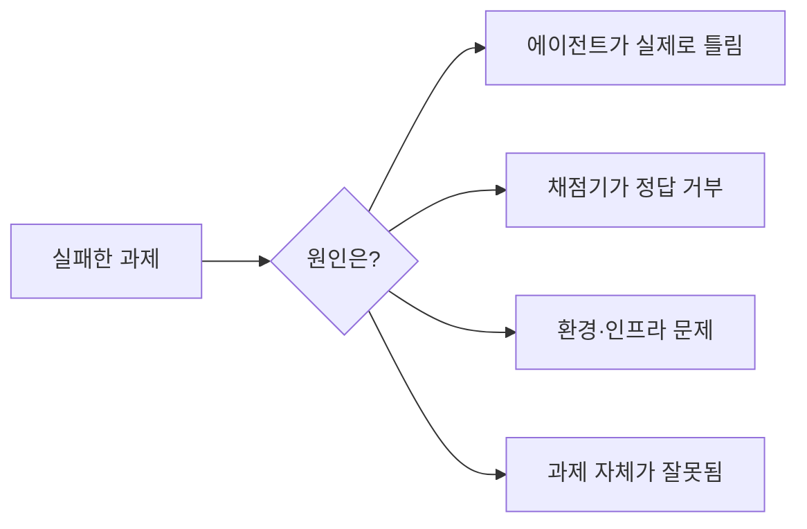

# 평가 트랜스크립트 (실행 기록)

> 에이전트가 한 번 시도한 전 과정(출력, 도구 호출, 추론, 중간 결과)을 남긴 기록. 점수만 보지 말고 이 기록을 직접 읽어야 채점기가 제대로 작동하는지, 에이전트가 왜 실패했는지 알 수 있다.

## 쉽게 말하면
학생의 시험 점수만 보지 말고 답안지를 펼쳐 봐야 한다. 점수가 낮은 이유가 학생이 틀린 것인지, 채점자가 정답을 오답으로 처리한 것인지는 답안지를 읽어야 구별된다. 에이전트 평가에서 답안지에 해당하는 것이 트랜스크립트다.

## 자세히
**용어(Anthropic "Demystifying evals for AI agents" 기준)**
- **트랜스크립트(trace, trajectory)**: 시도 한 번의 "완전한 기록". 출력·도구 호출·추론·중간 결과를 포함한다.
- **결과(outcome)**: 시도 후 환경의 최종 상태. 항공권 예약 에이전트라면 "예약됐다고 말했는가"가 아니라 **데이터베이스에 예약이 실제로 있는가**다.
- **평가 하네스**: 지시·도구를 주고 과제를 동시에 돌리고 각 단계를 기록하고 채점하고 결과를 집계하는 기반 시설([평가 하네스](#eval-harness)).

**채점기 종류**
| 종류 | 예 | 장점 | 약점 |
|---|---|---|---|
| 코드 기반 | 문자열 일치, 이진 테스트, 정적 분석, 도구 호출·결과 점검 | 빠르고 싸고 객관적, 재현 가능 | 유효한 변형에 취약, 뉘앙스에 약함 |
| 모델 기반 | 채점표, 자연어 단정문, 쌍 비교, 다수 판정자 합의 | 유연, 열린 출력 처리 | 비결정적, 비쌈, 사람 기준으로 보정 필요 |
| 사람 | 전문가 검토, 표본 점검, A/B | 최종 기준, 모델 채점기 보정 | 비싸고 느림 |
권고: 가능하면 결정적 채점기, 필요하면 LLM 채점기, 검증에는 사람.

**트랜스크립트를 읽어야 하는 이유**
- "채점기가 잘 작동하는지는 트랜스크립트를 읽어 봐야 안다." 많은 시도의 기록과 점수를 함께 읽는다.
- 실패한 과제에서 **에이전트가 실제로 실수했는지, 채점기가 유효한 해법을 거부했는지**를 가려낸다.
- 에이전트가 낸 **결과물**을 채점하고 **경로**를 엄격히 채점하지 않는다. 단계 순서를 고정해 채점하면 유효한 창의적 접근을 벌한다.

**기록 운영 팁**: 시도마다 고유 ID로 저장, 도구 호출 인자·결과 원문 보관, 민감정보는 마스킹([데이터 마스킹](#data-masking)), 줄 단위 JSON(JSONL)로 남기면 검색·분석이 쉽다. 실패 사례를 유형별로 분류(에이전트 오류/채점기 오류/환경 오류/과제 오류)해 개선 우선순위를 정한다.

**관련 수치(같은 글의 예)**: 시도당 성공률 75%일 때 3번 모두 성공할 확률 pass^3 = 0.75³ ≈ 42%(직접 계산 0.4219). 점수 한 줄이 감추는 일관성 차이를 트랜스크립트와 함께 본다([pass^k](#pass-hat-k-tau-bench)).

## 그림으로 보기

## 예시
- 고객 환불 에이전트 평가 100건 중 12건 실패: 트랜스크립트를 읽어 보니 5건은 에이전트가 정책을 어겼고, 4건은 채점기가 "환불 완료" 표현만 보고 DB 상태를 확인하지 않아 정답을 오답 처리했으며, 3건은 환경 초기화 실패. 수정 후 점수와 개선 방향이 달라진다.
- 교육 활용: 수강생이 에이전트 실행 기록 5개를 읽고 실패 원인 네 가지로 분류하는 실습.

## 헷갈리는 것과 비교
| 개념 | 차이 |
|---|---|
| 트랜스크립트 | 과정 전체의 기록 |
| 결과(outcome) | 환경의 최종 상태(채점의 기준) |
| [평가 하네스](#eval-harness) | 기록·채점·집계를 하는 기반 시설 |
| [LLM 심판](#llm-as-judge) | 트랜스크립트를 읽고 채점하는 모델 기반 채점기 |

## 더 읽을거리
- [Demystifying evals for AI agents (Anthropic)](https://www.anthropic.com/engineering/demystifying-evals-for-ai-agents) — 트랜스크립트·채점기·격리
