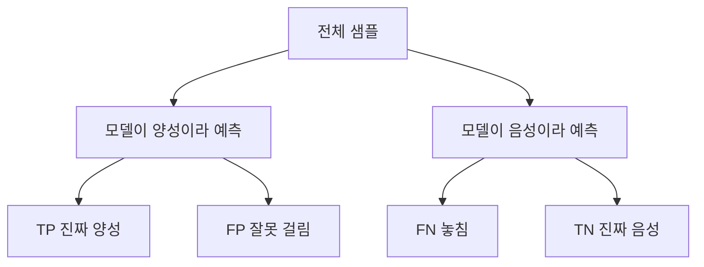
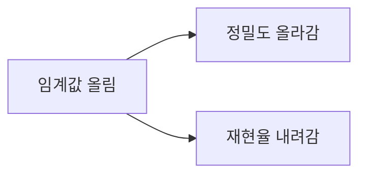

# 정확도·정밀도·재현율

> 정확도는 전체 중 맞힌 비율, 정밀도는 "양성이라 한 것 중 진짜 양성" 비율, 재현율은 "진짜 양성 중 찾아낸" 비율이다. 데이터가 불균형하면 정확도만 보면 속는다.

## 쉽게 말하면
불량품 검사로 보면, 정밀도는 "불량이라고 걸러낸 것 중 진짜 불량 비율", 재현율은 "전체 진짜 불량 중 걸러낸 비율"이다. 의심을 많이 하면 불량을 놓치진 않지만(재현율↑) 멀쩡한 걸 많이 버린다(정밀도↓).

## 자세히
Google ML Crash Course 기준(TP·TN·FP·FN = 진양성·진음성·위양성·위음성):
- 정확도 = (TP+TN)/(TP+TN+FP+FN)
- 재현율(recall, 진양성률) = TP/(TP+FN)
- 정밀도(precision) = TP/(TP+FP)
- **정확도의 함정**: 양성이 약 1%인 불균형 데이터에서 항상 음성이라 답하는 모델도 정확도가 약 99%다. 하지만 양성을 하나도 못 찾는다. 이럴 땐 재현율·정밀도가 낫다.
- **트레이드오프**: 둘 다 분류 임계값에 따라 변한다. 임계값을 올리면 위양성이 줄어 정밀도↑, 위음성이 늘어 재현율↓. 반대도 마찬가지다. 위음성이 더 치명적인지(암 검진) 위양성이 더 치명적인지(스팸 필터가 중요 메일을 막음)로 균형을 정한다.
- 이 지표들은 사람이 성능을 볼 때 쓰며, 학습의 목표인 [손실 함수](#loss-function)와는 다르다. LLM 평가는 [AI 평가·벤치마크](#ai-evaluation) 가지에서 다룬다.

## 그림으로 보기

## 예시
- 1,000건 중 양성 10건. 모델이 8건을 찾고 오탐 2건이면 TP=8, FP=2, FN=2 → 정밀도 80%, 재현율 80%.
- 같은 데이터에서 항상 "음성"이라 답하면 정확도 99%, 재현율 0%.

## 헷갈리는 것과 비교
| 지표 | 묻는 것 |
|---|---|
| 정확도 | 전체에서 얼마나 맞혔나 |
| 정밀도 | 양성이라 한 것을 믿을 수 있나 |
| 재현율 | 진짜 양성을 얼마나 놓치지 않았나 |

## 더 읽을거리
- [Google ML Crash Course: Accuracy, precision, and recall](https://developers.google.com/machine-learning/crash-course/classification/accuracy-precision-recall) — 정의와 불균형 데이터 사례.
