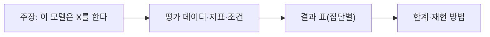
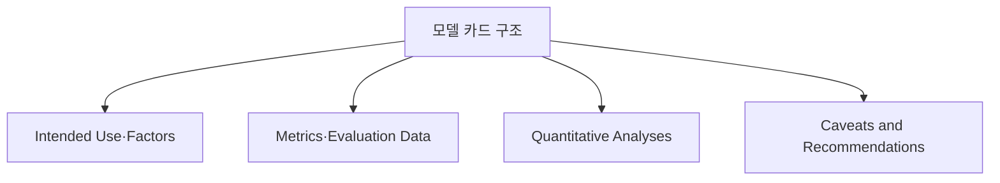

# 평가 보고서

> 시스템 카드·모델 카드에서 "이 모델이 이런 능력·위험이 있다"는 주장을 재현 가능한 근거(데이터·지표·조건·결과)와 함께 설명하는 부분이다.

## 쉽게 말하면
성적표에 "수학 우수"라고만 쓰는 대신 어떤 시험을 어떤 조건에서 봤고 몇 점이었는지 적는 것이다. 읽는 사람이 같은 시험을 다시 볼 수 있어야 한다.

## 자세히
(Mitchell 외 "Model Cards for Model Reporting" arXiv 1810.03993과 Anthropic Claude Opus 4.1 시스템 카드 부록(2025년 8월, 8쪽)을 하위 에이전트가 원문으로 읽은 노트 기준. 예시 카드의 수치는 읽지 않았다.)
- **모델 카드 항목**: Model Details, Intended Use, Factors, Metrics, Evaluation Data, Training Data, **Quantitative Analyses(단일·교차)**, Ethical Considerations, Caveats and Recommendations.
- **시스템 카드 예(Opus 4.1 부록)**: 안전장치 결과, 에이전트 안전성, 자동 감사(모델당 1,160개 대화 기록, 시드 지시 290개, 평가 기준 8개), RSP 평가를 다룬다. Opus 4.1은 ASL-3로 배포되며 자동화된 평가만 사용했다고 서술.
- **좋은 평가 보고서의 요소(제안)**: ① 주장 한 줄 ② 평가 데이터·방법·지표 ③ 실행 조건(안전장치 ON/OFF, 시스템 프롬프트, 날짜·버전) ④ 결과 표(집단별) ⑤ 한계와 불확실성 ⑥ 재현 방법.
- **한계**: 보고서가 있다고 독립 검증이 된 것은 아니다([자기 보고 vs 독립 평가](#self-reported-vs-independent-eval)).

## 그림으로 보기

## 예시
- 사내 모델 보고서에 "한국어 요약 정확도 0.87(평가 세트 v3, 2026-11)"처럼 조건을 적는다.
- 교육 활용: 시스템 카드의 평가 항목을 직접 읽고 주장과 근거를 짝짓는 실습.

## 헷갈리는 것과 비교
| 개념 | 차이 |
|---|---|
| 평가 보고서 | 주장+근거의 재현 가능한 설명 |
| 벤치마크 점수표 | 점수만 나열 |
| [시스템 카드](#system-cards) | 보고서가 들어가는 상위 문서 |

## 더 읽을거리
- [Model Cards for Model Reporting (arXiv 1810.03993)](https://arxiv.org/abs/1810.03993) — 카드 항목.
