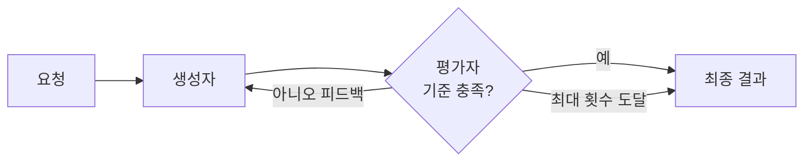

# 평가자-최적화 루프

> 한 LLM이 답을 만들고 다른 LLM이 평가·피드백을 주는 과정을 기준을 넘을 때까지 반복하는 워크플로 패턴.

## 쉽게 말하면
글쓰기 수업의 초고와 첨삭이다. 학생이 쓰고 선생님이 "근거가 약하다"고 고쳐 주면 다시 쓴다. 기준(루브릭)이 분명할수록 몇 번 돌면 글이 좋아진다.

## 자세히
Anthropic "Building effective agents" 기준:
- 정의: 한 호출이 응답을 생성(generator)하고 다른 호출이 평가·피드백(evaluator)을 주는 반복 루프.
- 적합 신호 둘: ① 사람이 피드백하면 응답이 실제로 나아진다, ② LLM이 그런 피드백을 스스로 줄 수 있다.
- 예: 문학 번역(평가자가 뉘앙스 누락 지적), 여러 번 검색해야 하는 조사(평가자가 더 찾아야 할지 판단).
- **종료 조건**이 필수다: 통과 점수, 최대 반복 횟수. 없으면 비용이 무한히 든다([에이전트 비용·지연](#agent-cost-latency)).
- 평가자는 [LLM 심사위원](#llm-as-judge)과 같은 편향 위험이 있다. 가능하면 테스트·린터 같은 결정적 검사를 섞는다([에이전트 검증 루프](#agent-verification)).

## 그림으로 보기

## 예시
- 영업 메일 초안 → 평가자가 "톤·길이·CTA" 루브릭으로 점수 → 80점 미만이면 수정 지시와 함께 재생성(최대 3회).
- 코드 생성 → 테스트 실행 결과를 피드백으로 재시도.

## 헷갈리는 것과 비교
| 개념 | 차이 |
| --- | --- |
| 평가자-최적화 | 생성 후 피드백으로 반복 개선 |
| [LLM 심사위원](#llm-as-judge) | 점수만 매김. 루프 없이 평가 용도 |
| [프롬프트 체이닝](#prompt-chaining) | 한 방향 단계. 되돌아가지 않음 |

## 더 읽을거리
- [Building effective agents (Anthropic)](https://www.anthropic.com/engineering/building-effective-agents) — 패턴 정의와 적합 신호
