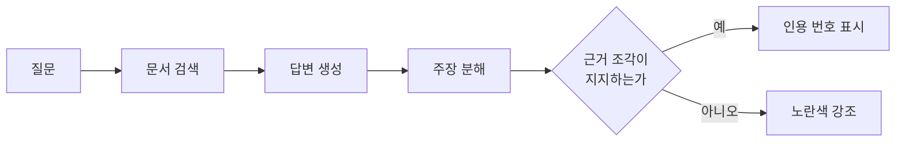

# 근거 일치도 표시

> AI가 "얼마나 확신하는지" 대신 "답이 가져온 근거 문서와 얼마나 맞는지"를 보여 주는 방식. 근거 인용과 문장별 지지 여부 표시가 대표적이다.

## 쉽게 말하면
논문 심사에서 "저자가 자신 있다고 말함"보다 "각주마다 출처가 달려 있음"이 더 믿을 만하다. 말투가 아니라 증거 연결을 보여 주는 것이다.

## 자세히
- **방식 ①: 문장·주장별 근거 점검.** 응답을 개별 주장(claim)으로 쪼개 검색된 문서 조각에 지지되는지 확인하고, 지지되지 않은 주장은 노란색 등으로 강조한다. Contextual AI 문서가 이 방식을 설명한다(`calculate_groundedness` 옵션, 기본 꺼짐).
- **방식 ② 인용 번호.** 문장 옆 위첨자 번호를 누르면 원문이 열린다. 문장 중 인용으로 추적되는 비율을 groundedness로 정의하는 도구도 있다(rag-eval 문서).
- **방식 ③ 종합 점수.** 출처 품질·검색 관련도·모델 확신을 합친 점수. 0.5 미만은 주의 같은 기준은 구현체의 휴리스틱이지 보정된 확률이 아니다.
- **장점**: 사용자가 직접 원문을 확인할 수 있어 [사용자 과의존](#user-overreliance)을 줄인다. 모델이 말하는 확신(말로 표현한 확신)보다 검증 가능하다.
- **한계**: 근거와 "일치"해도 근거 자체가 틀렸거나 오래됐을 수 있다. 일치도를 판정하는 모델도 틀린다. 수치를 사용자에게 보일지는 합의가 없으며 감사 기록용으로만 쓰자는 의견도 있다.

## 그림으로 보기

## 예시
- 사내 규정 챗봇: 답변 문장마다 [1][2] 링크, 근거 없는 문장은 회색 + "확인되지 않음".
- 평가 팀은 답변 100건에서 지지되는 주장 비율을 측정해 RAG 품질 지표로 쓴다.

## 헷갈리는 것과 비교
| 개념 | 차이 |
|---|---|
| 근거 일치도 | 답과 검색 근거의 관계 |
| [AI 확신도 표시](#ai-confidence-display) | 모델 자신의 확신 표시 |
| [환각](#hallucination) | 근거 없는 내용 생성(일치도가 낮은 상태) |

## 더 읽을거리
- [Contextual AI: enable groundedness score](https://docs.contextual.ai/reference/enable-groundedness-score) — 주장 단위 근거 점검과 UI 강조
- [Responsible RAG for Climate Decision Making](https://arxiv.org/pdf/2410.23902) — 평가 점수를 응답 후 실시간으로 표시하는 UI(검색 요약만 확인)
