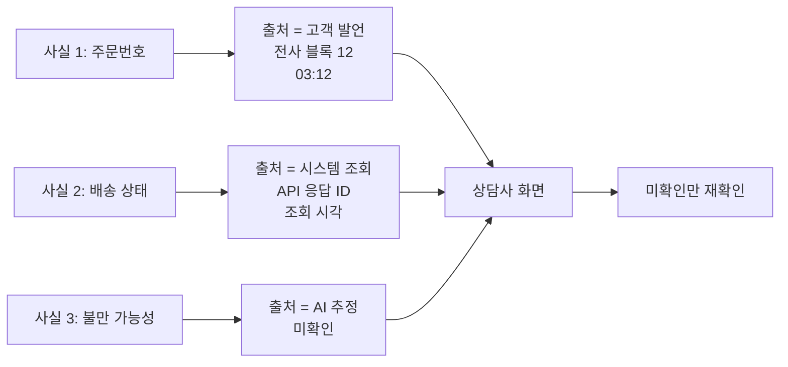

# 근거 출처 태그 (Evidence Provenance Tags)

> 이관 메시지나 요약 속 **각 사실에 "어디서 온 정보인지(출처)와 언제 얻었는지(시각)"를 붙이는 것**. 받는 사람이 사실을 믿어도 되는지, 다시 확인해야 하는지 판단할 수 있게 한다.

## 쉽게 말하면
기사 속 문장마다 각주가 달려 있으면 독자가 직접 확인할 수 있다. 인수인계 메모도 "고객이 직접 말함(통화 03:12)"과 "AI가 추정"을 구분해 적어야 받는 사람이 무엇을 다시 물을지 안다.

## 자세히
출처: Claude API Citations 문서(본문 확인, [원문 링크형 요약](#source-linked-summary)에서 정리)와 KCS 문서 상태([출처 문서 소유자](#source-article-ownership)). 태그 설계는 제안이다.
- **구조적 근거 연결의 예(Citations)**: 문서 위치(문자 범위·페이지·블록 인덱스)를 응답에 구조화해 돌려주고 인용 원문은 출력 토큰으로 세지 않는다. 이관 요약의 사실마다 전사 구간을 연결하는 기반이 된다.
- **태그 항목(제안)**: `source_type`(고객 발언 / 상담사 입력 / 시스템 조회 / AI 추정), `source_ref`(전사 블록 번호·문서 ID·API 응답 ID), `observed_at`(시각), `confidence`(확인됨 / 미확인), `verified_by`(사람·시스템).
- **쓰임**: 받는 사람이 "AI 추정" 항목만 재확인, 오래된 시스템 조회 값은 다시 조회, 문서 출처는 KCS 상태(검증됨)를 함께 표시.
- **환각 억제**: 출처 없는 사실은 요약에서 제외하거나 "미확인"으로 표시한다. 인용이 있다는 것이 주장이 옳다는 보증은 아니므로 샘플 검수가 필요하다([요약 충실도 점수](#summary-faithfulness-score)).
- **시각의 중요성**: 계좌 잔액·주문 상태처럼 변하는 값은 조회 시각이 없으면 낡은 값을 믿을 수 있다.
- **검증**: 이관 경계에서 필수 태그 존재를 검사([이관 경계 검증](#handoff-boundary-validation)).
- **한계**: 태그가 많으면 화면이 복잡해진다. 위험 정보·금액·약속에만 우선 적용한다.

## 그림으로 보기


## 예시
```json
{"fact": "주문번호 12345", "source_type": "customer_utterance", "source_ref": "block:12",
 "observed_at": "2026-11-18T14:03:12+09:00", "verified_by": null}
```
교육 활용: 자사 이관 요약 한 건의 모든 사실에 출처 유형을 붙여 보고 "AI 추정"이 몇 개인지 세어 보는 실습.

## 헷갈리는 것과 비교
| 개념 | 차이 |
|---|---|
| 출처 태그 | 사실마다 출처·시각 기록 |
| [원문 링크형 요약](#source-linked-summary) | 요약 문장을 전사 구간에 연결 |
| [권한 범위 명시](#authorization-scope) | 받는 쪽이 할 수 있는 일 |
| 데이터 계보(lineage) | 데이터가 거쳐 온 경로 전체 |

## 더 읽을거리
- [Claude Citations 문서](https://platform.claude.com/docs/en/build-with-claude/citations) — 인용 형식과 위치 지정
