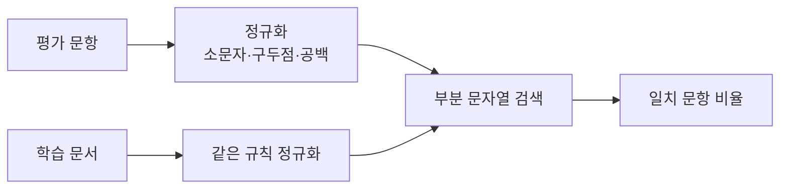
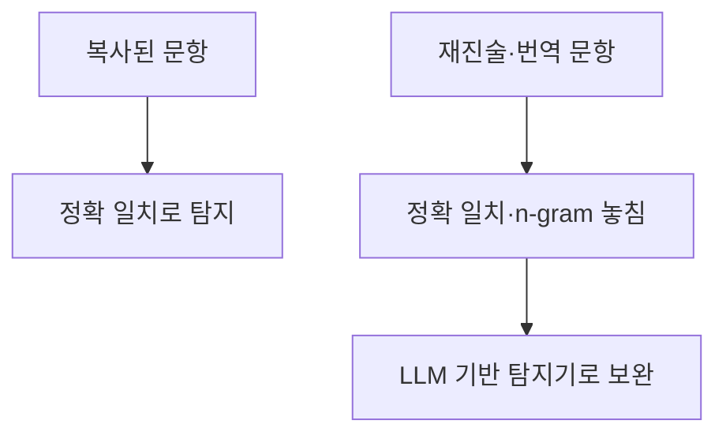

# 정확 일치 오염 측정

> 평가 문제를 **대소문자·구두점·공백을 정리(정규화)한 뒤 학습 문서와 문자열이 정확히 같은지** 확인해 겹침을 세는 가장 단순한 오염 탐지법. 빠르고 기준이 분명하지만 말만 바꾼 문제는 못 잡는다.

## 쉽게 말하면
시험 문제가 족보에 그대로 실려 있는지 "복사 붙여넣기" 수준으로 대조하는 것이다. 글자 하나만 달라도 놓치므로 대소문자와 쉼표 정도는 먼저 통일해 둔다. 문제를 다른 말로 풀어 쓰면 이 방법으로는 절대 찾지 못한다.

## 자세히
- **정확 일치의 위치**: 연속 N단어가 겹치는지 보는 [n-그램 겹침](#ngram-overlap-contamination)의 가장 엄격한 형태(N을 문항 전체 길이로 잡은 것)로 이해하면 된다. GPT-3 논문은 정규화로 구두점·공백·대소문자를 무시하고 겹침을 계산했다(arXiv 2005.14165 부록 C, 직접 읽음). GPT-4 보고서는 50글자 겹침을 오염 기준으로 쓴다고 위 논문들이 인용한다(Yang 외 논문 요약, 원문 미확인).
- **절차**: ① 평가 문항과 학습 문서 모두 같은 규칙으로 정규화 ② 문항 전체(또는 정답 포함 문자열)가 학습 문서에 부분 문자열로 있는지 검색 ③ 겹친 문항 비율을 보고하고 clean/dirty로 나눠 성능 비교.
- **재진술에 약하다(Yang 외, "Rethinking Benchmark and Contamination for Language Models with Rephrased Samples", arXiv 2311.04850; LMSYS 블로그, 직접 읽음)**: 평가 문제를 바꿔 쓰거나 번역해서 학습시키면 n-gram 겹침이나 임베딩 유사도 검색이 이를 잡지 못했다. 이런 변형 데이터로 학습한 13B 모델이 MMLU·GSM-8K·HumanEval에서 GPT-4 수준 점수를 냈고, 그 MMLU 점수는 85.9였다(블로그 주장). 제안된 LLM 기반 탐지기(가장 비슷한 학습 항목을 찾은 뒤 GPT-4 같은 모델이 재진술 여부를 판정)는 저자들의 200쌍 MMLU 테스트에서 F1이 가장 높았다. 저자들은 CodeAlpaca, MATH, StarCoder-Data에서 재진술된 평가 항목이 발견됐다고 보고한다. 구체적 오염 비율은 블로그 텍스트에 없었다. 논문 초록에서는 HumanEval의 8~18%가 RedPajama·StarCoder 데이터와 겹친다고 한다(검색 요약).
- **언제 쓰면 좋은가**: 1차 필터로 싸고 빠르게. 정확 일치로 먼저 확인된 오염은 확실한 하한선이다. 정확 일치 0%는 "오염 없음"이 아니라 "복사 오염은 없음"일 뿐이다.
- **정규화 선택이 결과를 바꾼다**: 숫자 서식, 유니코드 공백, 따옴표 종류까지 통일하지 않으면 같은 문장이 다르게 보인다(제안).

## 그림으로 보기

## 예시
| 평가 문항 상태 | 정확 일치 탐지 |
|---|---|
| 학습 문서에 그대로 실림 | 탐지 |
| 쉼표·대소문자만 다름 | 정규화하면 탐지 |
| 같은 뜻을 다르게 풀어 씀 | 놓침 |
| 영어 문항을 한국어로 번역 | 놓침 |
- 업무 장면: 직접 만든 사내 평가 문제를 챗봇 학습 로그와 정확 일치 검색한 뒤, 0건이어도 "비슷한 문제가 있었는지" 사람 눈으로 몇 개 확인한다.

## 헷갈리는 것과 비교
| 개념 | 차이 |
|---|---|
| 정확 일치 | 정규화한 문자열이 같은가 |
| [n-그램 겹침](#ngram-overlap-contamination) | 연속 N단어만 같아도 겹침 |
| LLM 기반 탐지 | 의미가 같은 재진술까지 판정, 비용이 큼 |
| [코퍼스 속 벤치마크 오염](#benchmark-contamination-in-corpus) | 이 방법들이 다루는 문제 |

## 더 읽을거리
- [Rethinking Benchmark and Contamination with Rephrased Samples (arXiv 2311.04850)](https://arxiv.org/abs/2311.04850) — 재진술이 문자열 탐지를 피하는 사례(초록·블로그 확인).
- [LMSYS: Catch me if you can! (블로그)](https://www.lmsys.org/blog/2023-11-14-llm-decontaminator) — LLM 탐지기와 MMLU 실험(직접 읽음).
- [Language Models are Few-Shot Learners (arXiv 2005.14165)](https://arxiv.org/abs/2005.14165) — 정규화 후 겹침 계산(직접 읽음).
