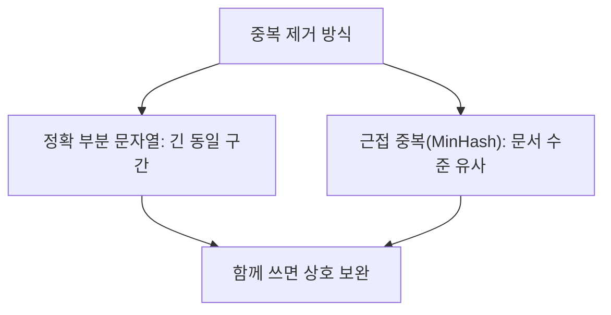

# 정확 부분 문자열 제거

> 학습 데이터 전체에서 일정 길이 이상(예: 50 토큰) 그대로 반복되는 구간을 접미사 배열(suffix array)로 찾아 지우는 중복 제거 방법이다. 문서 전체가 비슷하지 않아도 문서 속 긴 상용구·인용·약관 같은 반복 구간을 제거한다.

## 쉽게 말하면
수천 권의 책을 한 줄로 이어 붙인 뒤, "50글자 이상 똑같이 반복되는 문장"을 전부 표시해 지우는 일이다. 책 전체가 다르더라도 면책 문구·저작권 고지가 수만 번 붙어 있으면 잡힌다.

## 자세히
(Lee 등 「Deduplicating Training Data Makes Language Models Better」(arXiv 2107.06499)의 ar5iv 본문을 직접 열어 확인.)
- **방법(ExactSubstr)**: 모든 예제를 하나의 시퀀스로 이어 접미사 배열을 만들고, 선형 스캔으로 **길이 임계값 이상의 접두사를 공유하는 인접 접미사**를 찾아 반복 구간을 제거한다.
- **임계값**: 50 BPE 토큰. 10토큰 이하 일치는 매우 흔해서 보수적으로 50으로 정했다.
- **비용**: 토큰당 약 8바이트, 대략 8배 메모리 오버헤드. 데이터 전체가 메모리에 올라가야 하지만 접미사 배열은 디스크에서 스트리밍 가능. 350GB C4의 접미사 배열은 약 1.5TB. Rust로 만든 병렬 분할 정복 구현으로 Wiki-40B(약 4GB)는 96코어·768GB RAM에서 2.3분, C4는 약 12시간 미만(약 1,000 CPU-시간), 그 뒤 제거 작업은 1시간 미만.
- **제거된 비율**
  | 데이터 | ExactSubstr(토큰) | NearDup(예제) |
  |---|---|---|
  | C4 | 7.18% | 3.04% |
  | RealNews | 19.4% | 13.63% |
  | LM1B | 0.76% | 4.86% |
  | Wiki-40B | 2.76% | 0.39% |
- **암기 감소**: 무프롬프트 생성 10만 건에서 50토큰 암기 구간에 속한 토큰 비율 — 원본 모델 1.926%(1에폭) → ExactSubstr 0.138%, NearDup 0.189%. 약 10배 감소(논문 표).
- 초록: C4에서 61단어 문장 하나가 6만 번 넘게 반복. 검증 세트 4% 이상에서 학습-시험 겹침.
- 한계(제안): 구현이 무겁다(전체 데이터가 메모리에). 한 글자만 달라도 일치가 끊기므로 약간 바뀐 반복은 [MinHash·LSH](#minhash-lsh) 같은 근접 중복 탐지가 보완한다.

## 그림으로 보기

## 예시
- 웹 크롤링 코퍼스에서 모든 페이지에 붙은 쿠키 동의문·푸터 문구 같은 긴 상용구를 지운다.
- 사내 문서 LLM 학습: 양식 문서의 반복 서식 문구가 모델에 암기되는 것을 줄인다.

## 헷갈리는 것과 비교
| 개념 | 차이 |
|---|---|
| 정확 부분 문자열 제거 | 임계 길이 이상의 동일 구간을 정확히 찾아 제거 |
| [MinHash·LSH](#minhash-lsh) | 문서가 비슷한지(자카드) 근사해 후보 탐지 |
| 문서 단위 정확 중복 제거 | 문서 전체가 같은 것만 제거 |
| [근접 중복 제거](#near-duplicate-removal) | 두 방식을 포괄하는 상위 개념 |

## 더 읽을거리
- [Deduplicating Training Data Makes Language Models Better — ar5iv 본문](https://ar5iv.labs.arxiv.org/html/2107.06499) — ExactSubstr·NearDup 방법·비용·표(열어 확인).
- [arXiv 초록](https://arxiv.org/abs/2107.06499) — 61단어 문장 6만 회, 암기 10배 감소(열어 확인).
