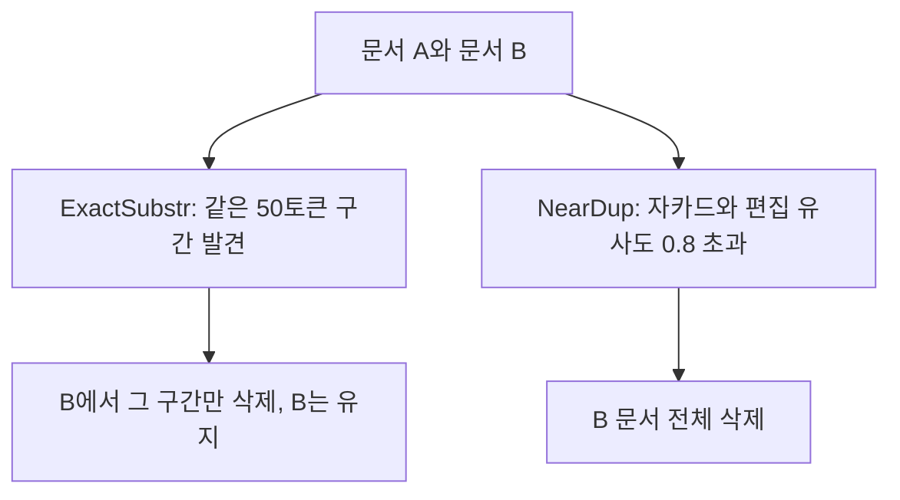

# ExactSubstr vs NearDup

> Lee 외(2021)의 두 중복 제거 방식. ExactSubstr는 50토큰 이상 똑같은 **구간만 도려내고**, NearDup은 MinHash로 비슷하다고 판정된 **문서를 통째로** 지운다. 둘은 겹치지만 서로 놓치는 것이 다르다.

## 쉽게 말하면
표절 처리 방식이 둘이다. A는 보고서에서 남의 글과 똑같은 문단만 빨간 줄로 지운다(ExactSubstr). B는 "이 보고서는 거의 복사본"이라 판단하면 보고서 한 편을 통째로 버린다(NearDup). 양식만 같고 칸의 내용이 조금씩 다른 문서는 B가 더 잘 잡고, 긴 글 속 한 문단만 복사된 경우는 A가 더 잘 잡는다.

## 자세히
(ar5iv 본문 확인, 수치는 저자 보고, C4 기준)

| | ExactSubstr | NearDup |
|---|---|---|
| 지우는 것 | 50 BPE 토큰 이상 일치 구간(문서는 남음) | 근접 중복으로 판정된 문서 전체 |
| 탐지 | 접미사 배열([접미사 배열](#suffix-array)) | MinHash 5-gram, 서명 9,000, b=20·r=450, 편집 유사도 0.8 초과 확정([편집 유사도](#edit-similarity)) |
| C4에서 제거량 | 학습 토큰 7.18% | 학습 예제 3.04% |
| 계산 비용 | 350GB에 12시간 미만(약 1,000 CPU시간), 색인 1.5TB | C4에서 약 41.5kWh(구글 구현) |
| 암기(무프롬프트, 1/2에폭) | 0.138% / 0.168% | 0.189% / 0.264% (원본 1.926% / 1.571%) |

- **겹침**: NearDup이 지운 C4 예제의 77%에는 50토큰 일치가 하나 이상 있었다. 반대 방향 비율은 논문이 보고하지 않는다.
- **암기 감소**는 둘 다 약 10배. 중복 학습 예제를 프롬프트로 줬을 때는 ExactSubstr의 암기율이 더 높았다(1에폭 5.71% vs 3.34%). 그래서 어느 한쪽이 낫다고 못 박기 어렵다.
- **장단점(저자)**: ExactSubstr는 부분 중복을 잡고 더 많이 지우지만 짧은 문서에 약하고(LM1B는 문서 90%가 50토큰 미만이라 NearDup의 약 1/8만 제거) 공유 구간을 지우면 출처 표기 등이 사라질 수 있다. NearDup은 양식형 문서를 잘 잡지만 문서를 통째로 버리고 계산이 더 든다.
- 저자 결론: 구체적 기법보다 **처음부터 엄격하게 중복을 제거하는 것**이 중요하다. 두 방식의 임계값이 달라 세부 비교는 조심해야 한다.

## 그림으로 보기

## 예시
- 법률·계약 양식처럼 칸만 다른 문서 다량: NearDup 먼저.
- 장문 블로그에 끼워 넣어진 같은 광고 문단: ExactSubstr.
- 교육: 같은 문서 쌍에 두 방식을 적용한 결과를 비교해 보게 한다. 다만 위 순서는 제안이며 논문이 권한 순서는 아니다.

## 헷갈리는 것과 비교
| 개념 | 차이 |
|---|---|
| [근접 중복 제거](#near-duplicate-removal) | 두 방식을 포괄하는 상위 개념 |
| [50토큰 임계](#dedup-threshold-50-tokens) | ExactSubstr의 최소 일치 길이 |
| [Lee 2021 논문](#lee-2021-dedup-paper) | 두 방식을 제시한 논문 전체 |

## 더 읽을거리
- [Deduplicating Training Data Makes Language Models Better — ar5iv](https://ar5iv.labs.arxiv.org/html/2107.06499) — 두 방식 비교표와 부록(열어 확인).
