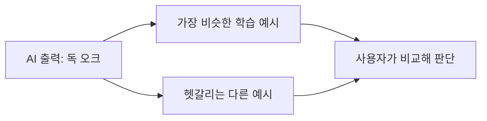

# 예시 기반 설명

> 모델이 학습한 **비슷한 예시를 보여 주어** 사용자가 출력이 맞는지 스스로 판단하게 하는 설명 방식이다. 추론 과정이 설명하기 어려울 때 쓴다.

## 쉽게 말하면
"이 식물은 독 오크입니다"라고만 하지 않고, 독 오크 사진 여러 장과 헷갈리는 다른 잎 사진을 나란히 보여 주는 것이다. 사용자는 사진을 비교해 보며 스스로 판단한다.

## 자세히
(Google PAIR "Explainability + Trust" 챕터를 직접 읽었다.)
- **정의(PAIR)**: 모델의 학습 세트에서 **관련 예시**를 보여 주어 사용자가 출력을 직접 판단하게 한다. 추론을 말로 설명하기 어려울 때 유용하나 **사용자가 예시를 분석해야** 한다는 부담이 있다.
- **특정 출력용**: 독 오크 판정과 함께 가장 비슷한 독 오크 이미지, 비슷한 다른 잎 이미지를 보여 줌.
- **일반 시스템용**: AI가 자주 틀리는 예시와 잘 처리하는 예시를 보여 줌.
- **다른 설명 방식과 비교(PAIR)**: 데이터 출처(회귀처럼 단순한 모델은 중요한 입력 표시), 반사실(왜 다른 예측이 아닌지), 상호작용(what-if 시험), 데이터 사용(범위·도달·삭제).
- **한계**: 예시 선택이 편향되면 오해를 줄 수 있다(해석, 문서가 직접 말하지는 않음). 사용자 분석 능력에 의존한다.

## 그림으로 보기

## 예시
- 문서 검수 AI가 "이 계약서는 위험 조항 포함"이라고 할 때 과거에 비슷했던 위험 계약 조항 3개를 함께 보여 준다(제안).
- 교육 소재: 같은 AI 답을 설명 없음·점수·예시 세 방식으로 보여 주고 사용자 판단이 어떻게 달라지는지 비교.

## 헷갈리는 것과 비교
| 개념 | 차이 |
|---|---|
| 예시 기반 설명 | 비슷한 학습 예시를 제시 |
| [국소 설명(속성 기여도)](#local-explanation-limits) | 속성별 기여도를 제시 |
| 반사실 설명 | 다른 예측이 안 나온 이유 |
| [부분 설명](#partial-explanation) | 설명 범위를 선택 |

## 더 읽을거리
- [Google PAIR — Explainability + Trust](https://pair.withgoogle.com/chapter/explainability-trust/) — 직접 읽음.
