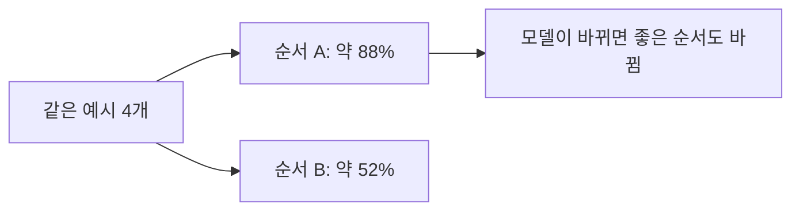

# 예시 순서 민감성

> few-shot 프롬프트에서 **같은 예시들을 순서만 바꿔도** 정확도가 거의 무작위에서 최고 수준까지 달라지는 현상이다.

## 쉽게 말하면
같은 문제집을 1장부터 풀 때와 마지막 장부터 풀 때 성적이 크게 달라지는 것이다. 문제도 사람도 같은데 순서만 바꿨는데 결과가 다르다.

## 자세히
(Lu 외, "Fantastically Ordered Prompts and Where to Find Them"(arXiv 2104.08786) PDF를 직접 읽었다. 2021년 GPT-2/GPT-3 시대 실험이라 최신 모델에 그대로 적용된다고 보장하지 않는다.)
- **발견(논문)**: 샘플 순서에 따라 성능이 **최신 수준에서 무작위 추측 수준**까지 달라진다. SST-2 감성 분류에서 어떤 순열은 지도학습에 가까운 **85% 이상**, 어떤 것은 **약 50%**. 한 순열이 88.7%에서 51.6%로 떨어지는 경우도 보고.
- **설정**: 4개 샘플(균형 분포) 24가지 순열, GPT-2(0.1B~1.5B)와 GPT-3(2.7B~175B).
- **성질(논문)**: ① 모델 크기와 무관하게 존재(가장 큰 모델도) ② 특정 샘플 부분집합에 한정되지 않음 ③ **한 모델에서 좋은 순서가 다른 모델로 전이되지 않음**. 좋은 순서의 공통 분모를 찾지 못했다.
- **해결 시도(논문)**: 개발용 라벨 데이터 없이, 언어 모델이 **스스로 생성한 레이블 없는 probing 집합**에서 예측 레이블 분포의 **엔트로피 통계**로 좋은 순열을 고른다. GPT 계열에서 11개 텍스트 분류 과제 평균 **13% 상대 향상**.
- **상충 주장(이전 정리 글의 검색 요약)**: 어떤 연구는 순서보다 예시 선택 효과가 더 크다고 보고한다. 이 글은 그 논문을 읽지 않았다.

## 그림으로 보기

## 예시
- 프롬프트 개선이 효과 있는지 볼 때 순서를 여러 개로 섞어 평균과 분산을 함께 보고(제안), 한 번의 우연한 순서에 의존하지 않는다.

## 헷갈리는 것과 비교
| 개념 | 차이 |
|---|---|
| 순서 민감성 | 같은 예시의 순서에 따른 성능 편차 |
| [kNN 선택](#knn-example-retrieval) | 어떤 예시를 고를지 |
| [MMR](#mmr-diversity) | 다양성 있는 선택 |

## 더 읽을거리
- [Lu et al. (2021) — Fantastically Ordered Prompts](https://arxiv.org/abs/2104.08786) — 직접 읽음.
