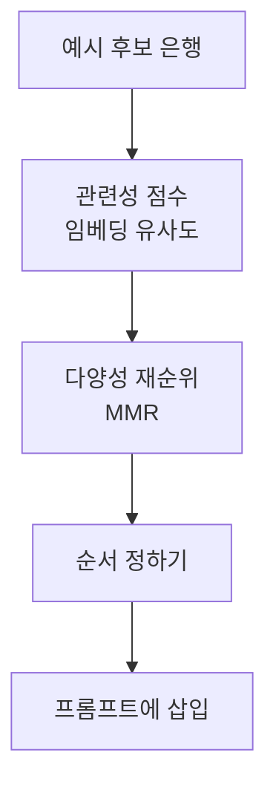
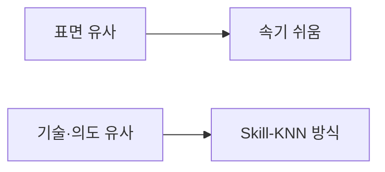

# 예시 고르기

> few-shot 프롬프트에 넣을 예시를 관련성·다양성·경계 사례 기준으로 고르고 순서를 정하는 일. 같은 개수의 예시라도 무엇을 어떻게 고르느냐에 따라 결과가 크게 달라진다.

## 쉽게 말하면
신입에게 사례집을 보여 줄 때, 지금 하려는 일과 닮은 사례를 먼저 고르되 같은 유형만 5개 주지 않고 서로 다른 요령이 드러나는 사례를 섞어 주는 것과 같다.

## 자세히
- **관련성 기준(kNN)**: 테스트 입력과 의미가 가까운 예시를 임베딩 유사도로 뽑는 방식이 대표적이다(KATE 계열, 검색 요약 기준).
- **표면 특징에 속는 문제**: 사전학습 임베딩은 과제와 무관한 문장 표면 특징에 쉽게 끌린다. Skill-KNN(arXiv 2305.14210, 초록 열람)은 입력을 "필요한 기술 설명"으로 다시 쓴 뒤 임베딩해 이를 줄인다. 학습이나 미세조정 없이 쓰므로 예시 은행이 자주 바뀌는 경우에 맞고, 5개 교차 도메인 의미 파싱 데이터셋·6개 모델에서 기존 선택법을 유의하게 앞섰다고 보고.
- **다양성(MMR)**: Complementary Explanations 논문(arXiv 2211.13892, 초록 열람)은 관련성과 상호 보완성을 함께 고려하는 MMR 기반 선택이 서로 다른 추론 기술을 보여 주는 예시들 덕에 개별적으로 관련 높은 예시 묶음보다 나을 수 있고, 3개 실제 과제·여러 LLM에서 성능이 올랐다고 보고한다. 관련성과 다양성의 가중치(λ)를 조절한다는 점은 검색 요약 기준이다.
- **순서 민감성(검색 요약 기준, 원문 미열람)**: 초기 연구는 GPT-3에서 예시 순서만 바꿔도 정확도가 수십 %p 달라진다고 보고했고, 한 논문은 좋은 예시도 순서가 나쁘면 약하다고 주장한다. 다른 논문은 순서를 바꾸는 효과보다 예시 자체를 잘 고르는 효과가 더 크다고 보고해 결과가 엇갈린다.
- **개수**: Delta-KNN 연구는 이 연구 조건에서 N=4 근처에서 최고였다고 보고하나 일반 규칙은 아니다.
- **경계 사례**: 실패하기 쉬운 경계 사례를 일부 넣는 것은 실무 관행이며 위 논문들이 직접 시험한 것은 아니다.
- 결론: 우리 과제와 모델에서 직접 비교해야 한다.

## 그림으로 보기

## 예시
- 고객 문의 분류: 각 분류당 비슷한 예시 1개와 헷갈리는 경계 예시 1개를 섞어 총 6개를 넣음.
- 교육 실습: 같은 질문에 예시 4개를 (a) 무작위 (b) 유사도 순 (c) 유사+다양 섞어 넣고 정답률을 비교.

## 헷갈리는 것과 비교
| 개념 | 차이 |
|---|---|
| 예시 고르기 | 프롬프트에 넣을 예시를 선택·정렬 |
| [예시를 학습 데이터로](#examples-to-training-data) | 예시를 파인튜닝 데이터로 확장 |
| [프롬프트 토큰 비용](#prompt-token-cost) | 예시가 길어질 때의 비용 |
| [질문·정답 세트 먼저 만들기](#eval-set-first) | 어떤 선택이 나은지 재는 기준 |

## 더 읽을거리
- [Skill-Based Few-Shot Selection (arXiv 2305.14210)](https://arxiv.org/abs/2305.14210) — Skill-KNN(초록 열람)
- [Complementary Explanations for Effective ICL (arXiv 2211.13892)](https://arxiv.org/abs/2211.13892) — MMR 기반 선택(초록 열람)
