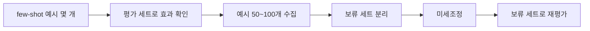
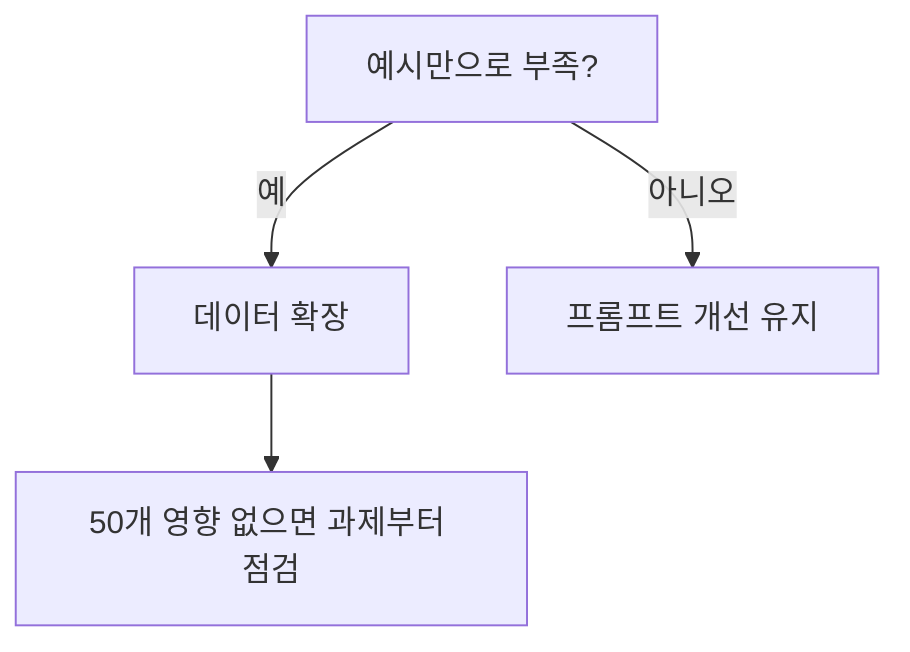

# 예시를 학습 데이터로

> 프롬프트에 넣던 few-shot 예시를 모아 입력-출력 쌍의 학습 데이터셋으로 확장해 모델을 미세조정하는 단계. 예시 몇 개로 충분하지 않거나 호출량이 많아 프롬프트가 부담될 때 고려한다.

## 쉽게 말하면
신입에게 매번 사례 5개를 보여 주며 일을 시키다가, 사례가 50~100개 쌓이면 사례집을 교육 과정으로 만들어 한 번에 익히게 하는 것이다. 그 뒤로는 사례를 들고 다닐 필요가 줄어든다.

## 자세히
- **데이터 형식(OpenAI SFT 가이드, 열람)**: JSONL, 한 줄에 완결된 JSON 하나, chat completions 메시지 형식. 파일은 최소 10줄.
- **개수**: 최소 10개, 먼저 잘 만든 시연 약 50개로 시작해 평가한다. 보통 50~100개에서 효과가 보이기도 하지만 용도에 따라 다르다. 50개로도 영향이 없으면 데이터를 더 모으기 전에 과제나 프롬프트를 다시 본다.
- **품질 우선**: 기대하는 실제 프롬프트·출력과 최대한 비슷하게, 구체적이고 명확한 질의응답으로, 과거·전문가·로그 데이터를 활용.
- **언제 미세조정하나**: 평가를 먼저 세워 기본 모델 대비 나아졌는지 확인한다. 분류, 미묘한 번역, 특정 출력 형식, 지시 불이행 교정 같은 과제에 맞다고 소개된다.
- **분할**: 수집한 데이터의 일부를 학습 전에 보류해 평가의 대조군으로 쓰고, 두 쪽의 입력·응답 다양성을 비슷하게 맞춘다(비율은 문서에 없음). 자세한 주의는 [학습·검증·평가 분할](#train-eval-split).
- **반복**: 프롬프트·데이터·작업 설정을 결과에 따라 고친다. 에폭 끝마다 체크포인트가 저장되고 마지막 3개만 남으며 과적합 시 사용한다.
- **적은 데이터의 가능성(LIMA, arXiv 2305.11206, 초록 열람)**: 정제한 약 1,000개의 프롬프트·응답으로 65B LLaMA를 지도 학습해 좋은 결과를 얻었고, 지식 대부분은 사전학습에서 온다고 해석했다. 이는 정렬(스타일) 연구이며 우리 과제에 그대로 적용된다는 뜻은 아니다.
- **접근 제한**: 해당 OpenAI 문서는 신규 사용자 접근 불가, 기존 고객의 훈련 작업 생성은 2027-01-06까지라고 안내한다(확인 시점 2026-11-16). 플랫폼 정책은 바뀌므로 사용 전 확인한다.

## 그림으로 보기

## 예시
- 고객 문의 분류 프롬프트의 예시 6개 → 로그에서 실제 문의 60건을 뽑아 정답 라벨을 붙이고 JSONL로 변환, 10건은 보류해 평가.
- 교육 실습: 자기 업무의 질문-정답 10쌍을 JSONL 한 줄씩 작성해 형식 오류가 없는지 확인.

## 헷갈리는 것과 비교
| 개념 | 차이 |
|---|---|
| few-shot | 프롬프트에 예시를 매번 넣음 |
| 미세조정 | 예시를 가중치에 반영 |
| [프롬프트 토큰 비용](#prompt-token-cost) | 예시가 길 때의 호출 비용 |
| [LoRA 어댑터](#lora-adapters) | 미세조정을 싸게 하는 방법 |

## 더 읽을거리
- [OpenAI: Supervised fine-tuning](https://developers.openai.com/api/docs/guides/supervised-fine-tuning) — 형식·개수·반복(열람)
- [LIMA (arXiv 2305.11206)](https://arxiv.org/abs/2305.11206) — 적은 정제 데이터(초록 열람)
