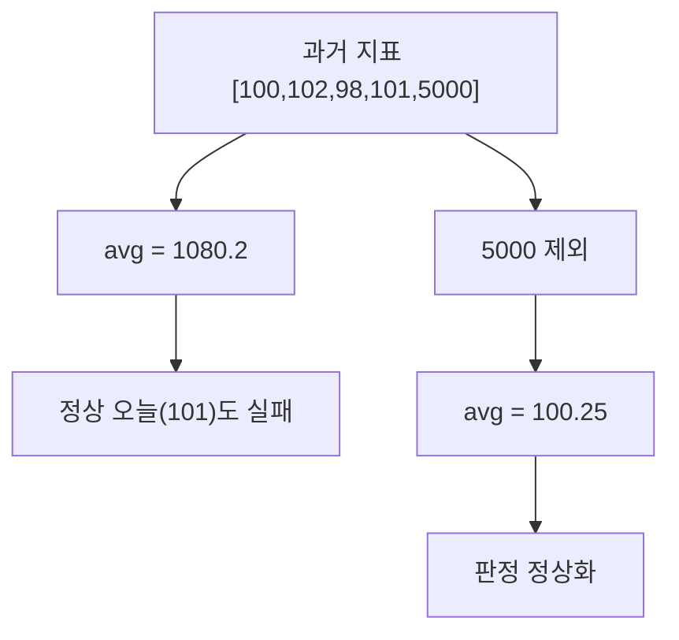

# 기준선에서 이상 통계 제외

> 과거 지표의 평균 같은 **기준선(baseline)**으로 오늘 값을 판정할 때, **일회성 대량 적재·장애 같은 이상 값이 기준선에 섞이면 이후 판정이 왜곡**된다. AWS Glue는 이런 통계를 **동적 규칙 계산에서 제외**하는 기능을 제공한다.

## 쉽게 말하면
최근 5일 평균 체중을 기준으로 삼는데, 하루는 체중계가 고장 나 5000kg이 찍혔다면 평균이 엉망이 된다. 그날 기록을 "계산에서 빼 주세요"라고 표시해야 이후 평균이 정상으로 돌아온다.

## 자세히
(제외 기능의 설명은 AWS 공식 문서 「DQDL reference」의 Dynamic rules 절을 WebFetch로 직접 확인. 아래 숫자 예는 이 노드가 **손으로 계산한 산술 예시**이며 Glue 실행 결과가 아니다.)
- **문서의 설명**: 역사적 데이터 일괄 적재를 했는데 그것이 평균에 영향을 주기를 원하지 않는 경우처럼, **동적 규칙 계산에서 일부 통계를 제외**할 수 있다. 방법은 Glue ETL에서 작업을 열고 **Data Quality 탭 → Statistics**에서 추세 차트와 통계 표를 보며 제외할 값을 선택해 **Exclude Statistics**를 누르는 것이다. 제외된 통계는 이후 동적 규칙 계산에 포함되지 않는다.
- **왜 필요한가(산술 예)**: 일일 행 수가 100, 102, 98, 101, 99였고 `RowCount > avg(last(5))`를 쓴다고 하자.
  | 기준선 | avg(last(5)) | 오늘 101 통과? | 오늘 1,000 통과? |
  |---|---|---|---|
  | 정상 5일 | **100.0** | 통과 | 통과 |
  | 5일 중 하루가 일괄 적재 5,000 | **1,080.2** | **실패** | **실패** |
  → 하루의 이상 값 때문에 기준선이 10배로 부풀어, **정상적인 오늘(101)이 실패**하고 **평소의 10배(1,000)도 실패**한다. 이 이상 값이 `last(5)` 창을 벗어나기까지(5회 실행) 판정이 왜곡된다.
- **제외로 해결되는 것(해석)**: 이상 값을 제외하면 평균이 약 100(100.25)으로 복원돼 판정이 정상화된다. 반대로 **제외를 남발**하면 진짜 급증·급감을 감추는 기준선이 되므로 사유를 기록해야 한다(제안).
- **운영 원칙(제안)**: ① 일회성 이벤트(마이그레이션·백필·장애)를 **즉시 표시**하는 절차를 둔다 ② 제외한 통계의 **사유·담당자·날짜**를 남긴다 ③ 제외 대신 `median(last(k))`처럼 **이상 값에 덜 민감한 집계**를 쓰는 방법도 고려한다(문서가 `median`을 지원한다고 확인, 이 효과는 위 표처럼 계산해 보지 않음). → [동적 규칙 last()](#dynamic-rules-last)
- **한계**: Glue 콘솔 조작은 문서 설명만 확인했고, 제외 기능이 다른 도구(Deequ 등)에도 있는지는 확인하지 않았다.

## 그림으로 보기

## 예시
- 데이터 이전으로 행 수가 하루 20배가 됐을 때 그 실행의 통계를 제외 표시해 이후 `avg(last(5))`가 오염되지 않게 함.
- 교육 활동: 5일치 값에 이상 값 하나를 넣고 평균·중앙값이 어떻게 변하는지 표로 비교.

## 헷갈리는 것과 비교
| 개념 | 차이 |
|---|---|
| 통계 제외 | 이상 값을 기준선 계산에서 뺌 |
| 중앙값 집계 | 이상 값의 영향을 줄이지만 빼지는 않음 |
| [동적 규칙 last()](#dynamic-rules-last) | 과거 값과 비교하는 규칙 |
| [DQDL 통계 제외](#dqdl-exclude-statistics) | 같은 기능의 DQDL 관점 노드 |

## 더 읽을거리
- [DQDL reference (AWS Glue 문서)](https://docs.aws.amazon.com/glue/latest/dg/dqdl.html) — Dynamic rules와 Excluding statistics(직접 확인). 표의 수치는 이 노드의 산술 예시다.
