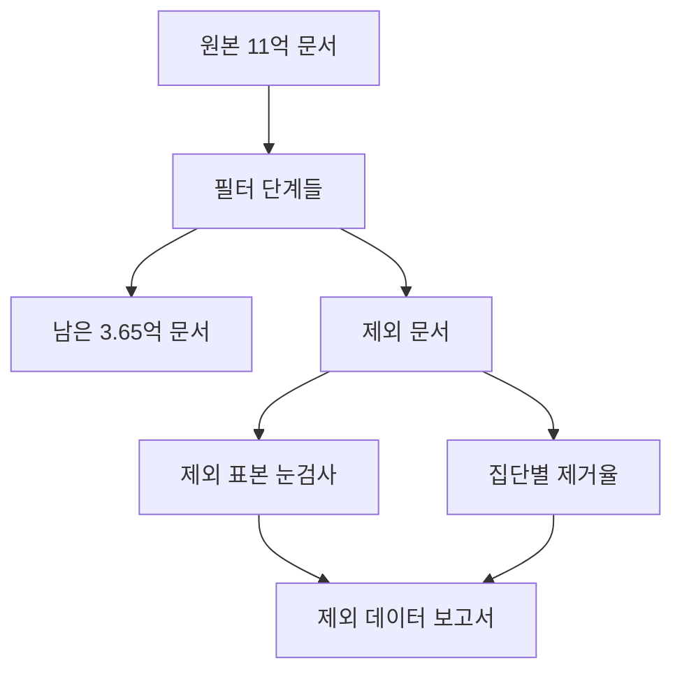
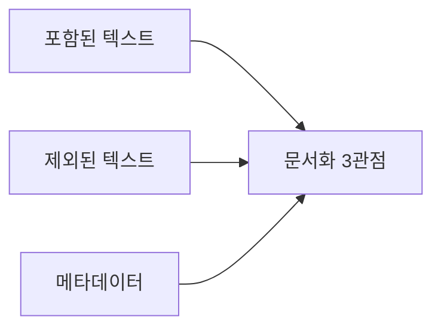

# 제외 데이터 보고

> 코퍼스 문서화에서 **"남긴 것"만이 아니라 "필터로 걷어낸 것"도 기록**하는 일. 필터별로 얼마나, 어떤 글이 빠졌는지 보여 줘야 필터가 만든 편향을 알아챌 수 있다.

## 쉽게 말하면
이삿짐을 정리하며 "가져간 것 목록"만 적고 "버린 것 목록"은 안 적으면, 나중에 소중한 물건이 사라졌는지 알 길이 없다. 버린 물건 목록과 사진 몇 장이 있어야 실수를 알아챈다.

## 자세히
(Dodge 외, "Documenting Large Webtext Corpora", EMNLP 2021, arXiv 2104.08758을 ar5iv로 직접 읽음)
- **권고**: 데이터를 **메타데이터·포함된 텍스트·제외된 텍스트** 세 관점으로 문서화하라고 한다. 도메인 출처 보고, 벤치마크 오염 점검, 사회적 편향 측정, 이슈를 신고할 창구, 한계(개인정보·저작권 텍스트 가능성) 명시도 함께 권한다. 또 필터가 무엇을 지우는지 특성화하고, 웹 크롤 데이터에 **금지어 목록 필터링은 쓰지 말라**고 권고한다.
- **C4 규모 표(Table 1)**: C4.en.noClean 11억 문서·1.4조 토큰·2.3TB → C4.en.noBlocklist 3.95억 문서·1,980억 토큰·380GB → C4.en 3.65억 문서·1,560억 토큰·305GB. 표에서 계산하면 금지어 필터 단계에서만 약 3,000만 문서·420억 토큰(noBlocklist 토큰의 약 21%)이 빠졌다. 논문은 나머지 필터의 개별 효과를 분리해 보고하지 않아, noClean→noBlocklist의 감소를 필터별로 나눌 수는 없다.
- **제외된 문서의 표본 분석**: 금지어로 제외된 문서 10만 개 표본에서 약 31%가 성적 내용이었고, 나머지는 과학·의학·건강·법·정치 등이었다. 성적 지향 단어가 가장 잘 걸렸다. 방언 분석에서 AAE 약 42%, 히스패닉 정렬 영어 약 32%, 백인 정렬 영어 6.2%, 기타 7.2%가 제거됐다([방언별 필터링 편향](#dialect-filtering-bias)).
- **좋은 제외 데이터 보고서에 넣을 것(제안)**: ① 필터 이름과 규칙(코드·임계값) ② 필터별 제거 문서·토큰 수와 비율 ③ 제거 문서 무작위 표본(수십~수백 개)과 눈검사 결과 ④ 도메인·언어·방언 같은 집단별 제거율 비교 ⑤ 오탐(정상 글이 빠진) 사례.
- **한계**: 제외 표본을 공개하면 유해·개인정보 내용이 포함될 수 있어 공개 범위를 조정해야 한다(제안).

## 그림으로 보기

## 예시
| 단계 | 문서 수(Dodge 외 Table 1) |
|---|---|
| C4.en.noClean | 11억 |
| C4.en.noBlocklist | 3.95억 |
| C4.en | 3.65억 |
- 업무 장면: 사내 문서 정제 파이프라인에서 필터가 3개라면 단계별 제거 건수 표와 제거 문서 100건 샘플을 보고서 부록에 첨부한다.

## 헷갈리는 것과 비교
| 개념 | 차이 |
|---|---|
| 제외 데이터 보고 | 걷어낸 데이터의 기록 |
| [데이터 카드 읽기](#data-card-reading) | 기록된 문서를 읽는 사용자 쪽 |
| [방언별 필터링 편향](#dialect-filtering-bias) | 제외 분석에서 드러난 편향 사례 |
| [웹 출처 분포 분석](#web-source-distribution) | 포함된 데이터의 출처 분포 |

## 더 읽을거리
- [Documenting Large Webtext Corpora (arXiv 2104.08758)](https://arxiv.org/abs/2104.08758) — 포함·제외·메타데이터 세 관점 문서화(ar5iv 본문 직접 읽음).
