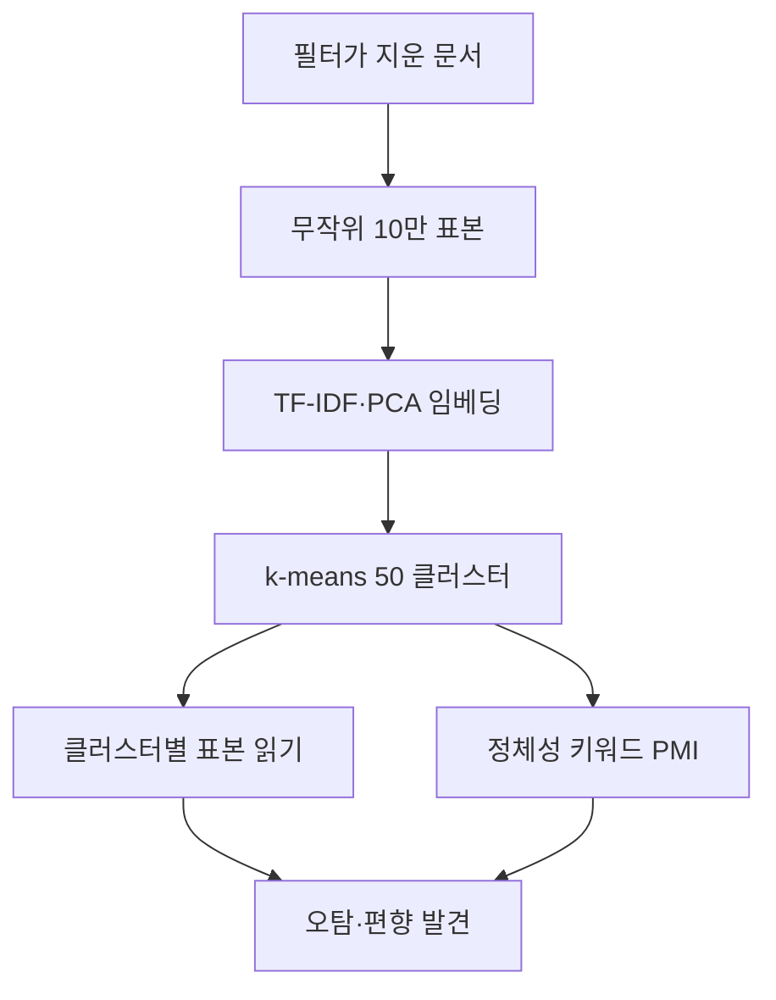
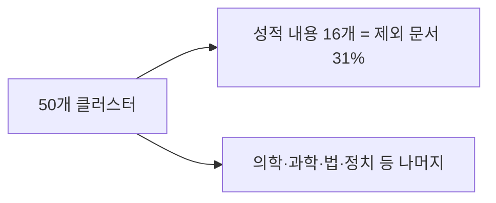

# 제외 문서 감사

> 필터가 지운 문서의 **무작위 표본을 모아 주제를 묶어 보고(클러스터링), 사람이 직접 읽어** 무엇이 억울하게 빠졌는지 확인하는 감사. 필터의 숨은 편향을 찾는 가장 직접적인 방법이다.

## 쉽게 말하면
쓰레기통을 뒤져 보는 일이다. "쓰레기"라고 버린 것 중에 쓸 만한 물건이 얼마나 섞여 있는지 보면, 분리수거 규칙이 잘 됐는지 알 수 있다.

## 자세히
(Dodge 외, arXiv 2104.08758 §5, ar5iv 본문 직접 읽음)
- **표본과 클러스터링**: 금지어로 제외된 문서에서 **10만 개를 무작위로 뽑아**, TF-IDF의 PCA 투영으로 임베딩하고 k-means로 **50개 클러스터**로 묶었다.
- **주제 결과**: **50개 중 16개 클러스터만 성적 내용 위주**였고 그 클러스터들이 제외 문서의 **31%**를 차지했다. 나머지 제외 클러스터는 과학·의학·건강, 법·정치 문서 등이었다. 부록은 포르노·혐오 표현 클러스터도 있지만 의학·종교·게임·영유아 돌봄 같은 주제도 있다고 덧붙인다.
- **정체성 단어 분석**: 성별 정체성·성적 지향·인종·종교를 아우르는 **정규식 22개**로 문서의 정체성 언급을 잡고, 각 언급과 "필터로 제외됨" 사이의 점별 상호정보량(PMI)을 계산했다. **성적 지향 단어(lesbian, gay, heterosexual, homosexual, bisexual)가 가장 잘 제외**됐고 인종·민족 정체성 단어보다 높았다.
- **수작업 검토**: 문서 50개씩 직접 읽은 결과 "lesbian"이 들어간 문서의 **22%**, "gay"가 들어간 문서의 **36%**가 비공격·비성적 내용이었고, 동성 결혼·연애를 다룬 문서도 있었다.
- **결론**: 저자들은 웹 크롤 데이터에 금지어 필터링을 쓰지 말라고 권하고, 단어 목록만으로는 해로운 글을 못 잡는 경우가 있으며 "금지어 필터링은 중요한 주제들을 제외한다"고 지적한다([방언별 필터링 편향](#dialect-filtering-bias)).
- **직접 해 볼 절차(제안)**: ① 필터가 지운 문서에서 무작위 N개(수천~수만) 추출 ② 임베딩·클러스터링으로 주제 지도를 만들고 클러스터별 표본 5~10개를 읽기 ③ 정체성·집단 키워드와 제외 여부의 연관(PMI 등) 계산 ④ 오탐 비율을 표로 기록 ⑤ 규칙·임계값 수정 후 재감사([제외 데이터 보고](#excluded-data-report)).
- **주의(제안)**: 제외 표본에는 유해·개인정보 내용이 있어 읽는 사람의 안전과 공개 범위를 고려한다([제외 표본 공유 시 주의](#safe-sharing-of-excluded-samples)).

## 그림으로 보기

## 예시
| 발견(Dodge 외) | 수치 |
|---|---|
| 성적 내용 클러스터 | 16/50개, 제외 문서의 31% |
| "lesbian" 문서 중 비공격·비성적 | 22%(50개 검토) |
| "gay" 문서 중 비공격·비성적 | 36%(50개 검토) |
- 업무 장면: 사내 비속어 필터가 상담 로그의 어떤 주제를 지웠는지 3천 건을 클러스터로 묶어 읽어 보고, 부서별·주제별 오탐을 정리한다.

## 헷갈리는 것과 비교
| 개념 | 차이 |
|---|---|
| 제외 문서 감사 | 지운 문서를 읽어 오탐 찾기 |
| [제외 데이터 보고](#excluded-data-report) | 감사 결과를 문서화 |
| [방언별 필터링 편향](#dialect-filtering-bias) | 방언 관점에서 본 같은 필터의 편향 |
| [필터 전후 집단 비율 감사](#pre-post-filter-audit) | 수치로 집단별 변화를 보는 감사 |

## 더 읽을거리
- [Documenting Large Webtext Corpora (arXiv 2104.08758)](https://arxiv.org/abs/2104.08758) — 제외 문서 분석 방법과 결과(ar5iv 직접 읽음).
