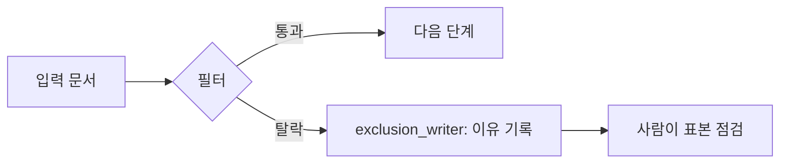
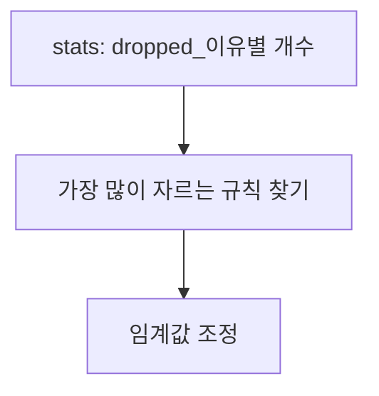

# 제외 문서 저장

> datatrove 필터에 `exclusion_writer`를 달면 **필터가 버린 문서를 별도 파일로 남긴다.** 무엇이 왜 지워졌는지 눈으로 점검할 수 있어, 필터 기준이 너무 세거나 느슨한지 확인하는 안전장치다.

## 쉽게 말하면
쓰레기통을 비우기 전에 쓰레기통 안을 한 번 들여다보는 것이다. 필요한 서류를 잘못 버리지 않았는지 확인하려면 버린 것도 따로 모아 두어야 한다.

## 자세히
(datatrove 0.10.1 `base_filter.py` 소스를 읽고 직접 실행)
- 사용법: 필터 생성 시 `exclusion_writer=JsonlWriter(경로)`를 넘긴다. 필터를 통과한 문서는 다음 단계로 가고, 탈락한 문서는 이 writer에 기록된다.
- 소스 동작: 필터 결과가 `(False, reason)` 꼴이면 탈락 문서의 `metadata["filter_reason"]`에 이유를 넣어 쓰고, 통계에 `dropped_<이유>` 카운터를 올린다. 이유가 없으면 이유 필드 없이 저장된다.
- 직접 실행: 문서 100개를 "길이 > 30자" 필터에 넣었더니 70개가 통과, 30개가 `removed/short/00000.jsonl.gz`에 저장됐다(각 줄에 text, id, metadata 포함). 이 실험의 단순 `LambdaFilter`는 이유를 안 주므로 `filter_reason`은 없었다. 품질 필터들은 이유를 반환하도록 구현돼 있다(FineWeb 예제가 필터마다 제외 기록을 쓴다).
- 점검 습관(제안): ① 제외 파일에서 무작위 50개를 읽어 오삭제 비율 확인 ② 이유별 카운트(`stats.json`의 `dropped_*`)로 어떤 규칙이 가장 많이 자르는지 확인 ③ 임계값을 바꾼 뒤 제외 파일을 비교.
- 비용: 제외 문서도 디스크에 쓰므로 대규모 실행에서는 저장 공간이 늘어난다. 필요한 필터에만 단다.

## 그림으로 보기



## 예시
```python
LambdaFilter(lambda d: len(d.text) > 30,
             exclusion_writer=JsonlWriter("removed/short"))
```
- 언어 필터가 한국어 문서를 영어 아님으로 잘못 지우는지 제외 파일에서 확인.
- 교육: "버린 데이터도 데이터다" — 정제 품질을 검증하는 방법.

## 헷갈리는 것과 비교
| 개념 | 차이 |
|---|---|
| exclusion_writer | 버린 문서 저장 |
| 일반 writer | 남긴 문서 저장 |
| 통계(stats) | 개수만, 내용은 없음 |
| [재시작 가능 파이프라인](#resumable-data-pipelines) | 작업 완료 기록, 별개 기능 |

## 더 읽을거리
- [huggingface/datatrove](https://github.com/huggingface/datatrove) — 필터·writer 소스와 FineWeb 예제.
