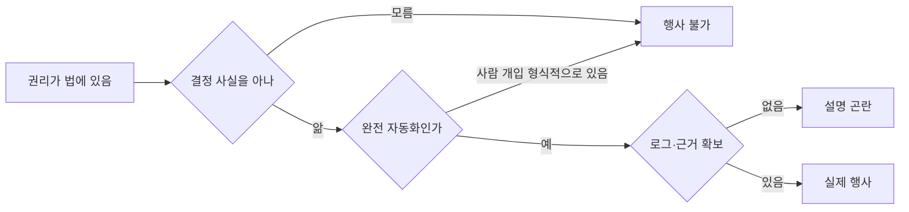

# 권리 행사 장벽

> 자동화 결정에 대한 설명·거부·재처리 권리가 법에 있어도 실제로 쓰기 어렵게 만드는 요인: 정보 비대칭, "완전 자동화" 문턱, 입증 부담, 로그·시간표 문제. (법률 자문 아님)

## 쉽게 말하면
도서관에 책이 있어도 목록을 못 보면 빌릴 수 없다. 내가 AI에게 평가받았다는 사실조차 모르면 "왜요?"라고 물을 수 없다.

## 자세히
출처: 법률신문 해설(본문 확인), Pebblous 블로그 글(본문 확인, 2차 자료라 수치는 "주장"으로 읽는다), 2026 개정 해설 기사(본문 확인, 시행일 없음).
- **정보 비대칭**: 자동화 결정이 있었는지 모르면 행사할 수 없다. 블로그는 복지 대상자가 결과 통보 뒤에야 판단이 있었음을 안다고 지적한다. 같은 글은 최근 2년간 351명이 공공기관 AI 채용검사에서 탈락했다고 제시한다(주장 수준).
- **"완전 자동화" 문턱**: 제37조의2 등은 완전 자동화 결정에만 권리를 준다. 기업이 마지막 단계에 사람을 넣으면 요건을 벗어날 수 있다는 지적이 있다([완전 자동화 결정](#fully-automated)).
- **입증·절차 부담**: 호주 로보뎁트처럼 당사자가 "빚이 없음"을 스스로 증명하게 한 사례가 반면교사로 소개된다(블로그 인용, 확인 안 됨).
- **로그 문제**: 결정 시점의 피처·가중치·임계값을 사후에 복원하기 어렵고, 로그가 없으면 정확한 설명이 불가능하다는 서술.
- **시간표**: EU 고위험 AI 의무가 2026-08 → 2027-12로 연기되었고 한국 AI 기본법은 2026-01 시행 후 계도기간이 있다는 서술(블로그).
- **집행**: 2026-02-12 국회를 통과한 개정안 해설은 "집행이 뒷받침되지 않으면 선언에 그칠 수 있다"고 한다. 해당 글에는 시행일이 없다.
- **한계**: 실제 행사 건수·수용률 통계는 어디서도 확인하지 못했다([설명요구 이용 현황](#explanation-request-trend)).

## 그림으로 보기

## 예시
- 지원자는 AI 서류 심사 사실을 공고에 알리지 않으면 알 길이 없다 → 처리자의 사전 공개 의무가 중요하다.
- 교육 활용: 직무 교육에서 "내 업무 AI는 결정 근거를 로그로 남기는가"를 점검 항목으로 쓴다.

## 헷갈리는 것과 비교
| 개념 | 차이 |
|---|---|
| 권리 행사 장벽 | 권리는 있으나 쓰기 어려운 이유 |
| [권리 인지율](#right-awareness) | 장벽 중 "아는가"만 측정 |
| [중대한 영향](#significant-impact) | 법적 문턱의 하나 |
| [설명요구 이용 현황](#explanation-request-trend) | 실제 이용량 조사 |

## 더 읽을거리
- [Pebblous: AI 의사결정 설명권](https://blog.pebblous.ai/blog/ai-decision-explanation-right/ko/) — 장벽 사례 모음(2차 자료)
- [법률신문 해설](https://www.lawtimes.co.kr/news/articleView.html?idxno=194236) — 완전 자동화 요건과 안내서 대기
- [2026 개정 해설](https://www.youthassembly.kr/news/972926) — 통과 사실과 실효성 우려
