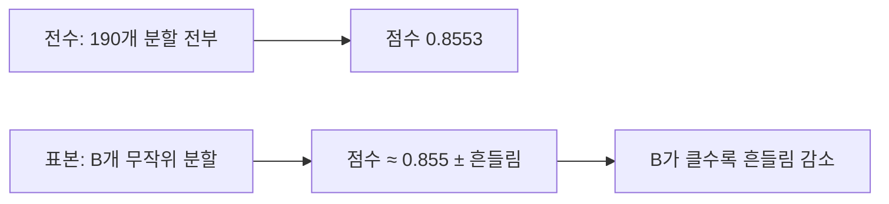
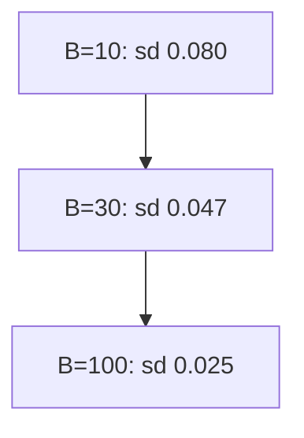

# 전수 vs 표본 교차검증

> 전수 교차검증은 가능한 모든 시험 조합을 다 돌리고, 표본 교차검증은 그중 무작위 일부만 뽑아 평균한다. 표본 방식은 불편추정에 가깝고 분할 수를 늘릴수록 전수 결과에 가까워지므로 대부분의 경우 현실적인 선택이다.

## 쉽게 말하면
전교생 모의고사 점수를 알려고 모든 학생 조합을 다 시험 볼 수는 없다. 무작위로 몇백 번만 뽑아 평균을 내면 모든 경우의 평균과 거의 비슷해진다. 몇 번 뽑느냐가 오차의 크기를 정한다.

## 자세히
- **전수의 비용**: [교차검증의 조합 폭발](#combinatorial-cost-cv)처럼 분할 수가 C(n, p)로 늘어난다. 문서(scikit-learn 교차검증)는 소모적 분할기는 비용이 커질 수 있고 `GroupShuffleSplit` 같은 샘플링이 대안이라고 한다.
- **직접 해 본 시뮬레이션(순수 파이썬, 시드 17)**: 표본 20개, 한 번에 2개를 시험에 쓰는 Leave-2-Out(C(20,2)=190개 분할 전수), 모델은 학습 데이터의 두 클래스 평균의 중점으로 판정하는 단순 규칙이다. 190개를 모두 평균한 전수 점수는 0.8553이었다. 같은 설정에서 무작위로 B번만 뽑아 평균하는 일을 500번 반복하면 평균 추정치는 B=10에서 0.8577, B=30에서 0.8549, B=100에서 0.8567로 전수 점수에 가까웠고(편향 거의 없음), 반복 간 표준편차는 B=10에서 0.0795, B=30에서 0.0470, B=100에서 0.0247이었다. 표준편차가 대략 1/√B로 줄었다. 이 실험은 표본이 20개인 한 가지 설정이다.
- **해석**: 표본 방식의 추정치는 전수 점수 주변에서 흔들리며 흔들림의 크기는 분할 수 B에 따라 줄어든다. B를 두 배로 하면 오차가 약 29% 줄고, 4배로 하면 절반이다([시뮬레이션 표본 수](#simulation-sample-size)와 같은 논리).
- **전수가 의미 있는 경우(해석)**: 표본이 매우 작고 학습이 순식간일 때(예: Leave-One-Out). 이때도 전수 점수의 불확실성은 데이터 크기에서 오며 분할 수가 줄여 주지 못한다.
- **선택(해석)**: 평가에 필요한 정밀도(분할 오차의 표준편차)를 정한 뒤 그에 맞는 B를 고른다. 시드를 고정하고 B를 두 배로 해도 결과가 변하지 않는지 확인한다.

## 그림으로 보기

## 예시
- 표본 20개 소규모 임상 예측: 190개 분할 전수가 가능하면 전수를, 표본 200개로 커지면 `ShuffleSplit(n_splits=200)`으로 샘플링한다.
- 교육 활용: 같은 데이터에 B=10·100으로 반복해 평균의 흔들림을 직접 비교하는 실습.

## 헷갈리는 것과 비교
| 개념 | 차이 |
| --- | --- |
| [Leave-P-out](#leave-p-out) | 상위 주제 |
| [교차검증의 조합 폭발](#combinatorial-cost-cv) | 전수의 비용 문제 |
| [ShuffleSplit](#shuffle-split) | 표본 방식의 대표 분할기 |
| 분할 수 B | 표본 방식의 정밀도 조절 값 |

## 더 읽을거리
- [scikit-learn: Cross-validation](https://scikit-learn.org/stable/modules/cross_validation.html) — 소모적 분할기와 샘플링 분할기
