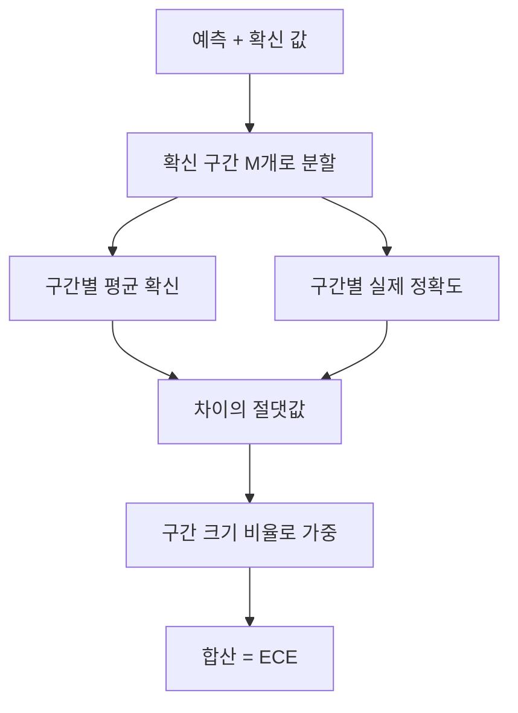

# 기대 보정 오차 (ECE)

> 모델이 말한 확신과 실제 정확도가 얼마나 어긋나는지를 **하나의 숫자**로 요약한 지표. 확신 구간(bin)별로 "평균 확신 − 실제 정확도"의 절댓값을 구하고 구간 크기로 가중 평균한다. 0에 가까울수록 보정이 잘 된 것이다.

## 쉽게 말하면
일기예보에서 "비 올 확률 70%"라고 한 날들만 모았더니 실제로 비가 온 날이 70%라면 예보는 정직하다. 50%밖에 안 왔다면 과신이다. ECE는 이런 어긋남을 모든 확률 구간에서 평균 낸 점수다.

## 자세히
출처: Guo·Pleiss·Sun·Weinberger, "On Calibration of Modern Neural Networks"(arXiv 1706.04599, PDF 텍스트 변환 후 정의·표 확인, 2026-11-18). 아래 시뮬레이션은 직접 만든 가상 데이터다.
- **정의(논문 식 3)**: `ECE = Σ_m (|B_m| / n) · |acc(B_m) − conf(B_m)|`. 예측을 확신 기준 **동일 폭 M개 구간**으로 나눠, 구간 B_m의 실제 정확도와 평균 확신의 차를 구간 크기 비율로 가중해 더한다. 논문 표는 M=15를 쓴다.
- **신뢰도 다이어그램(reliability diagram)**: 구간별 정확도 대 확신을 그린 그림. 대각선에서 벗어난 정도가 보정 오차다([보정 곡선](#calibration-curve)).
- **MCE**: 구간 중 가장 큰 보정 간극(최악 사례). 위험이 큰 응용에서 최악을 보려 할 때 쓴다고 논문은 소개한다.
- **온도 스케일링**: 초록은 로그잇을 하나의 파라미터로 나누는 방식(플랫 스케일링의 단일 파라미터 변형)이 대부분 데이터셋에서 "놀랍게도" 효과적으로 보정한다고 말한다.
- **직접 시뮬레이션**: 5,000건, 실제 정답 확률은 Beta(5,2) 분포. ①확신 = 실제 확률 → ECE ≈ 0.010 ②확신을 +0.15 부풀린 과신 모델 → ECE ≈ 0.135(평균 확신 0.853, 실제 정확도 0.718). 과신이 ECE에 거의 그대로 드러난다(구간 10개).
- **해석 주의**: ECE는 구간 수·구간 방식에 따라 값이 달라지고, 표본이 작으면 불안정하다. 한 숫자가 확신 분포의 어디가 틀렸는지는 알려 주지 않으므로 다이어그램과 함께 본다. 정확도가 높은데 보정이 나쁠 수도, 그 반대일 수도 있다.
- **LLM 맥락**: 사후 학습이 보정을 해친다는 보고([RLHF 과신](#rlhf-overconfidence))와 말로 한 확신 점수의 ECE가 낮다는 보고가 있으나 모델·과제에 따라 다르다.

## 그림으로 보기


## 예시
```python
import numpy as np
def ece(conf, correct, M=15):
    b = np.minimum((conf * M).astype(int), M - 1)
    total = 0.0
    for m in range(M):
        s = b == m
        if s.any():
            total += s.mean() * abs(correct[s].mean() - conf[s].mean())
    return total
```
교육 활용: "AI 확신 점수를 이관 규칙에 쓰기 전에 ECE와 신뢰도 다이어그램을 그려 본다"를 실습 과제로.

## 헷갈리는 것과 비교
| 개념 | 차이 |
|---|---|
| ECE | 구간별 간극의 가중 평균 |
| MCE | 구간별 간극의 최댓값 |
| 정확도 | 맞힌 비율, 확신과 무관 |
| Brier 점수 | 확률 예측의 제곱오차, 보정과 구분력을 함께 반영 |

## 더 읽을거리
- [On Calibration of Modern Neural Networks (arXiv 1706.04599)](https://arxiv.org/abs/1706.04599) — ECE·MCE 정의, 온도 스케일링
- [GPT-4 Technical Report](https://arxiv.org/abs/2303.08774) — 사전·사후 학습 보정 비교(Figure 8)
