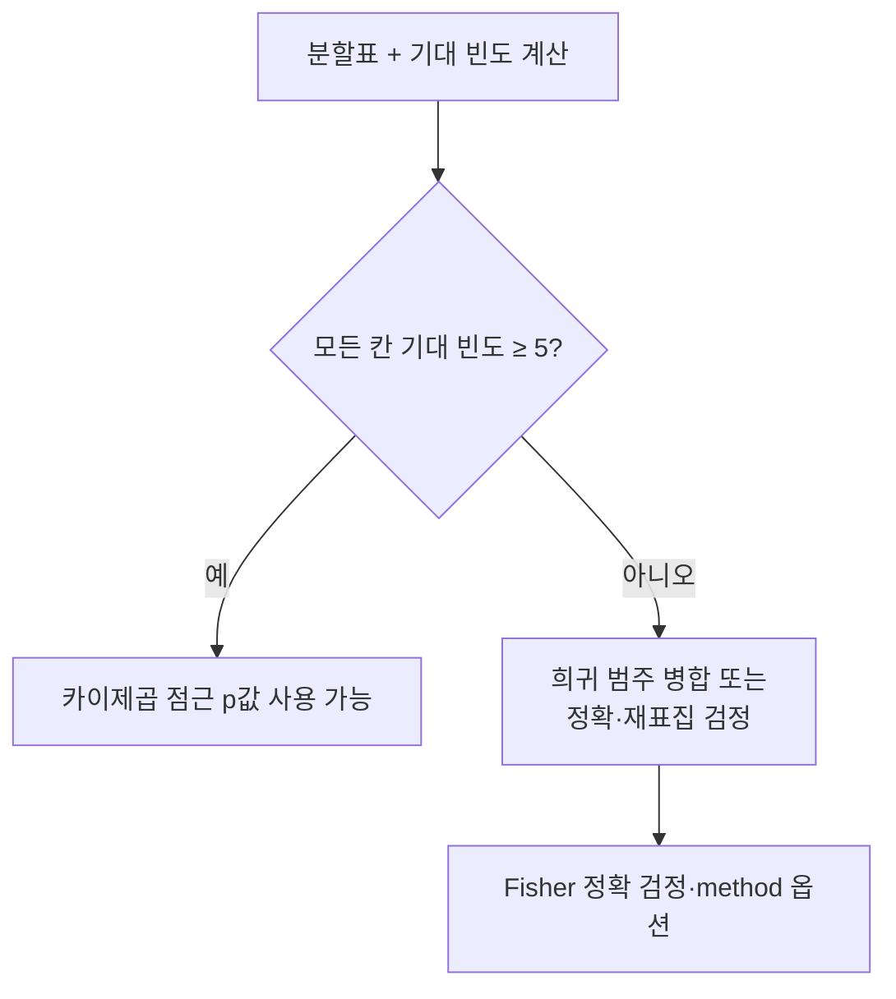

# 기대 빈도 5 이상 규칙

> 카이제곱 검정의 점근 p값이 믿을 만하려면 분할표의 **모든 칸의 기대 빈도가 대체로 5 이상**이어야 한다는 일반 지침. 표본이 작아 이 조건을 못 지키면 정확 검정이나 재표집 방법을 쓴다.

## 쉽게 말하면
동전을 세 번만 던져 놓고 "앞면 확률이 정확히 반"이라고 단정하기 어렵듯이, 칸마다 관측이 너무 적으면 카이제곱의 근사 공식이 어긋난다. 그래서 칸마다 최소한 이 정도는 있어야 한다는 안전선이 있다.

## 자세히
출처: SciPy 공식 문서 `scipy.stats.chi2_contingency`(열어서 읽음) + 이 세션의 직접 실험(scipy 1.17.1).
- **지침(SciPy)**: 일반적 지침은 **모든 칸의 기대 빈도가 최소 5**여야 한다는 것이다. 표 전체 표본이 작으면 기본 **점근 p값이 부정확**할 수 있고 재표집(순열·몬테카를로) 방법이 권장된다.
- **옵션(SciPy)**: `method`로 순열·몬테카를로 p값을 계산할 수 있다(`correction=False`, 기본 `lambda_`, 2차원 표에서만). Yates 연속성 보정(`correction=True`)은 자유도가 1일 때만 적용된다.
- **직접 실험(합성 2×2 표 [[8,2],[3,7]], 이 세션)**: 기대 빈도는 [[5.5, 4.5], [5.5, 4.5]]로 **4.5인 칸이 있어 지침을 어긴다**.
  - 보정 없는 카이제곱 p = **0.0246**(유의하다고 나옴)
  - Yates 보정 p = 0.0722
  - Fisher 정확 검정 p = 0.0698
  - 점근 방법이 정확 검정보다 훨씬 작은 p를 내 **과대 유의** 판정을 낳았다. 한 표의 결과이며 일반적 크기를 뜻하지 않는다.
- **드리프트 적용**: 범주별 빈도가 작은 희귀 범주가 많은 특성은 기대 빈도가 5 미만인 칸이 생기기 쉽다. 이럴 때는 희귀 범주를 "기타"로 묶거나 정확·재표집 검정, 효과 크기 지표를 쓴다([카이제곱 드리프트 검정](#chi-square-drift), [Cramér의 V](#cramers-v)).
- **한계**: 5라는 기준은 관행적 지침이며 엄격한 경계가 아니다. 정확한 기준은 교재에 따라 다를 수 있다(이번 문서는 "common guideline"이라고만 표현).

## 그림으로 보기


## 예시
```python
from scipy.stats import chi2_contingency
r = chi2_contingency(table, correction=False)
if (r.expected_freq < 5).any():
    print("기대 빈도 5 미만 칸 있음: 정확 검정 또는 범주 병합 고려")
```
- 점검: 새 범주나 희귀 범주 때문에 기대 빈도가 낮은 칸이 있는가.

## 헷갈리는 것과 비교
| 개념 | 차이 |
|---|---|
| 기대 빈도 | 독립을 가정할 때 각 칸에서 기대되는 빈도 |
| 관측 빈도 | 실제 센 빈도 |
| Fisher 정확 검정 | 작은 표본용 정확 p값 |
| [카이제곱 드리프트 검정](#chi-square-drift) | 이 규칙이 적용되는 검정 |

## 더 읽을거리
- [scipy.stats.chi2_contingency (SciPy 문서)](https://docs.scipy.org/doc/scipy/reference/generated/scipy.stats.chi2_contingency.html) — 기대 빈도 지침과 method 옵션(열어서 확인)
