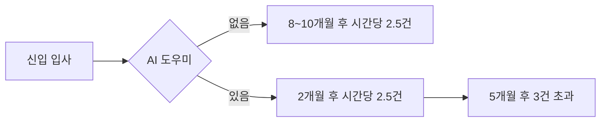

# 경험 곡선 단축

> AI 도우미가 초보자가 숙련도에 도달하는 시간을 줄이는 효과. 고객지원 현장 연구에서 AI를 쓴 입사 2개월 상담사가 AI 없이 6개월 넘게 일한 상담사만큼 성과를 냈다.

## 쉽게 말하면
도제식으로 몇 달 걸려 배우던 요령을, 옆에서 선배가 실시간으로 귀띔해 주는 것과 같다. 그래서 신입이 숙련자 수준에 더 빨리 닿는다.

## 자세히
출처: Brynjolfsson, Li, Raymond "Generative AI at Work"(NBER 31161, 2023; QJE 2025). NBER PDF 본문을 직접 읽었다.
- **연구 대상**: 5,172명 고객지원 상담사(arXiv 초록). 한 소프트웨어 회사의 채팅 지원 환경에서 AI 대화 어시스턴트를 단계적으로 도입.
- **경험 곡선 결과**: AI를 항상 쓴 상담사는 시간당 해결 건수가 약 2.0에서 입사 2개월 만에 2.5에 도달했고, 5개월차에 3건을 넘겼다. AI 없는 상담사는 2.5에 이르는 데 8~10개월이 걸렸다. 논문 요약: "AI를 쓴 입사 2개월 상담사가 AI 없는 6개월 넘는 상담사만큼 성과."
- **메커니즘(저자 해석)**: AI가 더 숙련된 직원의 모범 사례를 퍼뜨려 신입이 경험 곡선을 더 빨리 내려가게 한다. 암묵지(tacit knowledge: 말로 설명하기 어려운 요령)가 AI 학습 과정에서 포착된다고 논의한다.
- **한계**: 안정적 제품과 기술 지원 질문이라는 환경에서의 결과로, 제품·환경이 빠르게 바뀌면 AI가 낡은 관행을 퍼뜨려 학습을 방해할 수도 있다고 저자들이 언급한다. 다른 업종·직무에 그대로 일반화하긴 어렵다.
- 관련 현상: 상위 성과자는 거의 이득이 없는 [숙련도 격차 축소](#skill-gap-compression).

## 그림으로 보기

## 예시
- 신입 교육 설계: AI 추천 답변을 보며 상담하는 대신, 추천 이유(참조 사례)를 같이 보게 하면 학습 효과가 커지는지 시험(제안).
- 인력 계획: 신입 생산성 도달 시간이 짧아져 채용·교육 비용 계산이 바뀐다.

## 헷갈리는 것과 비교
| 개념 | 차이 |
|---|---|
| 경험 곡선 | 경험이 쌓일수록 성과 향상 |
| 경험 곡선 단축 | AI로 그 속도가 빨라짐 |
| [암묵지 확산](#tacit-knowledge-diffusion) | 단축의 원인으로 제시된 메커니즘 |

## 더 읽을거리
- [Generative AI at Work (arXiv 2304.11771)](https://arxiv.org/abs/2304.11771) — 초록
- [NBER Working Paper 31161](https://www.nber.org/system/files/working_papers/w31161/w31161.pdf) — 본문(2개월 vs 6개월 결과)
